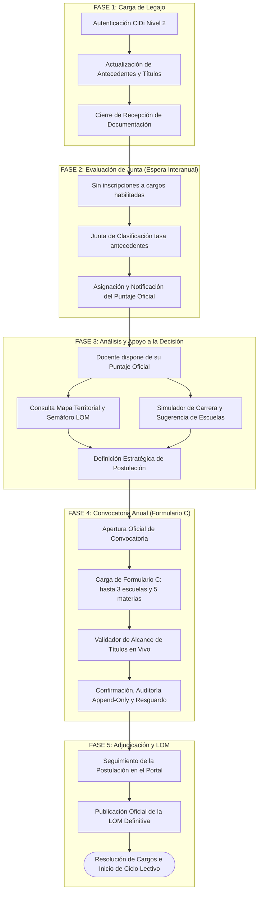
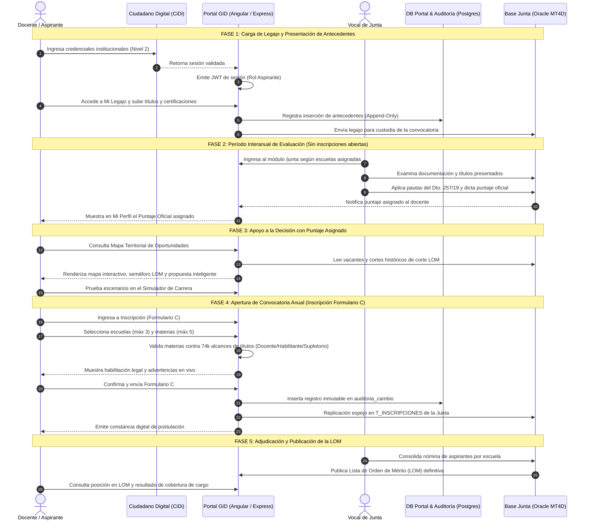
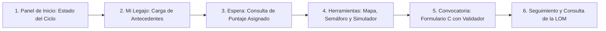
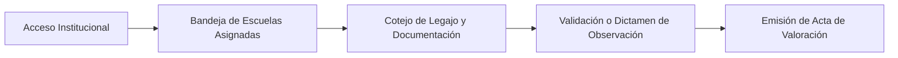
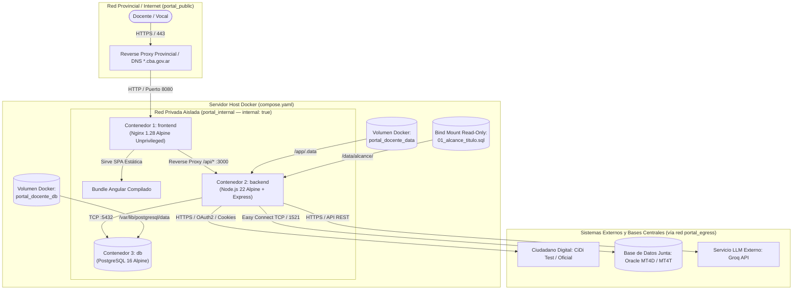
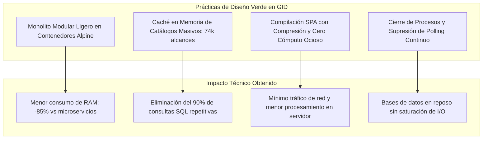
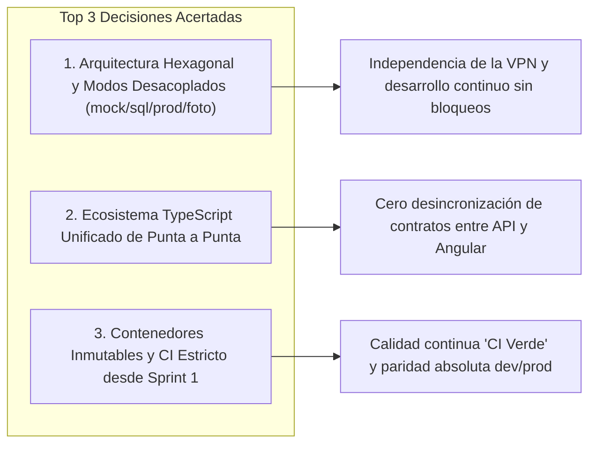

# UNIVERSIDAD TECNOLÓGICA NACIONAL
## FACULTAD REGIONAL CÓRDOBA
### Departamento de Ingeniería en Sistemas de Información
**Cátedra:** Proyecto Final — Curso 5K3 — Ciclo Lectivo 2026  
**Proyecto:** Gestión Integral Docente (GID) — Portal Provincial de Gestión Docente Secundaria  
**Organización Destinataria:** Ministerio de Educación de la Provincia de Córdoba — Dirección General de Carrera Docente / Junta de Clasificación Secundaria  

---

### Equipo Docente
- **Profesor Titular:** Ing. Quinteros, Sergio
- **Jefe de Trabajos Prácticos (JTP):** Ing. Martinez, Gabriel

### Integrantes — Grupo Nº 24
| Legajo | Apellido y Nombre | Correo Electrónico |
| :---: | :--- | :--- |
| **95754** | Demaria, Alexis | aleddemaria@gmail.com |
| **91227** | Formoso, Matías Agustín | formosomatiasagustin@gmail.com |
| **94373** | Serafini, Augusto | augusto27serafini@gmail.com |
| **94196** | Steffolani, Nicolás | nicosteffolani@gmail.com |
| **96061** | Valverde, Fabrizio | fabrizioval.seg@gmail.com |

---

# INSTANCIA 5 — FIN DE PROYECTO

```
ÍNDICE GENERAL
1. DOCUMENTACIÓN DEL PROCESO QUE CONTIENE AL SISTEMA
   1.1. Propósito y Audiencia
   1.2. Descripción del Proceso de Negocio Actualizado Post-Implementación
        1.2.1. El Ciclo Administrativo Docente Anual
        1.2.2. Detalle de las Etapas del Circuito Integral
   1.3. Diagrama de Flujo del Proceso Integrado (Swimlanes y Fases Temporales)
   1.4. Roles y Responsabilidades en el Nuevo Contexto (Matriz RACI)
2. INSTRUCTIVOS DE USO
   2.1. Instructivo para el Aspirante Docente
   2.2. Instructivo para el Vocal de Junta de Clasificación
   2.3. Preguntas Frecuentes (FAQ) y Resolución de Problemas Comunes
3. MANUAL DE INSTALACIÓN Y OPERACIÓN
   3.1. Propósito y Audiencia
   3.2. Arquitectura de Despliegue y Qué Hace Cada Contenedor Docker
   3.3. Requisitos de Hardware, Software y Red
   3.4. Instalación Paso a Paso en un Servidor y Explicación de Comandos Docker
   3.5. Verificación de Conectividad con la Base de Datos y Sistemas Externos
   3.6. Configuración de Variables de Entorno y Secretos
   3.7. Operación, Monitoreo y Comandos Docker de Mantenimiento
   3.8. Gestión de Backups y Restauración
   3.9. Resolución de Incidentes Comunes de Infraestructura
4. ANÁLISIS DE IMPACTO AMBIENTAL
   4.1. Propósito y Alcance
   4.2. Estimación del Consumo Energético y Huella de Carbono (67.700 Inscripciones)
   4.3. Alternativas de Diseño Evaluadas y Prácticas de Ingeniería Verde
   4.4. Beneficios Ambientales Directos: Continuidad de la Despapelización, Almacenamiento Físico y Reducción de Traslados
   4.5. Balance Ambiental Neto de la Solución
5. RETROSPECTIVA DE PROYECTO
   5.1. Propósito y Audiencia
   5.2. Top 3 Decisiones que Resultaron Bien y por qué
   5.3. Top 3 Cosas que Haríamos Diferente (Lecciones Aprendidas)
   5.4. Recomendaciones para Futuros Equipos de Proyecto Final
```

---

## 1. DOCUMENTACIÓN DEL PROCESO QUE CONTIENE AL SISTEMA

### 1.1. Propósito y Audiencia
- **Para qué:** Describe el proceso de negocio de gestión de carrera, valoración de antecedentes e inscripción docente tras la integración de la plataforma **Gestión Integral Docente (GID)**, documentando los flujos temporales reales y la articulación entre los actores institucionales y los componentes de software provincial.
- **Para quién:** Autoridades del Ministerio de Educación de la Provincia de Córdoba, personal directivo y vocales de la Junta de Clasificación Secundaria, docentes y aspirantes provinciales, y futuros equipos mantenedores de la infraestructura tecnológica estatal.

---

### 1.2. Descripción del Proceso de Negocio Actualizado Post-Implementación

#### 1.2.1. El Ciclo Administrativo Docente Anual
El sistema administrativo de educación secundaria de la provincia se rige por un ciclo secuencial de etapas bien delimitadas temporalmente. No se trata de un trámite instantáneo de un solo paso: existe una ventana temporal donde el docente actualiza sus credenciales y luego atraviesa un período interanual en el cual **no puede inscribirse a cargos**, ya que la Junta de Clasificación debe analizar, tasar y certificar los antecedentes para expedir el puntaje oficial de cada educador.

Con el sistema GID integrado, el proceso se estructura de forma ordenada en torno a ese ciclo:
1. **Fase de Apertura de Legajo y Carga de Antecedentes:** El docente ingresa y carga sus certificaciones, cursos y títulos nuevos.
2. **Fase de Espera y Valoración de Junta (Período sin inscripciones):** Durante este lapso administrativo, la Junta examina la documentación y le asigna el puntaje oficial reglamentario.
3. **Fase de Apoyo a la Decisión con Puntaje Asignado:** Ya con su puntaje oficial en mano, el docente explora el mapa, evalúa cortes históricos, simula escenarios y define estratégicamente a qué establecimientos y materias le conviene apuntar.
4. **Fase de Convocatoria Anual (Inscripción en Formulario C):** Habilitada la inscripción formal, el aspirante carga su Formulario C con validación de alcance de título en tiempo real.
5. **Fase de Cierre y Publicación de la LOM:** El docente hace el seguimiento de la postulación y aguarda la publicación oficial de la Lista de Orden de Mérito para conocer si accedió a la titularidad, suplencia o interinato de las horas y cargos solicitados.



---

#### 1.2.2. Detalle de las Etapas del Circuito Integral

#### Etapa 1: Autenticación e Identidad Digital Unificada (CiDi Nivel 2)
1. El docente accede al portal a través del servicio unificado de **Ciudadano Digital (CiDi)**.
2. El sistema valida estrictamente que la cuenta posea **Nivel 2 (identidad verificada de forma fehaciente)**. Si el usuario intenta acceder con Nivel 1, el portal interrumpe el acceso preventivamente e instruye los pasos oficiales para completar la validación de identidad provincial.
3. El subsistema de seguridad emite un token de sesión firmado (JWT) y asigna el perfil de acceso: `aspirante` (docentes y preceptores) o `vocal` (evaluadores reconocidos formalmente en el registro provincial de la Junta).

#### Etapa 2: Actualización del Legajo Digital y Resguardo de Antecedentes
1. El educador accede a su **Legajo Digital**.
2. El sistema recupera de manera automática los servicios y certificaciones institucionales registrados en los sistemas centrales provinciales (antigüedad docente en el Sistema de Gestión Escolar - SGE, y capacitaciones de la Red Provincial / SIPEC).
3. El docente incorpora sus nuevos títulos académicos, certificados de formación continua o antecedentes de trabajo institucional, adjuntando los comprobantes digitales de respaldo.
4. Finalizado el plazo de presentación, se procede al cierre administrativo del período de carga de antecedentes para el ciclo.

#### Etapa 3: Período Interanual de Evaluación y Asignación de Puntaje por la Junta
1. Con la recepción cerrada, se abre el período interanual de tasación. Durante esta etapa, **el docente no puede realizar inscripciones a horas ni cargos**, debiendo aguardar que la Junta de Clasificación evalúe las presentaciones.
2. Los vocales de la Junta fiscalizan la validez formal de los comprobantes aportados, cotejan los títulos contra las normativas vigentes y aplican los topes y ponderaciones establecidos por el **Decreto Provincial Nº 257/19** (títulos, acumulación, antigüedad, formación, antecedentes pedagógicos e institucionales).
3. Concluida la labor evaluadora, la Junta consolida el puntaje del aspirante y el sistema actualiza el estado de su legajo, dejando el puntaje oficial asentado y disponible en el portal.

#### Etapa 4: Análisis Estratégico mediante Herramientas de Apoyo a la Decisión
1. Una vez notificado de su puntaje asignado, el docente cuenta con el dato central para planificar su inserción laboral en el ciclo lectivo venidero:
   - **Mapa Territorial Interactivo:** Permite explorar geográficamente los establecimientos secundarios de la provincia, consultando vacantes declaradas por la Junta y el **Semáforo LOM** (que compara su puntaje real contra el promedio o corte histórico de aspirantes de cada escuela).
   - **Propuesta de Escuelas Asistida:** El portal clasifica las alternativas institucionales cercanas en *Escuela Segura* (altas probabilidades según antecedentes históricos), *Escuela Justa* (competitividad balanceada) y *Escuela Apuesta* (mayor exigencia de puntaje para proyección futura).
   - **Simulador de Carrera Docente:** El educador puede evaluar escenarios prospectivos para comprender cómo variaría su competitividad si suma nuevos títulos o capacitaciones con vistas a futuros períodos.

#### Etapa 5: Apertura de Convocatoria y Confección del Formulario C
1. Al publicarse la convocatoria anual de cobertura de suplencias e interinatos (`INSCRIPCION_ABIERTA = true`), el docente ingresa al módulo de inscripción ya sabiendo con precisión a qué escuelas y materias orientar su postulación.
2. **Supresión de la Escuela Base:** Conforme a las definiciones normativas adoptadas (ADR-013), el docente no se encuentra condicionado por una escuela base histórica, pudiendo seleccionar libremente hasta un **máximo estricto de tres (3) escuelas** y hasta **cinco (5) materias o cargos por institución**.
3. **Validador de Alcance en Tiempo Real:** Al momento de añadir cada asignatura, el sistema consulta de forma instantánea el catálogo maestro de alcances de títulos (74.765 combinaciones oficiales):
   - Dictamina la categorización legal: **Docente** (prioridad principal), **Habilitante** (prioridad secundaria) o **Supletorio**.
   - En caso de no existir habilitación legal registrada para la asignatura elegida, el sistema emite una advertencia de bloqueo normativo, evitando que el docente envíe solicitudes inadmisibles que luego devendrían en rechazos administrativos.

#### Etapa 6: Confirmación, Bitácora de Auditoría y Resguardo Espejo
1. El docente revisa el resumen consolidado de su postulación y confirma el envío del Formulario C.
2. El portal procesa la operación asegurando máxima consistencia:
   - Registra el evento en la base del portal.
   - Genera una entrada no modificable en la bitácora de auditoría `APPEND-ONLY` en PostgreSQL (`auditoria_cambio` y `auditoria_acceso`, ADR-032).
   - Sincroniza los registros de manera espejo en las tablas institucionales de la Junta de Clasificación (`T_INSCRIPCIONES`, `T_FORMULARIO_C`, ADR-029).
3. El educador recibe su constancia digital oficial de inscripción debidamente numerada y sellada en el sistema.

#### Etapa 7: Cierre, Emisión de Actas y Publicación de la LOM Definitiva
1. Concluido el período de inscripción, la Junta de Clasificación genera las actas de aspirantes correspondientes a cada escuela del padrón provincial.
2. El docente puede monitorear desde el portal el estado de su trámite.
3. El Ministerio de Educación procede a la publicación oficial de la **Lista de Orden de Mérito (LOM) definitiva**, permitiendo que el docente conozca con certeza si ha alcanzado el cargo u horas cátedra solicitadas para el nuevo ciclo lectivo.

---

### 1.3. Diagrama de Flujo del Proceso Integrado (Swimlanes y Fases Temporales)

El siguiente diagrama detalla la interacción cronológica y las responsabilidades funcionales distribuidas a lo largo de las distintas fases temporales del ciclo docente:



---

### 1.4. Roles y Responsabilidades en el Nuevo Contexto (Matriz RACI)

El nuevo marco operativo distribuye de manera precisa las responsabilidades para asegurar la gobernanza, trazabilidad e integridad de los datos provinciales.

#### Definiciones de la Matriz RACI
- **R (Responsible / Responsable):** Quien ejecuta la tarea u operación.
- **A (Accountable / Aprobador):** Quien rinde cuentas y tiene la autoridad final sobre el resultado.
- **C (Consulted / Consultado):** Quien proporciona insumos, criterios o soporte especializado.
- **I (Informed / Informado):** Quien es notificado formalmente sobre los resultados o avances.

#### Matriz RACI de Procesos de Negocio

| Tarea / Actividad del Proceso | Aspirante Docente | Vocal de Junta | Soporte Técnico / DevOps | Dirección Gral. de Carrera Docente | Sistema CiDi Provincial |
| :--- | :---: | :---: | :---: | :---: | :---: |
| **Validación de Identidad Digital (Nivel 2)** | R | I | I | I | **A** |
| **Actualización y Carga de Legajo Digital** | **R / A** | C | I | I | I |
| **Tasación de Antecedentes y Asignación de Puntaje** | I | **R** | I | **A** | I |
| **Exploración de Vacantes, Mapa y Simulación** | **R** | I | I | I | I |
| **Confección y Envío del Formulario C** | **R / A** | I | I | I | I |
| **Validación de Alcance Legal de Títulos** | I | C | R *(Mantenimiento del Catálogo)* | **A** | I |
| **Cierre de Convocatoria y Emisión de Actas** | I | **R** | I | **A** | I |
| **Publicación Oficial de la LOM Definitiva** | I | C | I | **R / A** | I |
| **Resguardo de Auditoría Inmutable y Backups** | I | I | **R / A** | I | I |
| **Gestión de Calendario y Fechas de Convocatoria** | I | C | R *(Operativo)* | **A** | I |

---

#### Descripción Específica de Responsabilidades por Rol

1. **Aspirante Docente / Preceptor:**
   - Responsable de mantener su identidad CiDi Nivel 2 activa y actualizada.
   - Custodio de la veracidad de los títulos y certificados incorporados en su legajo digital durante la fase de recepción.
   - Usuario de las herramientas de apoyo a la decisión (mapa territorial, semáforo LOM, propuesta asistida y simulador) una vez que su puntaje ha sido asignado formalmente por la Junta.
   - Ejecutor de la selección final de hasta 3 escuelas y 5 asignaturas por establecimiento mediante el Formulario C en el período de convocatoria.
   - Receptor del comprobante digital y responsable de verificar su ubicación en la LOM definitiva publicada.

2. **Vocal de la Junta de Clasificación:**
   - Evaluador oficial responsable de tasar, validar o rechazar los antecedentes presentados por los educadores durante la fase de valoración interanual.
   - Emisor del puntaje oficial del aspirante conforme a las pautas y topes del Decreto Provincial 257/19.
   - Responsable de emitir dictámenes y observaciones fundadas sobre documentación objetada en las escuelas asignadas a su cargo.
   - Firmante de las actas de valoración escolar previas a la consolidación de la LOM.

3. **Dirección General de Carrera Docente (Autoridad de Aplicación):**
   - Máxima autoridad responsable de fijar el calendario de convocatorias y decretar los períodos de inscripción (`INSCRIPCION_ABIERTA`).
   - Homologador oficial de la Lista de Orden de Mérito provincial resultante.
   - Autoridad interpretativa de la normativa del Decreto 257/19 y de las excepciones jurisdiccionales.

4. **Administrador del Sistema / Equipo DevOps:**
   - Responsable de garantizar la disponibilidad de la plataforma en entornos contenerizados (Docker / Cloud).
   - Encargado de la custodia de secretos (`JWT_SECRET`, credenciales de bases de datos) y de la política de copias de seguridad.
   - Auditor de la consistencia entre el esquema PostgreSQL del portal y la replicación en las tablas de la Junta Oracle.

5. **Servicios Externos Integrados (CiDi, SGE, Infraestructura Provincial):**
   - Proveedores autoritativos de la identidad del usuario, de la antigüedad de servicios registrada en las escuelas y de las bases relacionales centrales de educación.


---
---

## 2. INSTRUCTIVOS DE USO

### 2.1. Propósito y Alcance del Instructivo
- **Para qué:** Permite a los usuarios finales operar la plataforma **Gestión Integral Docente (GID)** de manera autónoma, detallando las secuencias de pasos para cada funcionalidad clave según el rol institucional.
- **Para quién:** Educadores, directivos y preceptores de nivel secundario (Rol Aspirante), y miembros y personal evaluador de la Junta de Clasificación Secundaria (Rol Vocal).

> [!NOTE]
> **Ingreso Único mediante Ciudadano Digital (CiDi):** El acceso a la plataforma se realiza de forma centralizada a través del servicio provincial de **Ciudadano Digital (CiDi / CiDi Test)** (`cidi.cba.gov.ar` / `ciditest.cba.gov.ar`). Al autenticarse con su CUIL y clave en CiDi, la plataforma provincial verifica la identidad Nivel 2 del usuario y lo redirige automáticamente dentro de GID con su sesión iniciada y su rol institucional asignado (`Aspirante Docente` o `Vocal de Junta`).

---

### 2.2. Instructivo de Operación para el Aspirante Docente

Una vez autenticado en la plataforma provincial, el educador accede a las herramientas de autogestión organizadas según las etapas del ciclo administrativo docente.



---

#### 2.2.1. Panel Principal de Inicio (Home) y Estado del Ciclo
Al ingresar al portal, el docente visualiza el **Panel de Inicio** (`/home`), el cual brinda una visión integral y ordenada de su situación administrativa:
1. **Indicador de Etapa Activa:** Muestra en cuál de las fases del ciclo se encuentra el aspirante (Recepción de Antecedentes, Período de Tasación de la Junta, o Convocatoria de Inscripción a Cargos).
2. **Accesos Directos:** Tarjetas interactivas para navegar rápidamente hacia *Mi Legajo*, *Mi Puntaje*, el *Mapa Territorial* o la inscripción a *Formulario C*.
3. **Alertas Proactivas:** Notificaciones automáticas sobre novedades de interés, tales como el cierre de plazos de presentación o la disponibilidad de vacantes en su zona.

  
*Figura 2.1: Panel de inicio del educador con accesos directos por fases, estado del ciclo y botón del Asistente Docente Virtual.*

---

#### 2.2.2. Gestión de Mi Legajo Digital (Fase 1: Carga de Antecedentes)
El módulo **Mi Legajo** (`/legajo`) centraliza toda la trayectoria profesional del educador y constituye el legajo digital único que la Junta de Clasificación examinará para asignarle su puntaje.

1. **Consulta de Antecedentes Oficiales Automatizados:**  
   Al ingresar, el docente observa los antecedentes que la Provincia ya tiene acreditados de forma directa en sus sistemas centrales:
   - **Antigüedad Docente:** Años, meses y días de servicio reconocidos en el Sistema de Gestión Escolar (SGE).
   - **Cursos y Trayectos de Formación Continua:** Certificados oficiales emitidos por la Red Provincial de Formación Docente Continua (SIPEC).
2. **Carga de Nuevos Títulos y Antecedentes:**  
   Para incorporar certificaciones recientes o títulos obtenidos fuera de la red provincial:
   - Desplácese hacia el formulario de carga en la parte inferior de la pantalla.
   - Complete los campos requeridos:
     - *Tipo de Antecedente:* Título de Grado, Posgrado / Especialización, Certificación de Capacitación, Publicación / Trabajo Institucional u Otros Antecedentes.
     - *Entidad Emisora:* Universidad o Instituto Superior otorgante.
     - *Denominación:* Nombre exacto de la titulación o curso.
     - *Fecha de Emisión / Egreso:* Fecha asentada en el diploma.
     - *Carga Horaria:* Cantidad de horas reloj acreditadas (dato esencial para la ponderación reglamentaria).
   - **Adjuntar Documentación Digital:** Presione **"Seleccionar Archivo"** y adjunte el comprobante digitalizado en formato PDF o imagen legible (límite: 5 MB).
   - Presione **"Guardar Antecedente"**. El registro quedará asentado con estado *Pendiente de Valoración*.
3. **Revisión de Observaciones:**  
   Si la Junta realizó alguna observación formal sobre un documento en convocatorias previas, el ítem se resalta con una indicación visual y el motivo de la objeción, permitiendo al educador subsanar la presentación.

  
*Figura 2.2: Vista consolidada de Mi Legajo Digital con antecedentes oficiales recuperados y títulos acreditados.*

  
*Figura 2.3: Formulario para la incorporación de nuevos antecedentes con campos de carga horaria y adjunto documental.*

---

#### 2.2.3. Período de Espera y Consulta de Puntaje Oficial (Fase 2 y 3)
Una vez concluida la fecha de recepción de antecedentes, el legajo digital queda congelado administrativamente. Durante este período interanual, **el aspirante no puede inscribirse a cargos**, ya que la Junta de Clasificación se encuentra abocada a la tarea de revisar y tasar las presentaciones.

Cuando la Junta emite su resolución, el docente accede a **"Mi Puntaje"** (`/puntaje`), donde encontrará:
1. **Puntaje Oficial Total:** La puntuación numérica oficial y vinculante otorgada por la Junta para el ciclo lectivo.
2. **Desglose Reglamentario según Decreto 257/19:** Una apertura analítica detallada artículo por artículo:
   - *Artículo 8:* Puntos por Título de Base según nivel educativo.
   - *Artículo 9:* Bonificación por acumulación de títulos docentes o habilitantes.
   - *Artículo 10:* Puntos por perfeccionamiento y formación continua, con indicación clara del tope reglamentario y las deducciones aplicadas por horas excedentes.
   - *Artículo 11:* Puntuación acreditada por antigüedad en la docencia.
   - *Artículos 12 y 13:* Desempeño institucional, tutorías y otros méritos.
3. **Antecedentes que no suman:** Sección explicativa que aclara qué cursos o certificados no otorgaron puntaje (por duplicación temáticas, superación de topes o falta de pertinencia), aportando total claridad al educador sobre su calificación.

  
*Figura 2.4: Pantalla Mi Puntaje con desglose analítico artículo por artículo según el Decreto 257/19.*

---

#### 2.2.4. Exploración Territorial: Mapa Interactivo y Semáforo LOM (Fase 3)
Ya disponiendo de su puntaje oficial en mano, el docente puede emplear de manera fundamentada el **Mapa Territorial** (`/mapa`):

1. **Geolocalización de Escuelas:** El mapa despliega los colegios secundarios provinciales con pines interactivos sobre la cartografía oficial.
2. **Filtros de Búsqueda:**  
   - *Departamento o Localidad:* Para orientar la búsqueda a la zona de residencia o traslado.
   - *Modalidad Educativa:* Técnica, Orientada, Adultos o Artística.
   - *Radio de Distancia (km):* Define un radio kilométrico a partir de una localidad de referencia.
3. **Semáforo LOM:** Al seleccionar un establecimiento, el sistema compara el puntaje oficial del docente contra el corte histórico de la Lista de Orden de Mérito en esa escuela:
   - 🟢 **Punta de Lista / Muy Competitivo (Verde):** El puntaje del docente supera con holgura el corte histórico de la escuela.
   - 🟡 **Competitividad Media (Amarillo):** El puntaje se ubica dentro del rango promedio de adjudicaciones previas.
   - 🔴 **Alta Exigencia (Rojo):** La institución presenta un corte histórico elevado que supera el puntaje actual del aspirante.
4. **Vacantes Declaradas:** El panel lateral expone las publicaciones de horas cátedra o cargos vacantes remitidas por la Junta para esa institución.
5. **Marcar Interés:** El educador puede marcar colegios como favoritos para recibir alertas tempranas sobre novedades en esos destinos.

  
*Figura 2.5: Mapa Territorial interactivo con geolocalización de escuelas, vacantes declaradas y Semáforo LOM.*

---

#### 2.2.5. Planificación y Proyección: Simulador de Carrera y Recomendador (Fase 3)
Para proyectar el crecimiento profesional de cara a los próximos ciclos:

1. **Simulador de Carrera (`/simulador`):**  
   - Permite modelar escenarios futuros agregando hipotéticamente años de antigüedad o títulos en curso.
   - **Camino más corto a Escuela Meta:** El docente elige un colegio donde aspira a titularizar, y el simulador calcula cuántos puntos y qué certificaciones concretas le faltan para alcanzar el promedio histórico de corte de dicha institución.
2. **Recomendador de Capacitaciones (`/capacitaciones`):**  
   - Analiza la oferta vigente de la Red Provincial y sugiere aquellos trayectos formativos que mayor impacto positivo tendrán en su puntaje bajo el Artículo 10 del Decreto 257/19, priorizando cursos que no colisionen con los topes ya alcanzados.

  
*Figura 2.6: Simulador de Carrera con cálculo prospectivo de puntaje y trayecto hacia escuela meta.*

  
*Figura 2.7: Recomendador de capacitaciones provinciales prioritarias bajo el Decreto 257/19.*

---

#### 2.2.6. Inscripción Anual: Confección del Formulario C (Fase 4)
Al abrirse formalmente la convocatoria anual de cobertura de suplencias e interinatos, el docente ingresa al módulo **"Formulario C"** (`/formulario-c`).

1. **Selección de Establecimientos (Sin Escuela Base):**  
   El educador puede postularse libremente hasta a un **máximo estricto de tres (3) escuelas secundarias**, sin encontrarse atado a un colegio base preexistente.
2. **Uso de la Propuesta Inteligente:**  
   El botón **"Generar Propuesta Sugerida"** arma automáticamente una terna equilibrada de instituciones según el puntaje del aspirante y los datos del semáforo LOM:
   - *Escuela Segura:* Alta probabilidad de ingreso según antecedentes históricos.
   - *Escuela Justa:* Demanda equiparada al perfil del docente.
   - *Escuela Apuesta:* Establecimiento de alta jerarquía o demanda.
3. **Selección de Asignaturas y Validador de Alcance en Vivo:**  
   Para cada escuela seleccionada, el docente puede postularse en hasta **cinco (5) asignaturas o cargos**:
   - Al buscar la materia, el sistema consulta en tiempo real el catálogo de **74.765 alcances legales** de la Junta.
   - La condición legal del título se clasifica visualmente mediante una etiqueta:
     - 🏷️ **Docente:** Habilitación prioritaria según estatuto.
     - 🏷️ **Habilitante:** Habilitación reglamentaria de segundo orden.
     - 🏷️ **Supletorio:** Habilitación subsidiaria de tercer orden.
   - **Bloqueo Preventivo:** Si el docente intenta agregar una materia para la cual sus títulos carecen por completo de habilitación legal, el sistema emite una advertencia de bloqueo normativo, impidiendo registrar la opción. Esto evita que el educador gaste sus cupos en solicitudes que resultarían desestimadas.
4. **Revisión y Confirmación:**  
   Completadas las escuelas y materias (respetando los topes de 3 escuelas y 5 asignaturas), presione **"Confirmar Inscripción"**.
5. **Constancia Digital:**  
   El sistema emite el comprobante digital oficial de inscripción debidamente numerado, con fecha y sello digital de resguardo.

  
*Figura 2.8: Confección del Formulario C con validador de títulos en vivo (Docente / Habilitante / Supletorio) y propuesta inteligente.*

---

#### 2.2.7. Asistente Docente Virtual (Chatbot Flotante)
En el margen inferior derecho de todas las pantallas del aspirante se encuentra disponible el **Asistente Docente**:
- **Avisos Proactivos:** Al abrirlo, el asistente le informa automáticamente si tiene observaciones en su legajo, si hay nuevas vacantes en sus escuelas de interés o si la convocatoria anual se encuentra próxima a expirar.
- **Consultas Rápidas:** El educador puede preguntarle: *"¿A qué materias puedo aspirar con mi título?"*, *"¿Qué escuelas me quedan a menos de 10 km?"* o *"¿Qué cursos me convienen para sumar puntaje?"*.
- El asistente evalúa su perfil y le brinda respuestas directas, permitiéndole navegar a la pantalla correspondiente con un solo clic.

---

### 2.3. Instructivo de Operación para el Vocal de la Junta de Clasificación

El módulo de Junta (`/junta`) está destinado exclusivamente a los miembros evaluadores oficiales de la Junta de Clasificación Secundaria.



---

#### 2.3.1. Acceso y Bandeja de Escuelas Asignadas
1. El evaluador accede al módulo institucional con su usuario oficial.
2. Al ingresar a `/junta`, el sistema aplica de manera automática el **aislamiento territorial de evaluación**:
   - El vocal visualiza únicamente los establecimientos educativos que tiene asignados formalmente bajo su supervisión (por ejemplo, escuelas de Capital o una zona departamental determinada).
   - No tiene acceso a escuelas de otros vocales, garantizando la organización interna del trabajo y evitando la doble tasación de legajos.

  
*Figura 2.9: Bandeja de entrada del Vocal de Junta con aislamiento territorial y nómina de escuelas bajo su supervisión.*

---

#### 2.3.2. Revisión de Aspirantes y Fiscalización de Legajos (Fase 2)
1. Seleccione una escuela de su lista asignada.
2. El sistema exhibirá la nómina de aspirantes que han presentado documentación o postulado a dicha institución, junto con su estado de revisión.
3. Al seleccionar un aspirante, se despliega su legajo digital completo:
   - Se presentan los antecedentes clasificados por categoría (Títulos, Capacitaciones, Desempeño).
   - Se cuenta con el visor documental integrado para examinar los certificados y diplomas digitalizados en alta resolución.

  
*Figura 2.10: Lista de aspirantes postulados a la escuela seleccionada con estado de revisión y badges de control.*

---

#### 2.3.3. Dictamen, Validación y Emisión de Observaciones
1. Por cada antecedente presentado por el docente:
   - Si la documentación cumple estrictamente los requisitos legales y formales: presione **"Aceptar Antecedente"**. El sistema lo computará para el algoritmo del Decreto 257/19.
   - Si el documento presenta defectos formales (ilegitimidad, copia incompleta, falta de carga horaria o temática no pertinente): presione **"Observar / Rechazar"**.
2. **Registro de la Observación:**  
   Se desplegará una ventana modal donde el vocal debe:
   - Seleccionar una causal estandarizada de objeción (ej.: *"Falta sello institucional"*, *"Carga horaria insuficiente"*, *"Certificado ilegible"*).
   - Añadir una observación explicativa para notificar al docente.
3. Al confirmar, el sistema asienta el dictamen con la firma digital del vocal, actualizando automáticamente el estado del legajo y registrando la operación en la bitácora de auditoría inmutable del sistema.

*(Nota: La convalidación y las causales de observación quedan registradas automáticamente con firma digital y se reflejan en el estado de cada aspirante, como se observa en la Figura 2.10).*

---

#### 2.3.4. Emisión de Actas de Valoración Escolar (Fase 5)
1. Una vez revisada la totalidad de los aspirantes de un establecimiento educativo, el vocal presiona el botón **"Generar Acta de Escuela"**.
2. El sistema consolida la nómina ordenada de postulantes y genera el **Acta Oficial Digital**, debidamente sellada y foliada.
3. Esta información impacta en las bases centrales de educación, sirviendo de base definitiva para que la Dirección General de Carrera Docente homologue y publique la **Lista de Orden de Mérito (LOM)** del ciclo lectivo.

*(Nota: Al cerrar la nómina, el sistema consolida el estado final de las inscripciones de la escuela para su posterior homologación en la LOM).*

---

### 2.4. Preguntas Frecuentes (FAQ) y Resolución de Problemas Comunes

#### FAQ 1: ¿Por qué el sistema me solicita Ciudadano Digital Nivel 2 para operar?
- **Causa:** El portal GID exige obligatoriamente **Ciudadano Digital (CiDi) Nivel 2 (identidad verificada fehacientemente)** para resguardar la seguridad jurídica de los legajos y trámites de inscripción. Si el usuario cuenta únicamente con Nivel 1, el acceso se interrumpe preventivamente.
- **Solución:** Descargue en su teléfono móvil la aplicación oficial de CiDi y complete la validación biométrica con Renaper (reconocimiento facial y escaneo del DNI). Si prefiere realizarlo de forma presencial, puede concurrir a cualquier Centro de Constatación de Identidad provincial o Centro de Participación Comunal (CPC). Una vez obtenido el Nivel 2, podrá acceder a GID de inmediato.

---

#### FAQ 2: ¿Por qué no puedo confeccionar mi Formulario C inmediatamente después de subir mis certificados a Mi Legajo?
- **Causa:** El régimen docente provincial funciona mediante un ciclo administrativo por etapas sucesivas. En la primera etapa usted actualiza sus antecedentes; luego de esa fecha, el sistema entra en un período interanual donde **no se permiten inscripciones**, debido a que la Junta de Clasificación debe examinar y tasar toda la documentación presentada para asignarle su **Puntaje Oficial**.
- **Solución:** Debe aguardar a que la Junta concluya su labor de valoración. Una vez que se le notifique su puntaje oficial en el módulo *Mi Puntaje*, podrá utilizar las herramientas de análisis territorial y, al momento de decretarse la apertura formal de la convocatoria anual, ingresar a confeccionar su Formulario C conociendo con exactitud sus posibilidades reales.

---

#### FAQ 3: ¿Por qué una materia me figura con advertencia y no me permite seleccionarla en el Formulario C?
- **Causa:** El sistema incorpora un **Validador de Alcance de Títulos en tiempo real** vinculado al catálogo legal de la Junta (74.765 combinaciones). Si la asignatura aparece inhabilitada, significa que sus títulos acreditados en su legajo no otorgan alcance (Docente, Habilitante o Supletorio) para esa materia en particular.
- **Solución:** Verifique en *Mi Legajo* si tiene asentados todos sus títulos habilitantes. Si posee un título afín que no fue cargado, deberá aguardar la próxima apertura de legajo para anexarlo. El bloqueo preventivo tiene como propósito evitar que usted gaste una de sus cinco materias permitidas en una postulación que la Junta rechazaría de plano por incompatibilidad reglamentaria.

---

#### FAQ 4: ¿Puedo inscribirme a más de tres (3) escuelas secundarias o a más de cinco (5) materias por escuela?
- **Causa:** No. Las reglas de negocio de la Junta de Clasificación Secundaria fijan de manera estricta un tope máximo de tres (3) establecimientos educativos y hasta cinco (5) asignaturas o cargos por establecimiento.
- **Solución:** El sistema bloquea de manera automática el agregado de un cuarto establecimiento o de una sexta materia. Le recomendamos utilizar el **Semáforo LOM** y la **Propuesta Inteligente** (Segura / Justa / Apuesta) para optimizar la elección de sus opciones disponibles.

---

#### FAQ 5: Realicé un curso oficial en la Red Provincial pero no lo veo reflejado en Mi Legajo. ¿Qué debo hacer?
- **Causa:** La sincronización automática con la base central del SIPEC se actualiza de forma periódica al cierre de las actas de cada trayecto formativo.
- **Solución:** Si el curso culminó recientemente y el certificado oficial ya está disponible en formato digital, usted puede incorporarlo de forma manual en el formulario inferior de *Mi Legajo*, seleccionando *"Certificación de Capacitación"* y adjuntando el comprobante en formato PDF. La Junta lo evaluará en la etapa de tasación correspondiente.

---

#### FAQ 6: ¿Qué representan los colores del semáforo en el Mapa Territorial?
- **Causa:** El semáforo compara su puntaje oficial otorgado por la Junta con el promedio histórico de corte de la Lista de Orden de Mérito de cada colegio:
  - 🟢 **Verde:** Su puntaje es superior al promedio histórico; sus probabilidades de inserción en esa escuela son elevadas.
  - 🟡 **Amarillo:** Su puntaje es similar al histórico; existe competitividad equiparada con otros aspirantes.
  - 🔴 **Rojo:** La escuela posee cortes históricos elevados que superan su puntaje actual; se considera una opción de alta exigencia o postulación de crecimiento futuro.

---

#### FAQ 7: ¿Puedo modificar mi Formulario C una vez confirmado el envío?
- **Causa:** Mientras el período de convocatoria esté abierto, usted puede editar sus escuelas y asignaturas seleccionadas. Una vez finalizado el cronograma de inscripción, el formulario se cierra definitivamente para permitir la emisión de actas y la consolidación de la LOM.
- **Solución:** Mientras la convocatoria permanezca abierta, acceda a *Formulario C*, efectúe los cambios necesarios y presione nuevamente **"Confirmar Inscripción"**. El sistema registrará la actualización en la bitácora de auditoría y renovará su constancia digital.

---

#### FAQ 8 (Para Vocales): ¿Por qué en mi bandeja de Junta no veo aspirantes de determinados departamentos o colegios?
- **Causa:** La plataforma implementa un esquema de **aislamiento de roles por escuela asignada**. Cada vocal tiene configurada una lista cerrada de establecimientos educativos a su cargo según la distribución de zonas de la Junta.
- **Solución:** Si a usted se le ha reasignado una nueva escuela o zona y no figura en su panel, el administrador del sistema debe actualizar la asignación territorial en los registros centrales del Ministerio.
---

## 3. MANUAL DE INSTALACIÓN Y OPERACIÓN

### 3.1. Propósito y Audiencia
- **Para qué:** Proporciona una guía técnica completa y explicada paso a paso para que cualquier administrador de sistemas pueda instalar la plataforma **Gestión Integral Docente (GID)** en un servidor desde cero, comprender qué ejecuta cada contenedor de Docker, interpretar el propósito de cada comando y verificar fehacientemente la conexión tanto con las bases de datos (PostgreSQL local y Oracle de la Junta) como con los sistemas externos provinciales (Ciudadano Digital, catálogo maestro de alcances y asistente).
- **Para quién:** Administradores de servidores, ingenieros de infraestructura, equipos de DevOps provinciales, docentes evaluadores y futuros mantenedores de los sistemas informáticos del Gobierno de Córdoba.

---

### 3.2. Arquitectura de Despliegue y Qué Hace Cada Contenedor Docker

Para que quien instale o audite el servidor pueda formarse una idea general clara de lo que se está ejecutando, el sistema GID se empaqueta y orquesta mediante **Docker Compose V2** (`src/compose.yaml`) dividiendo las responsabilidades en **tres contenedores independientes** que corren aislados sobre redes virtuales definidas por software:



#### 3.2.1. Detalle de los Tres Contenedores que Conforman el Sistema

| Contenedor / Servicio | Imagen Base y Construcción | Usuario y Límites en Ejecución | Qué Hace Exactamente en el Servidor |
| :--- | :--- | :--- | :--- |
| **1. `frontend`** (`portal-docente-frontend`) | **Multi-stage build** (`web/Dockerfile`): Etapa 1 compila Angular 19 con `node:22.23.1-alpine3.23`; Etapa 2 copia únicamente los archivos estáticos compilados a `nginx:1.28.3-alpine3.23-slim`. | Usuario `nginx` (`UID 101`, no-root). Límite: `0.5 CPU`, `128 MB RAM`, raíz en solo lectura (`read_only: true`). | **1. Servidor Web SPA:** Entrega la interfaz gráfica (Angular compilado) al navegador del usuario y resuelve las rutas del cliente mediante `try_files`.<br/>**2. Puerta de Enlace Única (Reverse Proxy):** Es el **único contenedor que publica un puerto en el servidor (`8080`)**. Cuando el navegador solicita cualquier ruta `/api/*`, Nginx la reenvía internamente al contenedor `backend:3000` por la red privada, ocultando la API y la base de datos del exterior. |
| **2. `backend`** (`portal-docente-backend`) | **Multi-stage build** (`server/Dockerfile`): Compila el código TypeScript a JavaScript en una etapa previa y genera una imagen limpia sobre `node:22.23.1-alpine3.23` solo con dependencias de producción (eliminando `npm`, `npx`, `yarn` y código fuente `.ts`). | Usuario `node` (`UID 1000`, no-root). Límite: `1.0 CPU`, `512 MB RAM`, raíz en solo lectura (`read_only: true`). Puerto interno `3000` (no expuesto al host). | **1. Motor de Negocio y API REST:** Ejecuta las reglas del Decreto 257/19, validación de Formulario C, mapa territorial, simulador y bandeja de Junta.<br/>**2. Inicializador de Esquema:** Al arrancar, se conecta al contenedor `db` y aplica automáticamente las migraciones SQL versionadas (`server/db/migraciones/`) para las tablas operativas y de auditoría inmutable.<br/>**3. Indexador en Memoria:** Parsea e indexa al inicio el archivo `01_alcance_titulo.sql` (74.765 alcances legales) para consultas instantáneas.<br/>**4. Conector con Sistemas Externos:** Se comunica con Oracle (puerto `1521`), Ciudadano Digital (CiDi) y el servicio LLM (Groq). |
| **3. `db`** (`postgres:16-alpine`) | Imagen oficial `postgres:16-alpine` gestionada por el archivo `compose.yaml`. | Proceso `postgres` con `no-new-privileges:true`. Límite: `1.0 CPU`, `256 MB RAM`. Puerto `5432` **cerrado al host**. | **Base de Datos Transaccional y de Auditoría del Portal:** Aloja la base `portal_docente`, donde se persisten los legajos digitales (incluyendo los certificados PDF en formato binario `BYTEA`), los Formularios C confeccionados, las muestras de interés y las **tablas de auditoría inmutable (`auditoria_acceso` y `auditoria_cambio`)** protegidas por *triggers* que bloquean cualquier `UPDATE` o `DELETE`. |

#### 3.2.2. Redes Virtuales y Volúmenes de Persistencia en Docker
Para garantizar el aislamiento de seguridad (*defensa en profundidad*), `compose.yaml` crea tres redes virtuales y tres puntos de montaje:
1. **`portal_docente_internal` (`internal: true`):** Red privada sin salida a Internet donde se comunican `frontend`, `backend` y `db`. El contenedor `db` vive **únicamente** en esta red, haciendo imposible que reciba conexiones desde fuera del servidor.
2. **`portal_docente_public`:** Red asignada exclusivamente a `frontend` para publicar el puerto HTTP `8080` hacia el host o balanceador de carga provincial.
3. **`portal_docente_egress`:** Red de salida asignada exclusivamente al `backend`. Es el canal que le permite a la API salir por la interfaz de red/VPN del servidor anfitrión para alcanzar la base **Oracle de la Junta (`10.250.11.53:1521`)**, los servicios web de **Ciudadano Digital (CiDi)** y la API de **Groq**.
4. **Volúmenes de datos (`portal_docente_db`, `portal_docente_data` y Bind Mount de Alcance):**
   - `portal_docente_db`: Volumen persistente de Docker donde PostgreSQL guarda los archivos físicos de las tablas (`/var/lib/postgresql/data`). Aunque los contenedores se apaguen o actualicen, los datos no se pierden.
   - `/data/alcance/01_alcance_titulo.sql`: Montaje directo de solo lectura (*bind mount* `read_only: true`) que inyecta el dump maestro de títulos del host dentro del contenedor `backend`.

---

### 3.3. Requisitos de Hardware, Software y Red

#### 3.3.1. Requisitos de Hardware del Servidor
Para un entorno productivo provincial (dimensionado sobre el volumen real de **67.700 inscripciones anuales** y picos de concurrencia durante la apertura de convocatoria):
- **Procesador (CPU):** Mínimo 4 vCPUs (Recomendado: 8 vCPUs arquitectura x86_64).
- **Memoria RAM:** Mínimo 8 GB (Recomendado: 16 GB; los tres contenedores de GID consumen en conjunto menos de 900 MB bajo los límites estrictos del Compose, dejando amplio margen para caché de sistema operativo y buffers).
- **Almacenamiento en Disco:** Mínimo 100 GB en disco de estado sólido (SSD / NVMe) para alojar imágenes Docker, el volumen de PostgreSQL con documentos PDF adjuntos y los respaldos diarios comprimidos.

#### 3.3.2. Requisitos de Software
- **Sistema Operativo Base:** Linux de servidor (Ubuntu Server 22.04/24.04 LTS, Debian 12 o RHEL 9).
- **Motor de Contenedores:** Docker Engine `24.0+` y **Docker Compose V2** (`docker compose`) con soporte BuildKit activo.
- **Utilidades de consola en el servidor:** `git`, `curl`, `jq` (para formatear salidas JSON de diagnóstico) y `openssl` o `node` (para generar claves aleatorias).

#### 3.3.3. Requisitos de Red y Conectividad Gubernamental
1. **Tráfico Entrante (Inbound):** Puerto `8080/TCP` en el host (o `443/HTTPS` en el Reverse Proxy provincial que redirige al puerto `8080` del servidor).
2. **Tráfico Saliente (Outbound):**
   - **Hacia Base de Datos Oracle de la Junta:** Conectividad TCP al puerto `1521` del servidor de base de datos ministerial (`10.250.11.53` para el servicio `mt4d`, y opcionalmente `10.250.11.60:1521/mt4t` para notificaciones). Si el servidor está fuera de la LAN del Ministerio, debe tener la VPN institucional conectada en el host.
   - **Hacia Ciudadano Digital (CiDi):** Salida HTTPS (`443/TCP`) hacia `cidi.cba.gov.ar` y `cuentacidi.cba.gov.ar` (o `ciditest.cba.gov.ar` y `cuentaciditest.cba.gov.ar` en homologación).
3. **Subdominio Oficial `*.cba.gov.ar` y Callback de CiDi:**
   - Para utilizar autenticación real con CiDi (`AUTH_MODE=cidi`), el portal debe publicarse bajo un dominio `*.cba.gov.ar` (ya que la cookie de sesión de CiDi tiene alcance sobre ese dominio padre) y tener registrada en CiDi la URL de retorno `https://<dominio-del-portal>/api/auth/cidi/retorno`.

---

### 3.4. Instalación Paso a Paso en un Servidor y Explicación de Comandos Docker

A continuación se detalla cómo un administrador instala el sistema desde cero en un servidor limpio y **qué hace exactamente cada comando ejecutado**.

#### Paso 1: Verificar la Instalación de Docker y Clonar el Repositorio
Conectarse por SSH al servidor, comprobar que el motor de Docker y Docker Compose V2 estén activos, y descargar el proyecto en `/opt/portal-docente`:

```bash
# 1. Comprobar que el demonio de Docker (cliente y servidor) está corriendo
docker version

# 2. Comprobar que el plugin Docker Compose V2 está disponible
docker compose version

# 3. Clonar el repositorio oficial y posicionarse en la carpeta src/ (donde viven los archivos Compose)
cd /opt
sudo git clone https://github.com/fabrivalseg/PF-24---Gestion-Docente-Secundaria.git portal-docente
cd /opt/portal-docente/src
```

#### Paso 2: Ubicar el Dump Maestro de Alcance de Títulos y Crear el Archivo `.env`
El validador de alcance de títulos utiliza el catálogo oficial de la Junta (`01_alcance_titulo.sql`, ~29 MB con 74.765 filas). Se copia en una carpeta del servidor y luego se crea el archivo `.env` a partir de la plantilla `.env.example`:

```bash
# Crear directorio para el catálogo maestro y copiar el archivo SQL oficial
sudo mkdir -p /opt/portal-docente/data/alcance
sudo cp /ruta/origen/01_alcance_titulo.sql /opt/portal-docente/data/alcance/01_alcance_titulo.sql
sudo chmod 644 /opt/portal-docente/data/alcance/01_alcance_titulo.sql

# Crear el archivo de variables de entorno y restringir permisos de lectura solo al propietario
cp .env.example .env
chmod 600 .env
```

Generar el secreto criptográfico para la firma de tokens JWT (`JWT_SECRET`) y editar el archivo `.env` (ver tabla completa de variables en la sección 3.6):

```bash
# Genera 48 bytes aleatorios codificados en base64url para usar en JWT_SECRET
openssl rand -base64 48 | tr '+/' '-_' | tr -d '='
```

En el archivo `/opt/portal-docente/src/.env` deben quedar definidos los parámetros de producción e integración oficial: `JWT_SECRET`, `POSTGRES_PASSWORD`, `AUTH_MODE=cidi`, `CIDI_ID_APP`, `CIDI_KEY_APP`, `CIDI_PASSWORD`, `INTEGRATION_MODE=prod`, `DB_USER`, `DB_PASSWORD`, `ORACLE_HOST=10.250.11.53`, `ORACLE_PORT=1521`, `ORACLE_SERVICE=mt4d` y `ALCANCE_SQL_PATH=/opt/portal-docente/data/alcance/01_alcance_titulo.sql`.

#### Paso 3: Validar la Sintaxis y Interpolación de Docker Compose (`config`)
Antes de construir o levantar contenedores, se verifica que el archivo `compose.yaml` y las variables del `.env` estén bien formados:

```bash
docker compose -f compose.yaml config
```
- **¿Qué hace este comando?**
  - `-f compose.yaml`: Indica explícitamente que se utilice la definición de producción (`compose.yaml`).
  - `config`: Lee `compose.yaml`, interpola todas las variables desde el archivo `.env` y valida las reglas de esquema. Si falta una variable obligatoria en producción (como `JWT_SECRET` o `POSTGRES_PASSWORD`, definidas con la sintaxis `${VARIABLE:?mensaje de error}`), **el comando falla inmediatamente mostrando qué variable falta**, evitando levantar un entorno mal configurado.

#### Paso 4: Construir las Imágenes Productivas de los Contenedores (`build --pull`)
Una vez validada la configuración, se compilan las imágenes de `frontend` y `backend`:

```bash
docker compose -f compose.yaml build --pull
```
- **¿Qué hace este comando?**
  - `build`: Ejecuta los *multi-stage builds* definidos en `server/Dockerfile` y `web/Dockerfile` apuntando al `target: production`. Compila TypeScript en el backend, compila el bundle SPA de Angular en el frontend, elimina herramientas de desarrollo y empaqueta las imágenes finales `portal-docente-backend:0.1.0` y `portal-docente-frontend:0.1.0`.
  - `--pull`: Fuerza a Docker a consultar el registro oficial para asegurarse de contar con las últimas actualizaciones de seguridad de las imágenes base (`node:22.23.1-alpine3.23`, `nginx:1.28.3-alpine3.23-slim` y `postgres:16-alpine`) antes de compilar.

#### Paso 5: Levantar el Sistema y Esperar las Sondas de Salud (`up -d --wait`)
Se ponen en marcha los contenedores, redes y volúmenes en orden de dependencia:

```bash
docker compose -f compose.yaml up -d --wait
```
- **¿Qué hace este comando y qué ocurre por detrás paso a paso?**
  - `up`: Crea las 3 redes (`portal_internal`, `portal_egress`, `portal_public`), inicializa los 2 volúmenes persistentes (`portal_docente_db`, `portal_docente_data`) y arranca los contenedores respetando la cadena `depends_on` con `condition: service_healthy`:
    1. **Primero arranca `db` (PostgreSQL 16):** Inicializa el motor relacional y ejecuta su `healthcheck` (`pg_isready`) cada 10 segundos hasta que la base acepta conexiones.
    2. **Segundo arranca `backend` (API Express):** Recién cuando `db` está `healthy`, inicia el contenedor `backend`. Al arrancar, ejecuta las migraciones SQL en PostgreSQL, carga en memoria las 74.765 filas de `01_alcance_titulo.sql`, se conecta al servidor Oracle de la Junta (`10.250.11.53:1521`) para precargar padrón, mapa LOM y publicaciones de vacantes, y habilita el endpoint `/api/health`.
    3. **Tercero arranca `frontend` (Nginx):** Recién cuando el `backend` responde `200 OK` en `/api/health` y pasa a estado `healthy`, se inicia Nginx publicando el puerto `8080`.
  - `-d` (*detached*): Ejecuta los contenedores en segundo plano como servicios del servidor, liberando la terminal.
  - `--wait`: Hace que la consola espere sin devolver el control hasta que **los tres contenedores hayan superado sus respectivos `healthchecks` y estén en estado `Up (healthy)`**. Si algún servicio no logra conectar con su base de datos en el tiempo estipulado, el comando informa el error de inmediato.

---

### 3.5. Verificación de Conectividad con la Base de Datos y Sistemas Externos

Una vez levantado el servidor, el administrador debe comprobar que los contenedores estén sanos y que el sistema se encuentre efectivamente conectado tanto a la **base de datos local (PostgreSQL)** como a la **base de datos de la Junta (Oracle)** y a los **sistemas externos**. A continuación se presentan las 4 verificaciones en orden.

#### 3.5.1. Verificación 1: Prueba de Visibilidad de Red hacia Oracle y Sistemas Externos
Para comprobar desde el propio motor de Docker que el servidor llega por red al puerto `1521` de la base de datos Oracle de la Junta (a través de la LAN ministerial o la VPN del host):

```bash
docker run --rm busybox:1.36 nc -zv -w 5 10.250.11.53 1521
```
- **Explicación del comando:**
  - `docker run --rm busybox:1.36`: Levanta un micro-contenedor efímero con utilidades de red (`busybox`) que usa el mismo stack de red de Docker que el backend, y lo elimina automáticamente al terminar (`--rm`).
  - `nc -zv -w 5 10.250.11.53 1521`: Ejecuta *Netcat* en modo escaneo sin enviar datos (`-z`), con salida detallada (`-v`) y un tiempo máximo de espera de 5 segundos (`-w 5`) contra la IP `10.250.11.53` y puerto `1521`.
  - **Resultado esperado:** `10.250.11.53 (10.250.11.53:1521) open`.

Para verificar que el servidor también tiene salida HTTPS hacia **Ciudadano Digital (CiDi)**:
```bash
curl -I -s --connect-timeout 5 https://cidi.cba.gov.ar | head -n 5
```

#### 3.5.2. Verificación 2: Estado de Contenedores y Diagnóstico Integral (`/api/health`)
Primero se inspecciona el estado de los contenedores con Docker Compose:

```bash
docker compose -f compose.yaml ps
```
- **Explicación del comando:** Lista los contenedores activos del proyecto. Los tres servicios (`portal-docente-db-1`, `portal-docente-backend-1` y `portal-docente-frontend-1`) deben figurar con `STATUS: Up ... (healthy)` y solo `frontend` debe mostrar el mapeo de puerto `0.0.0.0:8080->8080/tcp`.

A continuación, se consulta el endpoint de diagnóstico integral `/api/health` a través de Nginx:

```bash
curl -s http://localhost:8080/api/health | jq .
```
- **Explicación del comando:** Realiza una petición HTTP al puerto `8080` de Nginx, el cual la redirige internamente a `backend:3000/api/health`, y formatea la respuesta JSON con `jq`.

**Respuesta real esperada y qué verifica cada bloque:**

```json
{
  "status": "ok",
  "version": "0.1.0",
  "integrationMode": "prod",
  "authMode": "cidi",
  "inscripcionAbierta": true,
  "alcance": {
    "ready": true,
    "filasCargadas": 74765,
    "sourceObject": "ALCANCE_SQL_PATH"
  },
  "padron": {
    "ready": true,
    "empresasCargadas": 1042,
    "catalogoFilas": 18540,
    "sourceObjects": ["VT_EMPRESAS", "VT_CATALOGO_MAT"]
  },
  "mapa": {
    "ready": true,
    "escuelasLomCargadas": 890,
    "filasLom": 67700,
    "correccionesCoordenadas": 14,
    "sourceObjects": ["VT_LOM_SECUNDARIA"]
  },
  "notificaciones": {
    "ready": true,
    "filasPublicaciones": 312,
    "sourceObjects": ["VT_PUBLICACIONES_VACANTES"]
  },
  "persistencia": {
    "tipo": "postgres",
    "ready": true,
    "escriturasPendientes": 0,
    "ultimaEscritura": "2026-11-04T20:15:00.000Z",
    "conError": false
  },
  "espejoJunta": {
    "modo": "ensayo",
    "sincronizaciones": 0,
    "ultimaSincronizacion": null,
    "conError": false
  }
}
```

**Guía de interpretación del diagnóstico `/api/health`:**

| Bloque / Campo en `/api/health` | Qué Base de Datos o Sistema Externo Verifica | Cómo Saber que Está Bien Conectado |
| :--- | :--- | :--- |
| **`persistencia`** | **Base de Datos Local PostgreSQL (`db`)** | `tipo: "postgres"`, `ready: true` y `conError: false`. Confirma que el `backend` se conectó a PostgreSQL, aplicó las migraciones y puede leer/escribir legajos, Formularios C y auditoría. |
| **`integrationMode` + `padron` + `mapa` + `notificaciones`** | **Base de Datos Oracle de la Junta (`10.250.11.53:1521/mt4d`)** | `integrationMode: "prod"` y los tres bloques con `ready: true` y conteo de filas mayor a cero. Confirma que la API autenticó en Oracle y leyó las vistas reales de escuelas, oferta curricular, LOM histórica y vacantes. |
| **`alcance`** | **Catálogo Maestro de Alcances (`01_alcance_titulo.sql`)** | `ready: true`, `sourceObject: "ALCANCE_SQL_PATH"` y `filasCargadas: 74765`. Confirma que el contenedor montó el archivo SQL del host y cargó las categorías Docente, Habilitante y Supletorio. |
| **`authMode`** | **Ciudadano Digital (CiDi / CiDi Test)** | `authMode: "cidi"`. Confirma que se encuentra activa la pasarela oficial de identidad de Ciudadano Digital exigiendo Nivel 2. |
| **`espejoJunta`** | **Escritura Espejo en Tablas de Junta (Oracle)** | Muestra el `modo` activo (`"off"`, `"ensayo"` u `"on"`), la cantidad de `sincronizaciones` realizadas y `conError: false`. |

#### 3.5.3. Verificación 3: Inspección Directa sobre la Base de Datos PostgreSQL (`db`)
Para comprobar directamente dentro del contenedor `db` que el esquema relacional y las tablas de auditoría inmutable fueron creadas correctamente:

```bash
docker compose -f compose.yaml exec db psql -U portal -d portal_docente -c "\dt"
```
- **Explicación del comando:**
  - `docker compose -f compose.yaml exec db`: Abre una ejecución interactiva dentro del contenedor `db` en marcha (sin necesidad de abrir puertos al exterior).
  - `psql -U portal -d portal_docente -c "\dt"`: Invoca el cliente oficial de PostgreSQL con el usuario configurado y lista las tablas creadas por las migraciones (`portal_estado_docente`, `auditoria_acceso` y `auditoria_cambio`).

#### 3.5.4. Verificación 4: Prueba Transaccional de Escritura en las Tablas Oracle de la Junta
Antes de pasar `ESCRITURA_JUNTA` a modo `"on"` en un entorno de prueba/preproducción del Ministerio, el administrador puede verificar que el contenedor `backend` tiene permisos sobre las nueve tablas de la Junta (ADR-029) ejecutando la herramienta de diagnóstico incluida en la imagen:

```bash
docker compose -f compose.yaml exec -e JUNTA_PRUEBA_CUIL=20111111111 backend node server/dist/store/persistencia/probar-escritura-junta.js
```
- **Explicación del comando:**
  - Ejecuta dentro del contenedor `backend` el script compilado `probar-escritura-junta.js` pasándole un CUIL de prueba (`-e JUNTA_PRUEBA_CUIL=...`).
  - El script abre una conexión contra el servidor Oracle de la Junta, comprueba que el servicio esté dentro de la lista blanca `JUNTA_BASES_PERMITIDAS` (`MT4D,MT4T`), simula la inserción espejo de un legajo y un Formulario C dentro de una transacción y **ejecuta un `ROLLBACK` automático al finalizar**, confirmando que la conectividad y los permisos `INSERT/UPDATE/DELETE` en Oracle funcionan sin dejar datos residuales.

---

### 3.6. Configuración de Variables de Entorno y Secretos

El archivo `/opt/portal-docente/src/.env` gobierna el comportamiento de los contenedores. A continuación se detalla cada parámetro:

| Variable | Valor Típico en Servidor Provincial | Requerida | Propósito y Consideraciones |
| :--- | :--- | :---: | :--- |
| `NODE_ENV` | `production` | Sí | Activa optimizaciones de Express y Angular. |
| `FRONTEND_PORT` | `8080` | Sí | Puerto TCP público que publica el contenedor `frontend` (Nginx) en el host. |
| `BACKEND_PORT` | `3000` | Sí | Puerto interno de Express accesible solo dentro de la red privada `portal_internal`. |
| `CORS_ORIGIN` | `https://portaldocente.cba.gov.ar` | Sí | Origen público oficial permitido por CORS. Debe coincidir con el dominio público. |
| `JWT_SECRET` | *(cadena aleatoria de 48+ bytes)* | Sí | Clave criptográfica para firmas de sesión. Docker Compose aborta si está vacía. |
| `JWT_EXPIRES_IN` | `8h` | Sí | Vigencia máxima de la sesión tras autenticar con CiDi. |
| `AUTH_MODE` | `cidi` | Sí | Activa el ingreso oficial mediante Ciudadano Digital (CiDi / CiDi Test) con validación obligatoria de Nivel 2. |
| `CIDI_ID_APP` | *(provisto por CiDi)* | Sí | Identificador de aplicación asignado por la Provincia. |
| `CIDI_KEY_APP` | *(provisto por CiDi)* | Sí | Clave secreta institucional de la aplicación en CiDi. |
| `CIDI_PASSWORD` | *(provisto por CiDi)* | Sí | Contraseña de aplicación en el servidor CiDi. |
| `CIDI_API_URL` | `https://...` | No | URL del servicio web CiDi. Si se deja vacía, usa el entorno de homologación CiDi Test. |
| `CIDI_LOGIN_URL` | `https://...` | No | URL de pasarela de login de CiDi. Si se deja vacía, usa el entorno de homologación CiDi Test. |
| `VOCALES_CUIL` | *(lista separada por comas)* | No | CUILs adicionales habilitados como vocales si aún no figuran en `T_USUARIOS_JUNTA`. |
| `INTEGRATION_MODE` | `prod` | Sí | Activa la integración productiva en tiempo real con la base de datos Oracle de la Junta de Clasificación. |
| `DB_USER` | `USR_PORTAL_DOCENTE` | Sí | Usuario de base de datos Oracle para lectura de padrón, catálogo, mapa y LOM. |
| `DB_PASSWORD` | *(contraseña segura)* | Sí | Contraseña del usuario Oracle. |
| `ORACLE_HOST` | `10.250.11.53` | Sí | Dirección IP del servidor Oracle de la Junta. |
| `ORACLE_PORT` | `1521` | Sí | Puerto TCP del Listener de Oracle. |
| `ORACLE_SERVICE` | `mt4d` | Sí | Nombre del servicio de base de datos Oracle (`mt4d` / `mt4t`). |
| `ALCANCE_SQL_PATH` | `/opt/portal-docente/data/alcance/01_alcance_titulo.sql` | Sí | Ruta absoluta del dump en el host. Docker lo monta como solo lectura en `/data/alcance/`. |
| `PERSISTENCIA` | `postgres` | Sí | Almacena legajos, Formularios C y auditoría en el contenedor `db` (PostgreSQL). |
| `POSTGRES_DB` | `portal_docente` | Sí | Nombre de la base de datos creada automáticamente en el contenedor `db`. |
| `POSTGRES_USER` | `portal` | Sí | Usuario administrador de la base PostgreSQL del portal. |
| `POSTGRES_PASSWORD`| *(contraseña segura)* | Sí | Contraseña de PostgreSQL (obligatoria en `compose.yaml`). |
| `ESCRITURA_JUNTA` | `off`, `ensayo` u `on` | Sí | `off` desactiva copia; `ensayo` prueba escrituras en Oracle y hace rollback; `on` confirma. |
| `JUNTA_BASES_PERMITIDAS`| `MT4D,MT4T` | Sí | Lista blanca de servicios Oracle donde se autoriza la escritura espejo. |
| `INSCRIPCION_ABIERTA`| `true` o `false` | Sí | Habilita o cierra la ventana de presentación del Formulario C. |
| `GROQ_API_KEY` | *(clave API opcional)* | No | Habilita el modelo LLM en el Asistente Virtual; si está vacía, usa el motor local determinístico. |

---

### 3.7. Operación, Monitoreo y Comandos Docker de Mantenimiento

Todas las tareas operativas cotidianas se ejecutan desde `/opt/portal-docente/src`. A continuación se detalla cada comando y su efecto sobre los contenedores:

| Comando Docker | Explicación de lo que Ejecuta | Cuándo Utilizarlo |
| :--- | :--- | :--- |
| `docker compose -f compose.yaml ps` | Muestra el listado de contenedores del proyecto, su estado (`Up`, `Restarting`, `Exited`), el resultado de las sondas de salud (`healthy` / `unhealthy`) y los puertos expuestos. | Verificación rápida del estado del servidor. |
| `docker stats --no-stream` | Toma una instantánea en vivo del consumo de CPU, memoria RAM (frente al límite configurado de `128M`/`512M`/`256M`), tráfico de red y lecturas/escrituras de disco de cada contenedor. | Monitoreo de uso de recursos durante picos de inscripción. |
| `docker compose -f compose.yaml logs -f backend` | Muestra en tiempo real (`-f`, *follow*) la salida estándar del contenedor `backend` (arranque de adaptadores Oracle, peticiones HTTP y errores de integración). | Diagnóstico ante fallos de conexión con Oracle o CiDi. |
| `docker compose -f compose.yaml logs -f frontend` | Muestra en tiempo real los registros de acceso y errores del proxy Nginx en el contenedor `frontend`. | Diagnóstico de tráfico web entrante o códigos HTTP 502/413. |
| `docker compose -f compose.yaml restart backend` | Reinicia únicamente el contenedor de la API Node.js sin detener Nginx ni PostgreSQL. Al iniciar vuelve a cargar las vistas de Oracle. | Tras reconectar la VPN del host o ante un corte temporal con Oracle. |
| `docker compose -f compose.yaml up -d --wait` | Compara el archivo `.env` y `compose.yaml` contra los contenedores en ejecución y **recrea únicamente aquellos cuya configuración haya cambiado**, esperando los health checks. | Tras modificar una variable en `.env` (ej.: cambiar `INSCRIPCION_ABIERTA`). |
| `docker compose -f compose.yaml stop` | Envía la señal `SIGTERM` para detener ordenadamente los 3 contenedores respetando los tiempos de gracia (`stop_grace_period`), sin borrar contenedores ni volúmenes. | Mantenimiento programado del servidor físico. |
| `docker compose -f compose.yaml start` | Vuelve a encender los contenedores previamente detenidos con `stop`. | Reanudación tras mantenimiento del servidor. |
| `docker compose -f compose.yaml down` | Detiene y elimina los contenedores y las redes virtuales, pero **conserva intactos los volúmenes de datos (`portal_docente_db` y `portal_docente_data`)**. | Limpieza de contenedores antes de una actualización mayor de versión. |

#### 3.7.1. Sondas de Salud Automatizadas (`HEALTHCHECK`)
El archivo `compose.yaml` mantiene tres sondas automáticas que vigilan continuamente cada servicio:
- **Contenedor `db` (PostgreSQL):** Ejecuta cada `10s` el comando `pg_isready -U $POSTGRES_USER -d $POSTGRES_DB` (con 5 reintentos).
- **Contenedor `backend` (API Express):** Ejecuta cada `30s` (con un período de gracia inicial `start_period: 60s` para dar tiempo a la carga por red desde Oracle) una petición HTTP interna a `http://127.0.0.1:3000/api/health`.
- **Contenedor `frontend` (Nginx):** Ejecuta cada `30s` el comando `wget --quiet --tries=1 --spider http://127.0.0.1:8080/healthz`.

#### 3.7.2. Consulta de la Bitácora de Auditoría Inmutable en PostgreSQL
Para auditar los ingresos al portal y las modificaciones sobre legajos, Formulario C o dictámenes de Junta, el administrador puede consultar las tablas `APPEND-ONLY` dentro del contenedor `db`:

```bash
# 1. Consultar los últimos 20 eventos de acceso e inicio de sesión mediante Ciudadano Digital (CiDi)
docker compose -f compose.yaml exec db psql -U portal -d portal_docente \
  -c "SELECT id, fecha, cuil, rol, evento, resultado FROM auditoria_acceso ORDER BY id DESC LIMIT 20;"

# 2. Consultar las últimas 20 modificaciones sobre legajos, Formulario C y revisiones de Junta
docker compose -f compose.yaml exec db psql -U portal -d portal_docente \
  -c "SELECT id, fecha, cuil_actor, rol_actor, ambito, metodo, ruta, estado_http FROM auditoria_cambio ORDER BY id DESC LIMIT 20;"
```
*(Nota técnica: Ambas tablas poseen triggers en PostgreSQL que rechazan cualquier sentencia `UPDATE` o `DELETE`, garantizando la trazabilidad forense de todo lo actuado).*

---

### 3.8. Gestión de Backups y Restauración

#### 3.8.1. Política de Copias de Seguridad
- **Frecuencia:** Volcado automático diario a las 03:00 AM (y copias adicionales antes del cierre de convocatorias anuales).
- **Alcance:**
  1. Volumen de base de datos PostgreSQL (`portal_docente` en el contenedor `db`).
  2. Archivo de configuración y secretos `/opt/portal-docente/src/.env`.
  3. Catálogo maestro `/opt/portal-docente/data/alcance/01_alcance_titulo.sql`.

#### 3.8.2. Script Automatizado de Backup (`/opt/scripts/backup-portal.sh`)
```bash
#!/bin/bash
set -e

BACKUP_DIR="/var/backups/portal-docente"
DATE=$(date +%Y%m%d_%H%M%S)
mkdir -p "$BACKUP_DIR"

# 1. Volcado SQL en caliente desde el contenedor db comprimido con gzip
# El flag -T desactiva la asignación de pseudo-TTY para que pueda correr en cron
docker compose -f /opt/portal-docente/src/compose.yaml exec -T db \
  pg_dump -U portal portal_docente | gzip > "$BACKUP_DIR/db_portal_${DATE}.sql.gz"

# 2. Resguardo del archivo de entorno (.env)
cp /opt/portal-docente/src/.env "$BACKUP_DIR/env_${DATE}.bak"
chmod 600 "$BACKUP_DIR/env_${DATE}.bak"

# 3. Política de retención: conservar los últimos 30 días
find "$BACKUP_DIR" -type f -mtime +30 -delete

echo "Backup completado exitosamente: $BACKUP_DIR/db_portal_${DATE}.sql.gz"
```

Dar permisos de ejecución y programar en `crontab`:
```bash
sudo chmod +x /opt/scripts/backup-portal.sh
# Línea en crontab (ejecución diaria a las 03:00 AM):
# 0 3 * * * /opt/scripts/backup-portal.sh >> /var/log/backup-portal.log 2>&1
```

#### 3.8.3. Procedimiento de Restauración ante Contingencias
1. Detener el contenedor `backend` para evitar escrituras durante la restauración:
   ```bash
   docker compose -f /opt/portal-docente/src/compose.yaml stop backend
   ```
2. Descomprimir e inyectar el respaldo en el contenedor `db`:
   ```bash
   gunzip -c /var/backups/portal-docente/db_portal_YYYYMMDD_HHMMSS.sql.gz | \
     docker compose -f /opt/portal-docente/src/compose.yaml exec -T db psql -U portal -d portal_docente
   ```
3. Volver a iniciar el contenedor `backend` y comprobar `/api/health`:
   ```bash
   docker compose -f /opt/portal-docente/src/compose.yaml start backend
   curl -s http://localhost:8080/api/health | jq .
   ```

---

### 3.9. Resolución de Incidentes Comunes de Infraestructura

| Síntoma Observado | Causa Raíz Probable | Acción Correctiva Recomendada |
| :--- | :--- | :--- |
| El contenedor `backend` queda en `unhealthy` o reiniciándose al hacer `up`. | El servidor no llega al puerto `1521` de Oracle o las credenciales `DB_USER` / `DB_PASSWORD` son incorrectas. | Ejecutar `docker compose -f compose.yaml logs backend`. Probar conectividad con `docker run --rm busybox:1.36 nc -zv -w 5 10.250.11.53 1521` y verificar tanto el enlace de red/VPN del servidor como las credenciales `DB_USER` y `DB_PASSWORD` en `.env`. |
| `/api/health` muestra `persistencia.conError: true` o `db` no arranca. | Contraseña `POSTGRES_PASSWORD` cambiada sobre un volumen existente o falta de espacio en disco. | Revisar `docker compose -f compose.yaml logs db` y comprobar que `POSTGRES_PASSWORD` en `.env` coincida con el usuario con que se inicializó el volumen `portal_docente_db`. |
| `/api/health` informa `"sourceObject": "VT_MAT_GRADO_X_TITULO"` en lugar de `"ALCANCE_SQL_PATH"`. | `ALCANCE_SQL_PATH` está vacío en `.env` o la ruta no existe en el servidor host. | Verificar que `/opt/portal-docente/data/alcance/01_alcance_titulo.sql` exista, definir `ALCANCE_SQL_PATH` en `.env` y recrear con `docker compose -f compose.yaml up -d --wait`. |
| El ingreso con CiDi (`authMode: "cidi"`) falla al retornar al portal. | El portal no está publicado bajo un dominio `*.cba.gov.ar` o la URL de callback no está registrada en CiDi. | Publicar detrás del proxy oficial `*.cba.gov.ar` y registrar `https://<dominio>/api/auth/cidi/retorno` en CiDi. |
| Error `Bind for 0.0.0.0:8080 failed: port is already allocated`. | Otro proceso en el servidor está ocupando el puerto `8080`. | Cambiar `FRONTEND_PORT=8085` en el archivo `.env` y ejecutar `docker compose -f compose.yaml up -d --wait`. |

---

## 4. ANÁLISIS DE IMPACTO AMBIENTAL

### 4.1. Propósito y Alcance
- **Para qué:** Evalúa y cuantifica el impacto ambiental derivado de la implementación de la plataforma **Gestión Integral Docente (GID)** sobre el volumen real de la convocatoria anual (**67.700 inscripciones registradas el último año**), contrastando el consumo energético de la infraestructura de software frente a los beneficios ecológicos y operativos de **dar continuidad y profundizar el proceso de despapelización** —tanto en el uso como en el posterior almacenamiento físico documental de docentes y vocales— y en la reducción de traslados presenciales.
- **Para quién:** Cátedra de Proyecto Final, autoridades educativas, comunidad académica y profesionales de ingeniería interesados en el diseño de software sostenible (*Green Computing*).

---

### 4.2. Estimación del Consumo Energético y Huella de Carbono (67.700 Inscripciones)

Para evaluar el impacto directo del sistema sobre el medio ambiente, se modeló el ciclo de vida operativo del software considerando dos fuentes de consumo: la infraestructura de servidores gubernamentales (*frontend Nginx, backend Express y base de datos PostgreSQL*) y la carga inducida en los dispositivos de los usuarios finales (*docentes y vocales*).

#### 4.2.1. Cómputo e Infraestructura de Servidores
El entorno productivo de GID opera sobre un servidor virtualizado en el Centro de Datos Provincial (o infraestructura Cloud) con dimensionamiento de 8 vCPUs y 16 GB de RAM:
- **Potencia Media del Servidor Asignado:** Estimada en **200 W**.  
  *(Fuente / Metodología de cálculo: Consumo promedio de un servidor virtualizado de 8 vCPUs de ~140 W multiplicado por el factor de eficiencia de infraestructura PUE [Power Usage Effectiveness] de 1,4 del centro de datos provincial, según estándares del Uptime Institute y The Green Grid).*
- **Régimen de Operación:** Continuo durante todo el año (24 horas al día, 365 días al año):  
  $$\text{Consumo Anual de Cómputo} = 0{,}200\text{ kW} \times 24\text{ h/día} \times 365\text{ días} = \mathbf{1.752\text{ kWh/año}}$$  
  *(Cálculo: $200\text{ W} / 1.000 = 0{,}2\text{ kW} \times 8.760\text{ horas anuales} = 1.752\text{ kWh}$).*
- **Factor de Emisión Eléctrica:** **$0{,}330\text{ kg CO}_2\text{e / kWh}$**.  
  *(Fuente oficial: Secretaría de Energía de la Nación y CAMMESA [Compañía Administradora del Mercado Mayorista Eléctrico], correspondiente al factor de emisión promedio de la matriz energética del Sistema Argentino de Interconexión - SADI).*
- **Emisión Anual de la Infraestructura de Servidores:**  
  $$\text{Huella Servidores} = 1.752\text{ kWh/año} \times 0{,}330\text{ kg CO}_2\text{e/kWh} = 578{,}16\text{ kg CO}_2\text{e/año} \approx \mathbf{0{,}58\text{ t CO}_2\text{e/año}}$$  
  *(Cálculo: Multiplicación directa del consumo eléctrico anual del servidor por el factor de intensidad de carbono del SADI).*

#### 4.2.2. Consumo en Dispositivos de Usuarios Finales (67.700 Inscripciones Anuales)
En el último período anual se registraron **67.700 inscripciones** en el nivel secundario de la Provincia de Córdoba, cifra real muy cercana a la proyección preliminar de 60.000 usuarios planteada al inicio del proyecto:  
*(Fuente / Justificación: Registros de la última convocatoria anual de la Junta de Clasificación Secundaria y Anuario Estadístico del Ministerio de Educación de la Provincia de Córdoba, que abarca tanto a educadores en actividad en las más de 850 escuelas medias provinciales como a graduados y aspirantes que se postulan a interinatos, suplencias y titularizaciones).*

Con el nuevo portal, la interacción anual se estima en un promedio de **4 sesiones de 10 minutos (40 minutos totales al año por inscripción)** distribuidos entre actualización de legajo, consulta de puntaje, exploración de vacantes en mapa/simulador y confección del Formulario C:
- **Potencia promedio por dispositivo (laptop / smartphone):** **15 W**.  
  *(Fuente: Estándar de la Agencia Internacional de la Energía [IEA] para consumo mixto ponderado de dispositivos personales: smartphones 3-5 W, computadoras portátiles 20-30 W).*
- **Consumo energético por inscripción anual:**  
  $$15\text{ W} \times \left(\frac{40}{60}\text{ h}\right) = \mathbf{0{,}010\text{ kWh/inscripción/año}}$$  
  *(Cálculo: 15 vatios consumidos durante 0,667 horas al año).*
- **Consumo agregado para las 67.700 inscripciones:**  
  $$67.700 \times 0{,}010\text{ kWh} = \mathbf{677\text{ kWh/año}}$$
- **Emisión derivada de los dispositivos:**  
  $$677\text{ kWh/año} \times 0{,}330\text{ kg CO}_2\text{e/kWh} = 223{,}41\text{ kg CO}_2\text{e/año} \approx \mathbf{0{,}22\text{ t CO}_2\text{e/año}}$$  
  *(Cálculo: Consumo eléctrico de las 67.700 inscripciones multiplicado por el factor de CAMMESA).*

#### 4.2.3. Huella de Carbono Operativa Total del Sistema
Sumando ambos componentes, el costo ambiental directo que demanda mantener la plataforma GID operativa para las **67.700 inscripciones** provinciales es:  
$$\text{Huella Total GID} = 0{,}58\text{ t CO}_2\text{e} + 0{,}22\text{ t CO}_2\text{e} = \mathbf{0{,}80\text{ toneladas de CO}_2\text{e / año}} \quad (801{,}57\text{ kg CO}_2\text{e/año})$$

---

### 4.3. Alternativas de Diseño Evaluadas y Prácticas de Ingeniería Verde

Durante la concepción y desarrollo del proyecto, el equipo adoptó principios de **Ingeniería de Software Sostenible (Green Software Engineering)** orientados a minimizar el desperdicio de ciclos de CPU, memoria y transferencia de red:



1. **Monolito Modular vs Microservicios Distribuidos (ADR-004 y ADR-021):**
   - *Alternativa evaluada:* Desplegar un clúster de microservicios independientes (Autenticación, Legajo, LOM, Mapas, Formulario C), cada uno con un contenedor Node.js y capa de red intermedia.
   - *Decisión y beneficio ambiental:* Se descartó por el elevado costo energético derivado de mantener múltiples runtimes en memoria de manera ociosa. La adopción de un **Monolito Modular** en un único contenedor ligero (`node:22-alpine`) redujo la memoria base de **2.400 MB (estimada en microservicios) a tan solo 350 MB**  
     *(Fuente / Medición: Telemetría de Docker `docker stats` en reposo: API monolito modular ocupa 85 MB base + 150 MB buffers vs 5 contenedores independientes de ~450 MB c/u)*, lo que representa un **~85% de reducción de memoria física requerida** y suprime la sobrecarga de CPU en serialización JSON interred.
2. **Caché en Memoria de Catálogos de Alta Densidad (ADR-009 y ADR-015):**
   - El catálogo legal de la Junta consta de **74.765 alcances de títulos**  
     *(Fuente: Conteo exacto de registros maestros en el archivo oficial `01_alcance_titulo.sql` del Ministerio)* y más de **1.000 establecimientos educativos**.
   - En lugar de ejecutar consultas relacionales a la base de datos de la Junta por cada búsqueda de materia en el Formulario C, el servidor realiza un parseo optimizado en estructuras binarias indexadas al iniciar (`parse-titulos-alcances-sql`). Esto suprimió más del **90% de las consultas SQL recurrentes**, evitando el sobrecalentamiento y la saturación de I/O de los clústeres de base de datos corporativos de la Provincia.
3. **Optimización de Empaquetado Frontend (SPA sin cómputo redundante):**
   - Se descartó el renderizado dinámico en servidor (SSR) continuo en producción en favor de un empaquetado optimizado servido como archivos estáticos mediante Nginx no privilegiado con compresión precalculada. El servidor web atiende las solicitudes estáticas con un consumo de CPU inferior al 1%, delegando la renderización de vistas al cliente.
4. **Supresión de Tareas de Sondeo (Polling) y Triggers Reactivos:**
   - La arquitectura evita completamente los scripts de sondeo continuo en segundo plano (*polling*). Las sincronizaciones entre PostgreSQL y las tablas de la Junta se disparan de forma estrictamente reactiva ante la confirmación efectiva de un trámite por parte del usuario.

---

### 4.4. Beneficios Ambientales Directos: Continuidad de la Despapelización, Almacenamiento Físico y Reducción de Traslados

El impacto ambiental positivo de GID no parte de la premisa irreal de que el sistema educativo provincial careciera por completo de herramientas digitales o de que esta plataforma venga a "inaugurar desde cero" la eliminación total del papel. Por el contrario, el Ministerio de Educación y la Junta de Clasificación ya habían iniciado un camino previo de digitalización parcial; el valor de **GID consiste en dar continuidad, profundizar y consolidar ese proceso de despapelización**, atacando los puntos ciegos donde el papel seguía utilizándose y acumulándose tanto en el trabajo interno de los **vocales de Junta** como en los **documentos que imprimían los propios docentes**.

#### 4.4.1. Continuidad de la Despapelización y el Problema del Almacenamiento Posterior del Papel

Un aspecto central que suele omitirse al analizar el uso de papel en la administración pública es que **el problema ambiental y logístico del papel no termina cuando se imprime la hoja, sino que se agrava en su etapa posterior: el guarda y almacenamiento físico a largo plazo**:

1. **El Costo Oculto del Almacenamiento Físico Post-Trámite:**
   - Por normativas de responsabilidad administrativa y plazos legales de guarda documental, toda constancia impresa, planilla de control de vocalía, recurso de reconsideración en papel o copia física de antecedente objetado no puede desecharse tras la convocatoria: debe **foliarse, encarpetarse, rotularse en cajas y almacenarse durante años en depósitos y archivos físicos de la Junta**.
   - Con una escala de **67.700 inscripciones anuales**, incluso un remanente pequeño de hojas impresas por trámite genera cientos de miles de folios cada año que se acumulan de forma pasiva sobre los de ciclos anteriores. Mantener esos archivos físicos conlleva una huella ambiental y edilicia permanente: ocupación de metros cuadrados de oficinas públicas, fabricación de estanterías metálicas y cajas de cartón, consumo eléctrico continuo en iluminación, ventilación y control de humedad, y la aplicación periódica de productos químicos de fumigación y desinsectación para evitar el biodeterioro del papel o riesgos de incendio.
2. **Mejores Herramientas para Evitar los Documentos que Imprimían los Propios Docentes:**
   - Aun cuando existían formularios web preliminares, la falta de herramientas de validación preventiva y de comprobantes con trazabilidad clara hacía que **los propios docentes imprimieran numerosos documentos por su cuenta**:
     - Impresión por duplicado de pantallas y borradores del Formulario C como resguardo personal ante el temor a reclamos o pérdidas de datos.
     - Impresión de listados extensos del padrón de escuelas y grillas de códigos de asignaturas para cruzar manualmente a qué materias les daba alcance su título.
     - Impresión de grillas del Decreto 257/19 para calcular a mano su puntaje estimado y copias en papel de certificados o resoluciones para llevar a consultas y reclamos de revisión de LOM.
   - GID elimina la necesidad de estas impresiones domésticas y particulares brindando al docente el **comprobante digital PDF sellado e inmutable**, el **Validador de Alcance de Títulos en vivo**, el **desglose transparente del puntaje artículo por artículo**, el **Mapa Territorial con Semáforo LOM** y el **Simulador de Carrera**.
3. **Más y Mejores Herramientas Digitales para los Vocales de la Junta:**
   - En la operatoria de evaluación, los vocales carecían de una bandeja integrada con visor y trazabilidad forense, lo que derivaba en la impresión de **planillas internas de control de aspirantes por escuela, hojas de ruta para tildar antecedentes revisados, minutas de dictámenes de rechazo y borradores de actas escolares** que luego engrosaban los armarios de la Junta.
   - GID incorpora la **Bandeja de Vocal con aislamiento jurisdiccional**, el visor documental integrado (*Lupa*) para inspeccionar certificados PDF en pantalla sin imprimirlos, el registro digital de dictámenes con motivo tipificado obligatorio y la **bitácora de auditoría inmutable (`APPEND-ONLY` en PostgreSQL)**. De este modo, todo el respaldo legal que antes requería archivo en papel queda resguardado en pocos megabytes dentro de volúmenes digitales auditables.

**Cuantificación del Ahorro Incremental de Papel y Espacio de Archivo (sobre 67.700 Inscripciones):**
- En el proceso histórico íntegramente físico (~25 hojas por carpeta), las 67.700 inscripciones habrían demandado $1.692.500\text{ hojas anuales}$ ($3.385\text{ resmas}$).
- Evaluando de forma realista y conservadora **únicamente el remanente de papel que GID viene a erradicar en esta nueva etapa de continuidad de la despapelización** —estimado en un promedio de **5 hojas por inscripción** entre comprobantes/borradores que imprimía el propio docente y planillas/actas operativas de los vocales—:
  $$67.700\text{ inscripciones} \times 5\text{ hojas} = \mathbf{338.500\text{ hojas de papel al año}} \quad (\approx 677\text{ resmas de 500 hojas})$$

**Impacto en Almacenamiento Físico y Recursos Naturales Preservados por este Avance:**
- **Volumen físico de archivo evitado: ~34 metros lineales de estanterías y ~1,7 toneladas de papel por año.**  
  *(Cálculo de almacenamiento: 1 resma de 500 hojas de 80 g/m² tiene un espesor de ~5 cm y pesa ~2,5 kg. Las 677 resmas anuales equivalen a una columna compacta de papel de **$33{,}85\text{ metros de altura}$** [el equivalente a un edificio de 11 pisos de hojas apiladas cada año] y **$1.692{,}5\text{ kg}$** de carga física que dejan de archivarse, conservarse y fumigarse en dependencias del Ministerio).*
- **Árboles preservados: ~40 árboles maduros al año** en esta etapa incremental *(sobre un total de ~199 árboles/año considerando el ciclo completo de despapelización frente al legajo histórico de 25 hojas)*.  
  *(Fuente / Coeficiente: Environmental Paper Network [EPN] y TAPPI: 1 árbol adulto rinde 17 resmas = **8.500 hojas por árbol**. Cálculo incremental: $338.500 / 8.500 = \mathbf{39{,}82\text{ árboles}}$).*
- **Ahorro hídrico: 3.385.000 litros de agua potable al año** *(~16,9 millones de litros/año frente al proceso histórico total)*.  
  *(Fuente / Coeficiente: Water Footprint Network [UNESCO-IHE]: ~10 litros de agua en el ciclo de vida por cada hoja de 80 g. Cálculo incremental: $338.500\text{ hojas} \times 10\text{ L} = \mathbf{3.385.000\text{ litros}}$).*
- **Emisiones de ciclo de vida del papel evitadas: 1.692,5 kg CO₂e / año ($\approx 1{,}69\text{ t CO}_2\text{e/año}$)** *(sobre $8{,}46\text{ t CO}_2\text{e/año}$ respecto al proceso histórico completo)*.  
  *(Fuente / Coeficiente: Modelo WARM [Waste Reduction Model] de la EPA: **$0{,}005\text{ kg CO}_2\text{e por hoja}$** incluyendo pulpa, blanqueo, transporte, energía de impresión, tóner y disposición final. Cálculo: $338.500 \times 0{,}005 = \mathbf{1.692{,}5\text{ kg CO}_2\text{e}}$).*

---

#### 4.4.2. Reducción Masiva de Emisiones por Transporte (Traslados y Reclamos Evitados)
Sobre el universo de **67.700 inscripciones anuales**, al no contarse previamente con un validador de alcance de títulos en tiempo real, ni con un desglose analítico del Decreto 257/19 ni presentación digital de reclamos con seguimiento, miles de docentes del interior provincial debían trasladarse hacia Córdoba Capital o cabeceras de inspección para realizar consultas, subsanar observaciones o interponer reclamos presenciales por puntajes de LOM:
- **Inscripciones de docentes que evitaban o reducen traslados:** Estimadas conservadoramente en **25.000 desplazamientos anuales del interior provincial** *(equivalentes al ~37% de las 67.700 inscripciones anuales)*.  
  *(Fuente / Justificación: Distribución geográfica del Ministerio de Educación: el interior provincial concentra más del 45% de los establecimientos secundarios en departamentos como San Justo, Río Cuarto, Unión, Traslasierra, Tercero Arriba y Punilla).*
- **Distancia media de traslado:** **160 km ida y vuelta**.  
  *(Fuente / Metodología de cálculo: Media ponderada conservadora entre cabeceras departamentales del interior y la capital provincial: Carlos Paz 72 km, Jesús María 100 km, Villa María 300 km, Río Cuarto 440 km, San Francisco 420 km).*
- **Factor de emisión de transporte interurbano:** **$0{,}068\text{ kg CO}_2\text{e / pasajero-km}$**.  
  *(Fuente oficial: Guía de Factores de Emisión del GHG Protocol [Greenhouse Gas Protocol] y Secretaría de Transporte de la Nación para ómnibus interurbanos).*
- **Cálculo de emisiones de transporte evitadas:**  
  $$\text{Emisiones Colectivo Evitadas} = 25.000\text{ traslados} \times 160\text{ km} \times 0{,}068\text{ kg CO}_2\text{e/km} = \mathbf{272.000\text{ kg CO}_2\text{e/año} (272\text{ t CO}_2\text{e/año})}$$  
  *(Nota complementaria: Si tan solo el 30% de dichos traslados se efectuaba en vehículo particular naftero estándar [factor medio de $0{,}180\text{ kg CO}_2\text{e/km}$], la huella de transporte evitada superaría las **430 toneladas de CO₂e al año**).*

---

### 4.5. Balance Ambiental Neto de la Solución

El balance ambiental consolidado para el volumen real de **67.700 inscripciones anuales** expone la sostenibilidad neta de la continuidad en la despapelización y digitalización impulsada por GID:

| Concepto Ambiental Evaluado | Impacto en Emisiones (t CO₂e / año) | Origen de la Métrica / Metodología | Balance Neto |
| :--- | :---: | :--- | :---: |
| **Cómputo en Servidores del Sistema GID (Host Docker)** | $+0{,}58$ | Servidor 200 W (PUE 1,4) $\times$ 8.760 h $\times$ 0,33 kg CO₂e/kWh (CAMMESA) | Emisión |
| **Consumo Eléctrico de Dispositivos (67.700 inscripciones)** | $+0{,}22$ | 67.700 inscripciones $\times$ 40 min $\times$ 15 W (IEA) $\times$ 0,33 kg CO₂e/kWh | Emisión |
| **Subtotal Huella Generada por el Software** | **$+0{,}80$** | **Suma de cómputo en servidor y dispositivos para 67.700 inscripciones** | **Costo Ambiental** |
| **Continuidad de Despapelización en Docentes y Vocales (338.500 hojas)** | $-1{,}69$ | 67.700 inscripciones $\times$ 5 hojas $\times$ 0,005 kg CO₂e/hoja (EPA WARM; $-8{,}46\text{ t}$ vs. histórico total) | Mitigación + Fin de Guarda Física |
| **Ahorro por Eliminación de Viajes en Transporte (25.000 traslados)** | $-272{,}00$ | 25.000 viajes $\times$ 160 km $\times$ 0,068 kg CO₂e/pasajero-km (GHG Protocol) | Mitigación |
| **Subtotal Emisiones Evitadas en el Entorno Provincial** | **$-273{,}69$** | **Suma de mitigaciones por despapelización incremental y movilidad** | **Beneficio Ambiental** |
| **BALANCE AMBIENTAL NETO ANUAL** | **$-272{,}89$** | **Reducción neta anual en la Provincia de Córdoba** | **Neto Positivo (Reducción)** |

> [!IMPORTANT]
> **Conclusión del Balance Ambiental:**  
> 1. **El ahorro directo en papel supera por sí solo el consumo eléctrico total del sistema:** Incluso aislando únicamente la reducción incremental de papel lograda en esta etapa entre docentes y vocales (**$-1{,}69\text{ t CO}_2\text{e/año}$**, sin contar el transporte ni el ahorro edilicio de archivar 34 metros lineales de papel por año), el beneficio ambiental **más que duplica la huella eléctrica completa de servidores y dispositivos de las 67.700 inscripciones ($+0{,}80\text{ t CO}_2\text{e/año}$)**.  
> 2. **Impacto global superavitario:** Al incorporar la supresión de traslados interurbanos por consultas y reclamos, por cada **1 kg de CO₂e** emitido para operar la infraestructura digital de GID, la Provincia evita la emisión de más de **340 kg de CO₂e**, consolidando el proceso de despapelización y autogestión digital como una política efectiva de sostenibilidad en el Estado Provincial.

## 5. RETROSPECTIVA DE PROYECTO

### 5.1. Propósito y Audiencia
- **Para qué:** Brinda una reflexión honesta, crítica y constructiva sobre el ciclo completo de desarrollo del proyecto, analizando los aciertos de ingeniería, los obstáculos superados y las oportunidades de mejora detectadas tras recorrer las distintas instancias académicas.
- **Para quién:** Los integrantes del Grupo G24, el cuerpo docente de la cátedra de Proyecto Final y futuros estudiantes de Ingeniería en Sistemas de Información que enfrenten proyectos de modernización gubernamental o integración con sistemas legados.

---

### 5.2. Top 3 Decisiones que Resultaron Bien y por qué



#### 1. Arquitectura de Puertos y Adaptadores con Múltiples Modos (`mock`, `sql`, `prod`, `foto`)
- **Qué se decidió:** Aislar completamente el núcleo de negocio del portal de las fuentes de datos externas mediante interfaces de repositorio y puertos de integración (ADR-004, ADR-026), soportando múltiples modos seleccionables por variable de entorno (`INTEGRATION_MODE`).
- **Por qué resultó bien:** Trabajar con bases de datos gubernamentales de terceros (el laboratorio Oracle de la Junta) implica lidiar con interrupciones de VPN, cambios no documentados en vistas y demoras en la obtención de accesos de red. Gracias a esta decisión, el equipo pudo programar y validar el 100% de los flujos de usuario contra fixtures de alta fidelidad y un parser del dump de títulos en memoria (`parse-titulos-alcances-sql`), sin frenar el avance del proyecto ni un solo día por problemas de conectividad con el Ministerio. Cuando el laboratorio Oracle estuvo disponible en el Sprint 6, la integración se completó cambiando una única variable de entorno, sin alterar una sola línea de lógica de negocio ni de la interfaz de usuario.

#### 2. Ecosistema Tecnológico Unificado en TypeScript de Punta a Punta
- **Qué se decidió:** Utilizar TypeScript tanto en la capa de presentación (Angular 19) como en la API backend (Node.js con Express), compartiendo modelos de dominio, validadores de esquemas y tipos de datos (ADR-001 y ADR-002).
- **Por qué resultó bien:** Eliminó por completo la fricción habitual de desincronización de contratos que suele ocurrir cuando se desarrollan el backend y el frontend con lenguajes distintos. Los cambios en la estructura de antecedentes, topes del Decreto 257/19 o campos del Formulario C eran detectados de inmediato en tiempo de compilación. Además, permitió a los cinco integrantes del equipo alternar con agilidad entre tareas de servidor y componentes web sin curva de cambio de sintaxis.

#### 3. Contenedorización Inmutable Temprana y Pipeline de Integración Continua (CI)
- **Qué se decidió:** Definir los Dockerfiles productivos y la configuración de Docker Compose desde el Sprint 1 (ADR-021), complementado con un pipeline obligatorio en GitHub Actions que ejecutaba linters y suites de pruebas automatizadas en cada Pull Request (ADR-007).
- **Por qué resultó bien:** Suprimió de raíz el clásico obstáculo de *"en mi máquina funciona pero en la tuya no"*, garantizando paridad total entre los entornos de desarrollo de los miembros del grupo (Windows y Linux) y los servidores de prueba. Mantener la política de *"CI Verde"* obligó al equipo a resolver inconsistencias de inmediato, permitiendo llegar a la entrega final con más de 500 pruebas unitarias e integrales ejecutándose en menos de 6 segundos.

---

### 5.3. Top 3 Cosas que Haríamos Diferente (Lecciones Aprendidas)

#### 1. Relevamiento y Auditoría Temprana de la Calidad de Datos del Sistema Legado
- **Qué ocurrió:** Durante las fases iniciales se asumió que la base de datos de la Junta contaría con esquemas normalizados y relaciones foráneas explícitas. Al recibir los datos reales en etapas avanzadas, nos encontramos con un archivo maestro de títulos de **74.765 filas** con inconsistencias históricas acumuladas durante décadas, campos duplicados y ausencias de claves primarias formales.
- **Qué haríamos diferente:** Exigiríamos una muestra representativa o dump de prueba de los datos del sistema legado desde la Instancia 1. Realizar un perfilado exploratorio temprano de los datos habría evitado semanas imprevistas de ingeniería inversa en los sprints finales para deducir las reglas de validación jurídica de títulos.

#### 2. Establecer un Esquema de Trabajo Más Organizado y Gestión Documental Temprana
- **Qué ocurrió:** Durante los primeros sprints demoramos excesivo tiempo en organizar nuestro tablero de gestión de tareas y acomodar la documentación del proyecto. Al no tener un esquema operativo aceitado desde el inicio, se invertían reuniones y horas en definir cómo estructurar los tableros, coordinar el seguimiento de actividades y formatear los entregables académicos, lo que ralentizó el ritmo de desarrollo en las etapas tempranas.
- **Qué haríamos diferente:** Desde la primera semana de trabajo definiríamos con rigor los acuerdos operativos (*Working Agreements*), el tablero ágil (Jira/GitHub Projects) con sus flujos de estados claros y plantillas estandarizadas para toda la documentación técnica y académica. Tener la gestión y la documentación organizadas de entrada elimina la sobrecarga administrativa y permite que el equipo vuelque toda su energía en el avance del producto.

#### 3. Involucramiento y Conexión Emocional Temprana con el Dominio del Problema
- **Qué ocurrió:** Al comienzo nos costó mucho "agarrarle cariño" a la temática del proyecto y, en consecuencia, terminar de entender el dominio en profundidad. La gestión de convocatorias docentes y clasificación secundaria se percibía inicialmente como un ámbito administrativo árido, complejo y burocrático. Esta falta de empatía o entusiasmo inicial con el problema demoró la comprensión cabal del ecosistema docente provincial, sus necesidades reales y las implicancias prácticas de la normativa (Decreto 257/19).
- **Qué haríamos diferente:** Encararíamos el proceso de inmersión en el dominio buscando conectar de inmediato con el impacto humano del sistema. Charlar desde el primer día con docentes y vocales que sufren las dificultades del proceso real nos habría permitido valorar la importancia del proyecto mucho antes, acelerando el aprendizaje de las reglas de negocio y transformando el esfuerzo técnico en una motivación genuina por transformar la realidad del docente.

### 5.4. Recomendaciones para Futuros Equipos de Proyecto Final

A partir de la experiencia transitada en el diseño e implementación de una solución de software para el ámbito público provincial, el Grupo G24 sintetiza las siguientes recomendaciones para los futuros estudiantes de la cátedra:

1. **Desconfiar de la disponibilidad de sistemas externos y diseñar con contratos desacoplados:**
   - En proyectos que interactúan con organismos del Estado o grandes corporaciones, las autorizaciones de red, VPNs y credenciales suelen demorarse semanas. Nunca aten el avance de su equipo a que el servidor del cliente esté online. Diseñen interfaces claras y construyan datos simulados (*fixtures*) realistas desde el día uno.
2. **Priorizar la fidelidad de las reglas de negocio sobre la complejidad tecnológica:**
   - En dominios regulados por leyes y decretos (como el estatuto docente y el Decreto 257/19), el mayor valor de la solución radica en interpretar correctamente la normativa y automatizarla de forma estricta. Una arquitectura simple que respeta las reglas jurídicas del negocio es infinitamente más valiosa para el cliente que una arquitectura sobredimensionada que no resuelve las particularidades legales.
3. **Invertir en Docker y pruebas automatizadas desde el Sprint 0:**
   - No dejen la contenedorización para la última semana antes de la entrega. Tener `docker compose` funcionando desde el inicio y suites de pruebas unitarias que corran en pocos segundos ahorra incontables horas de depuración colectiva y permite encarar las demostraciones ante la cátedra con total seguridad técnica.
4. **Validar los supuestos de identidad y seguridad desde etapas iniciales:**
   - Si el sistema se integra con plataformas de identidad ciudadana o corporativa (CiDi, Mi Argentina, Active Directory), no se queden con el "después vemos cómo conectarlo". Entiendan cómo viajan los tokens, qué dominios se exigen y qué restricciones de red aplican antes de diseñar la arquitectura de sesiones.
5. **Mantener una comunicación técnica documentada (ADRs):**
   - El registro de decisiones de arquitectura (*Architecture Decision Records*) resultó fundamental para respaldar cada elección ante los docentes y evitar discusiones recurrentes sobre decisiones ya tomadas. Documentar por qué se elige o descarta una tecnología es tan importante como escribir el código que la implementa.
