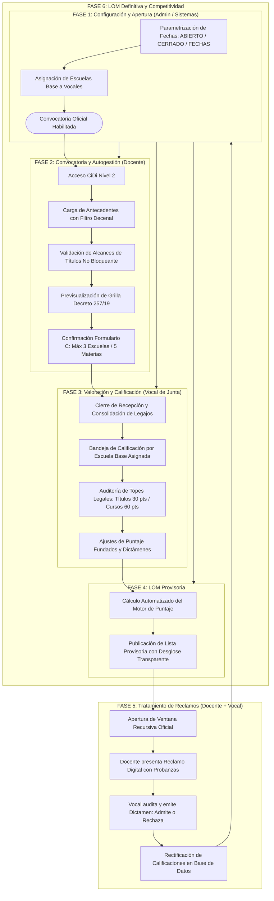
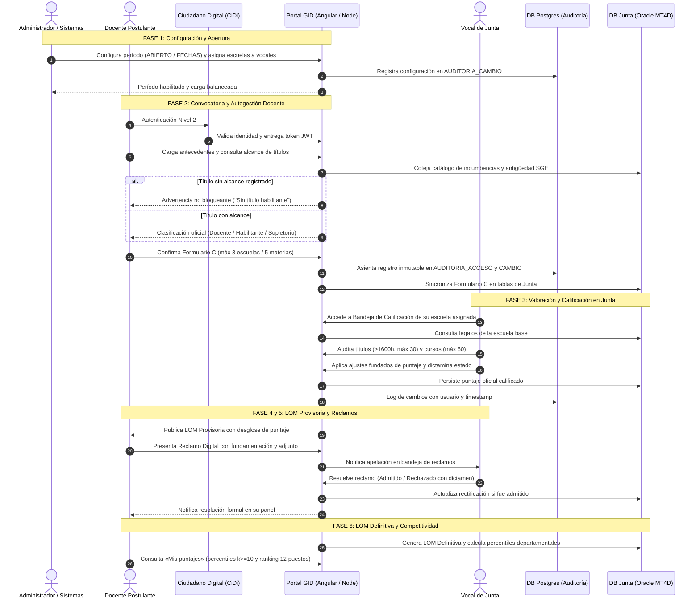
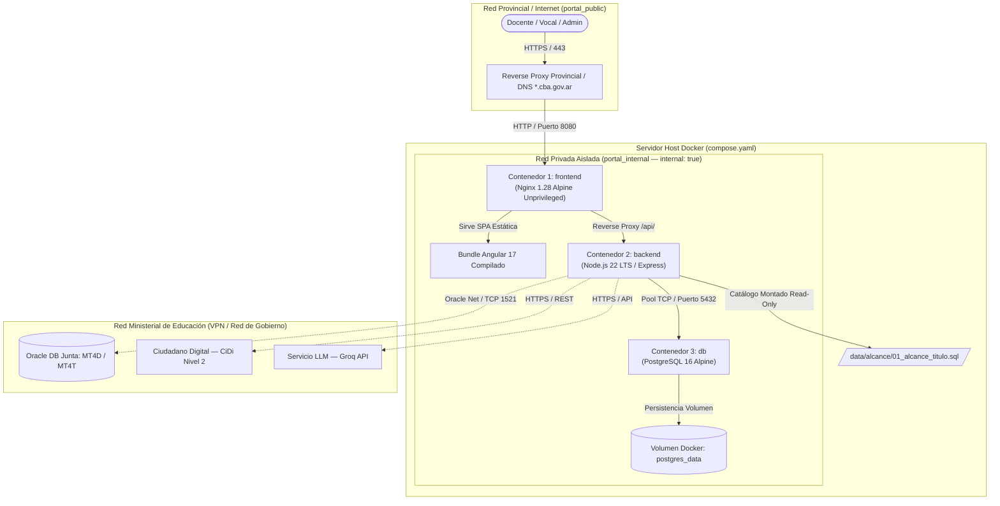
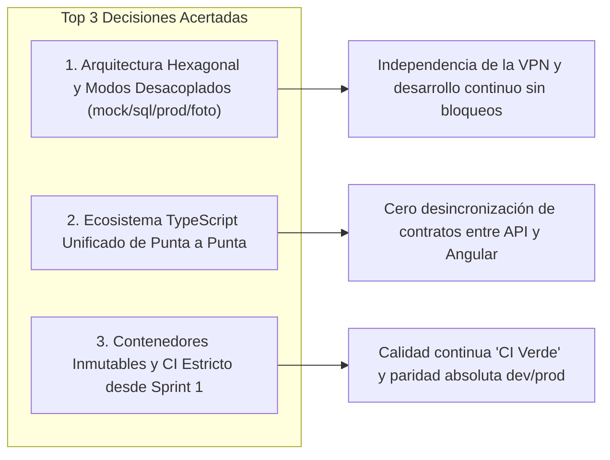

# UNIVERSIDAD TECNOLÓGICA NACIONAL
## FACULTAD REGIONAL CÓRDOBA
### Departamento de Ingeniería en Sistemas de Información
**Cátedra:** Proyecto Final — Curso 5K3 — Ciclo Lectivo 2026  
**Proyecto:** Gestión Integral Docente (GID) — Portal Provincial de Gestión Docente Secundaria  
**Organización Destinataria:** Ministerio de Educación de la Provincia de Córdoba — Dirección General de Carrera Docente / Junta de Clasificación Secundaria  

---

### Equipo Docente
- **Profesor Titular:** Ing. Quinteros, Sergio
- **Jefe de Trabajos Prácticos (JTP):** Ing. Martinez, Gabriel

### Integrantes — Grupo Nº 24
| Legajo | Apellido y Nombre | Correo Electrónico |
| :---: | :--- | :--- |
| **95754** | Demaria, Alexis | aleddemaria@gmail.com |
| **91227** | Formoso, Matías Agustín | formosomatiasagustin@gmail.com |
| **94373** | Serafini, Augusto | augusto27serafini@gmail.com |
| **94196** | Steffolani, Nicolás | nicosteffolani@gmail.com |
| **96061** | Valverde, Fabrizio | fabrizioval.seg@gmail.com |

---

# INSTANCIA 5 — FIN DE PROYECTO

---

## 📑 Índice General

- [**1. Documentación del Proceso que Contiene al Sistema**](#1-documentación-del-proceso-que-contiene-al-sistema)
  - [1.1. Propósito y Audiencia](#11-propósito-y-audiencia)
  - [1.2. Descripción del Proceso de Negocio Actualizado Post-Implementación](#12-descripción-del-proceso-de-negocio-actualizado-post-implementación)
    - [1.2.1. El Ciclo Administrativo Docente Anual](#121-el-ciclo-administrativo-docente-anual)
    - [1.2.2. Detalle de las Etapas del Circuito Integral](#122-detalle-de-las-etapas-del-circuito-integral)
  - [1.3. Diagrama de Secuencia del Proceso Integrado](#13-diagrama-de-secuencia-del-proceso-integrado)
  - [1.4. Roles y Responsabilidades en el Nuevo Contexto (Matriz RACI)](#14-roles-y-responsabilidades-en-el-nuevo-contexto-matriz-raci)
- [**2. Instructivos de Uso**](#2-instructivos-de-uso)
  - [2.1. Propósito y Alcance del Instructivo](#21-propósito-y-alcance-del-instructivo)
  - [2.2. Instructivo de Operación para el Docente Postulante](#22-instructivo-de-operación-para-el-docente-postulante)
  - [2.3. Instructivo de Operación para el Administrador de la Junta / Usuario de Sistemas](#23-instructivo-de-operación-para-el-administrador-de-la-junta--usuario-de-sistemas)
  - [2.4. Instructivo de Operación para el Vocal de la Junta de Clasificación](#24-instructivo-de-operación-para-el-vocal-de-la-junta-de-clasificación)
  - [2.5. Preguntas Frecuentes (FAQ) y Resolución de Problemas Comunes](#25-preguntas-frecuentes-faq-y-resolución-de-problemas-comunes)
- [**3. Manual de Instalación y Operación**](#3-manual-de-instalación-y-operación)
  - [3.1. Propósito y Audiencia](#31-propósito-y-audiencia)
  - [3.2. Arquitectura de Despliegue y Qué Hace Cada Contenedor Docker](#32-arquitectura-de-despliegue-y-qué-hace-cada-contenedor-docker)
  - [3.3. Requisitos de Hardware, Software y Red](#33-requisitos-de-hardware-software-y-red)
  - [3.4. Instalación Paso a Paso en un Servidor y Explicación de Comandos Docker](#34-instalación-paso-a-paso-en-un-servidor-y-explicación-de-comandos-docker)
  - [3.5. Verificación de Conectividad con Bases de Datos y Sistemas Externos](#35-verificación-de-conectividad-con-bases-de-datos-y-sistemas-externos)
  - [3.6. Configuración de Variables de Entorno y Secretos](#36-configuración-de-variables-de-entorno-y-secretos)
  - [3.7. Operación, Monitoreo y Comandos Docker de Mantenimiento](#37-operación-monitoreo-y-comandos-docker-de-mantenimiento)
  - [3.8. Gestión de Backups y Restauración](#38-gestión-de-backups-y-restauración)
  - [3.9. Resolución de Incidentes Comunes de Infraestructura](#39-resolución-de-incidentes-comunes-de-infraestructura)
- [**4. Análisis de Impacto Ambiental**](#4-análisis-de-impacto-ambiental)
  - [4.1. Propósito y Alcance](#41-propósito-y-alcance)
  - [4.2. Estimación del Consumo Energético y Huella de Carbono (67.700 Inscripciones)](#42-estimación-del-consumo-energético-y-huella-de-carbono-67700-inscripciones)
  - [4.3. Alternativas de Diseño Evaluadas y Prácticas de Ingeniería Verde](#43-alternativas-de-diseño-evaluadas-y-prácticas-de-ingeniería-verde)
  - [4.4. Beneficios Ambientales Directos: Continuidad de la Despapelización, Almacenamiento Físico y Reducción de Traslados](#44-beneficios-ambientales-directos-continuidad-de-la-despapelización-almacenamiento-físico-y-reducción-de-traslados)
  - [4.5. Balance Ambiental Neto de la Solución](#45-balance-ambiental-neto-de-la-solución)
- [**5. Retrospectiva de Proyecto**](#5-retrospectiva-de-proyecto)
  - [5.1. Propósito y Audiencia](#51-propósito-y-audiencia)
  - [5.2. Top 3 Decisiones que Resultaron Bien y por qué](#52-top-3-decisiones-que-resultaron-bien-y-por-qué)
  - [5.3. Top 3 Cosas que Haríamos Diferente (Lecciones Aprendidas)](#53-top-3-cosas-que-haríamos-diferente-lecciones-aprendidas)
  - [5.4. Recomendaciones para Futuros Equipos de Proyecto Final](#54-recomendaciones-para-futuros-equipos-de-proyecto-final)

---

## 1. DOCUMENTACIÓN DEL PROCESO QUE CONTIENE AL SISTEMA

### 1.1. Propósito y Audiencia
- **Para qué:** Describe el proceso de negocio de gestión de carrera, valoración de antecedentes, fiscalización e inscripción docente tras la integración de la plataforma **Gestión Integral Docente (GID)**, documentando los flujos temporales reales, la articulación entre los actores institucionales y los componentes de software provincial.
- **Para quién:** Autoridades del Ministerio de Educación de la Provincia de Córdoba, personal directivo, vocales y administradores de la Junta de Clasificación Secundaria, docentes y aspirantes provinciales, y futuros equipos mantenedores de la infraestructura tecnológica estatal.

---

### 1.2. Descripción del Proceso de Negocio Actualizado Post-Implementación

#### 1.2.1. El Ciclo Administrativo Docente Anual
El régimen administrativo de educación secundaria de la provincia de Córdoba se estructura en torno a un ciclo anual riguroso y secuencial. Lejos de constituir un trámite instantáneo o aislado, la cobertura de horas cátedra y cargos directivos/docentes exige una coordinación sincronizada entre la autogestión de los aspirantes, la tasación jurídica de la Junta de Clasificación y la gobernanza operativa del Ministerio:

1. **Fase 1 — Configuración Previa y Apertura de Convocatoria:** El Administrador de la Junta / Usuario de Sistemas parametriza la ventana temporal en la web (`ABIERTO`, `CERRADO`, `FECHAS`) y distribuye operativamente las escuelas base entre los vocales calificadores.
2. **Fase 2 — Convocatoria y Autogestión Docente:** Habilitado el plazo, el docente accede con CiDi Nivel 2, actualiza sus antecedentes (con filtro automático de caducidad a 10 años según Decreto 257/19), valida el alcance de sus títulos de forma no bloqueante, simula su puntaje estimado y formaliza su Formulario C (hasta 3 escuelas y 5 asignaturas por establecimiento).
3. **Fase 3 — Valoración de Legajos y Fiscalización en Junta:** Cerrada la convocatoria, los vocales acceden a su bandeja por escuela base asignada. Auditan las probanzas aplicando los topes normativos (máximo 30 pts en títulos con carga horaria superior a 1600 h; máximo 60 pts en cursos y capacitaciones) y registran ajustes fundados.
4. **Fase 4 — Publicación de la LOM Provisoria:** El motor calcula los totales preliminares y publica la lista provisoria con desglose transparente de ítems aprobados y desestimados.
5. **Fase 5 — Régimen Digital de Reclamos:** Se abre la ventana formal de impugnación. El aspirante fundamenta su disconformidad y adjunta nueva prueba; el vocal analiza el expediente y emite dictamen resolutivo vinculante (admitido o rechazado).
6. **Fase 6 — LOM Definitiva y Analítica de Competitividad:** El Ministerio homologa la LOM definitiva para la cobertura de suplencias e interinatos. El docente consulta en «Mis puntajes» su posición oficial, percentiles departamentales (con privacidad diferencial $k \ge 10$) y el ranking escolar de los 12 primeros puestos.



---

#### 1.2.2. Detalle de las Etapas del Circuito Integral

#### Etapa 1: Autenticación, Identidad Digital y Asignación de Roles
1. El usuario accede a través del portal único de **Ciudadano Digital (CiDi)** provincial.
2. El sistema exige estrictamente **CiDi Nivel 2 (identidad fehaciente verificada)**. Si un usuario intenta ingresar con Nivel 1, el portal bloquea preventivamente la sesión e instruye los pasos para validar su identidad en los centros provinciales.
3. El subsistema de seguridad emite un token JWT firmado y resuelve el perfil operativo según las fuentes maestras:
   - `docente`: postulación e inscripción general.
   - `vocal`: calificador formal habilitado en la Junta de Clasificación.
   - `administrador`: usuario de sistemas designado por CUIL (`ADMINISTRADORES_CUIL`) con atribuciones de gobierno y auditoría.

#### Etapa 2: Parametrización y Convocatoria Anual
1. El Administrador de la Junta configura desde el módulo web de gestión el estado del período de inscripción (`ABIERTO`, `CERRADO` o por rango programado de `FECHAS`).
2. Desde la interfaz de asignación, el Administrador balancea la carga de trabajo distribuyendo las escuelas secundarias provinciales entre los vocales activos.
3. Se publican los términos y el calendario oficial en la portada del portal GID.

#### Etapa 3: Autogestión, Títulos y Carga de Antecedentes
1. El docente accede a su **Legajo Digital** y visualiza su historial consolidado (servicios SGE, antigüedad PeopleNet y certificaciones previas).
2. **Filtro de Caducidad Decenal:** Al incorporar nuevos certificados y cursos, el sistema verifica que la fecha de emisión no supere los diez (10) años al momento del cierre de la convocatoria, conforme a las prescripciones del Decreto 257/19.
3. **Validación de Alcances No Bloqueante:** Al seleccionar asignaturas para su postulación, el sistema coteja contra el catálogo de alcances de títulos (más de 74.000 combinaciones):
   - Determina la prioridad legal: **Docente**, **Habilitante** o **Supletorio**.
   - En caso de no existir incumbencia previa registrada, el sistema **no bloquea el trámite**: emite una advertencia formal y permite al educador continuar postulándose bajo la categoría *"Sin título habilitante"*, garantizando el derecho a la postulación sujeta a revisión de Junta.
4. **Previsualización de Grilla (Decreto 257/19):** Antes de confirmar, el docente visualiza la estimación preliminar de su puntaje desglosado por concepto, distinguiendo claramente la simulación de grilla respecto del puntaje oficial emitido por Junta.
5. El docente confirma su Formulario C (hasta 3 escuelas y hasta 5 asignaturas por establecimiento), emitiéndose comprobante digital con hash de seguridad.

#### Etapa 4: Valoración y Calificación por Vocales de Junta
1. Al vencer el plazo de inscripción, la recepción se bloquea automáticamente.
2. Cada vocal accede a su bandeja exclusiva conteniendo únicamente los legajos de los aspirantes postulados a su **escuela base asignada**.
3. El vocal audita las probanzas documentales y el sistema asiste en la aplicación estricta de los límites del Decreto 257/19:
   - **Tope de acumulación de títulos:** Hasta un máximo de **30 puntos** (requiriendo constatar planes con carga horaria superior a 1600 horas).
   - **Tope de cursos y perfeccionamiento:** Hasta un máximo de **60 puntos**.
   - **Ajustes de puntaje justificados:** Posibilidad de aplicar adiciones o detracciones especiales, requiriendo obligatoriamente un campo de fundamentación para auditoría.
4. El legajo transita formalmente por los estados: *Pendiente → En Revisión → Calificado / Observado*.

#### Etapa 5: LOM Provisoria y Régimen Digital de Reclamos
1. El motor consolida las calificaciones y genera la **Lista de Orden de Mérito Provisoria**.
2. Los aspirantes pueden consultar públicamente su posición preliminar y el desglose de puntaje otorgado.
3. **Instancia Recursiva Digital:** Dentro del plazo reglamentario de días hábiles, el docente disconforme puede formular un reclamo digital desde el portal:
   - Identifica el rubro o antecedente objetado.
   - Redacta la fundamentación formal y adjunta documentación probatoria complementaria.
4. El vocal revisor evalúa el reclamo y emite un **dictamen resolutivo vinculante**:
   - **Admitir:** Rectifica la calificación y actualiza el puntaje en la base de datos.
   - **Rechazar:** Asienta la resolución fundada denegatoria.
5. El docente es notificado formalmente a través de su panel personal.

#### Etapa 6: LOM Definitiva y Analítica de Competitividad
1. El Ministerio de Educación procede a la homologación de la **LOM Definitiva Oficial**, instrumento público e inalterable que rige las asambleas de designación docente.
2. **Módulo «Mis Puntajes» y Competitividad Regional:**
   - **Percentiles Departamentales:** Cálculo en base de datos mediante `PERCENTILE_CONT` para que el docente conozca su ubicación relativa frente a los demás aspirantes de su misma disciplina en el departamento.
   - **Protección de Privacidad ($k \ge 10$):** Si en un departamento existen menos de 10 inscriptos en una materia, el sistema suprime el percentil para resguardar el secreto estadístico y evitar la individualización de colegas.
   - **Ranking Escolar Público:** Visualización abierta de los primeros 12 puestos de la LOM escolar para transparentar la cobertura efectiva de las vacantes.

---

### 1.3. Diagrama de Secuencia del Proceso Integrado



---

### 1.4. Roles y Responsabilidades en el Nuevo Contexto (Matriz RACI)

El nuevo marco operativo distribuye de manera precisa las responsabilidades para asegurar la gobernanza, trazabilidad e integridad de los datos provinciales.

#### Definiciones de la Matriz RACI
- **R (Responsible / Responsable):** Quien ejecuta operativamente la tarea.
- **A (Accountable / Aprobador):** Quien rinde cuentas y posee la autoridad final sobre el resultado.
- **C (Consulted / Consultado):** Quien proporciona criterios normativos o soporte técnico especializado.
- **I (Informed / Informado):** Quien es notificado formalmente sobre los avances o resultados.

#### Matriz RACI de Procesos de Negocio

| Tarea / Actividad del Proceso | Docente Aspirante | Vocal de Junta | Administrador de Junta / Sistemas | Dirección Gral. de Carrera Docente | Soporte Técnico / DevOps | Ciudadano Digital (CiDi) |
| :--- | :---: | :---: | :---: | :---: | :---: | :---: |
| **Validación de Identidad Digital (Nivel 2)** | R | I | I | I | I | **A** |
| **Parametrización de Períodos de Convocatoria** | I | I | **R** | **A** | C | I |
| **Asignación y Reasignación de Escuelas a Vocales** | I | I | **R / A** | C | I | I |
| **Actualización y Carga de Legajo Digital** | **R / A** | C | I | I | I | I |
| **Validación de Alcances de Títulos (No Bloqueante)** | R | C | I | **A** | C *(Catálogo)* | I |
| **Confección y Envío del Formulario C** | **R / A** | I | I | I | I | I |
| **Valoración de Legajos y Control de Topes (Dto. 257/19)** | I | **R** | C | **A** | I | I |
| **Publicación de la LOM Provisoria** | I | C | R | **A** | I | I |
| **Presentación de Reclamos Digitales** | **R / A** | I | I | I | I | I |
| **Dictamen y Resolución de Reclamos** | I | **R / A** | I | C | I | I |
| **Homologación y Publicación de LOM Definitiva** | I | C | R | **R / A** | I | I |
| **Consulta de Percentiles ($k \ge 10$) y Ranking** | **R** | I | I | I | I | I |
| **Monitoreo de Avance y Rendimiento por Vocal** | I | I | **R / A** | I | I | I |
| **Fiscalización del Log Inmutable de Auditoría** | I | I | **R / A** | I | C | I |
| **Resguardo de Base de Datos y Backups** | I | I | C | I | **R / A** | I |

---

#### Descripción Específica de Responsabilidades por Rol

1. **Docente / Aspirante a Horas y Cargos:**
   - Responsable de mantener su identidad CiDi Nivel 2 activa y validada.
   - Custodio de la veracidad de los títulos, cursos y certificaciones adjuntados en su legajo.
   - Ejecutor de la selección libre de hasta 3 escuelas y 5 asignaturas por establecimiento mediante el Formulario C en el período de convocatoria.
   - Titular del derecho de impugnación: formula reclamos fundados dentro de la ventana recursiva.
   - Usuario de las herramientas de competitividad regional («Mis puntajes») para planificar su carrera profesional.

2. **Vocal de la Junta de Clasificación:**
   - Calificador oficial responsable de tasar, validar o rechazar los antecedentes presentados por los educadores en su escuela base asignada.
   - Aplicador de los topes y ponderaciones del Decreto Provincial 257/19 (máximo 30 pts en títulos con carga horaria >1600 h; máximo 60 pts en capacitaciones).
   - Emisor de ajustes de puntaje fundados con justificación obligatoria para auditoría.
   - Juez administrativo de primera instancia: analiza los reclamos docentes y emite dictámenes resolutivos (admite rectificando el puntaje o rechaza con causa).

3. **Administrador de la Junta / Usuario de Sistemas (`ADMINISTRADORES_CUIL`):**
   - Responsable de la parametrización del calendario web de convocatorias (apertura, prórrogas, cierre).
   - Encargado de balancear la carga de trabajo asignando y reasignando escuelas base entre los vocales habilitados.
   - Supervisor del progreso de calificación mediante el panel de control y estadísticas en tiempo real (avance por vocal y estado de expedientes).
   - Auditor forense: facultado para consultar y filtrar el log inmutable de auditoría en PostgreSQL (`AUDITORIA_ACCESO` y `AUDITORIA_CAMBIO`) por CUIL, fecha o tipo de operación.

4. **Dirección General de Carrera Docente (Autoridad de Aplicación):**
   - Máxima autoridad ministerial responsable de homologar los cronogramas y refrendar la validez de las convocatorias.
   - Firmante y homologador oficial de la Lista de Orden de Mérito provincial definitiva.
   - Órgano rector de interpretación normativa del Decreto 257/19.

5. **Soporte Técnico / DevOps:**
   - Responsable de la infraestructura de contenedores (Docker Compose), redes y alta disponibilidad de los servicios frontend (Angular 17) y backend (Node.js).
   - Custodio de la seguridad de credenciales y variables de entorno (`JWT_SECRET`, cadenas de conexión a PostgreSQL Supabase y Oracle Lab MT4D).
   - Administrador de las rutinas de backup automatizado y continuidad operativa.

---
## 2. INSTRUCTIVOS DE USO

### 2.1. Propósito y Alcance del Instructivo
- **Para qué:** Brindar una guía operativa clara, estructurada paso a paso y orientada a tareas para cada uno de los actores que interactúan con el portal **Gestión Integral Docente (GID)**, facilitando la autogestión, la calificación transparente y la gobernanza administrativa.
- **Para quién:** 
  1. **Docentes y Aspirantes provinciales:** para la administración de su legajo, inscripción a convocatorias, reclamos y análisis de competitividad.
  2. **Administradores de la Junta / Usuarios de Sistemas:** para la configuración de períodos web, distribución de escuelas entre vocales, monitoreo y auditoría.
  3. **Vocales de la Junta de Clasificación:** para la fiscalización de legajos asignados por escuela base, control de topes del Decreto 257/19 y resolución de reclamos.

---

### 2.2. Instructivo de Operación para el Docente Postulante

#### 2.2.1. Acceso mediante CiDi Nivel 2 y Panel Principal
1. Ingrese al portal provincial GID desde cualquier navegador web moderno.
2. Haga clic en el botón oficial **«Ingresar con Ciudadano Digital»**.
3. Ingrese su CUIL y contraseña provincial en la pasarela segura de **CiDi**.
   > [!IMPORTANT]
   > Se requiere estrictamente **CiDi Nivel 2 (identidad verificada)**. Si cuenta con Nivel 1, el portal indicará los centros provinciales habilitados para elevar su nivel de seguridad.
4. Una vez autenticado, el sistema lo redirigirá al **Panel Principal del Docente**, donde visualizará el estado actual del ciclo lectivo, accesos directos a su legajo, la convocatoria activa y notificaciones oficiales.

#### 2.2.2. Mi Legajo Digital: Títulos, Certificaciones y Filtro Decenal (Decreto 257/19)
1. En la barra de navegación superior, seleccione **«Mi Legajo»**.
2. **Pestaña Títulos:** Visualice sus títulos registrados oficialmente en el sistema provincial. Para añadir un nuevo título, pulse *«Cargar Título»*, ingrese nivel, institución emisora, año de egreso y adjunte el archivo PDF del analítico legalizado.
3. **Pestaña Antecedentes y Capacitaciones:**
   - Para registrar un nuevo certificado, haga clic en *«Añadir Antecedente»*.
   - Complete la denominación del curso, institución acreditada, fecha de emisión y carga horaria en horas reloj.
   - **Filtro de Caducidad Decenal:** El sistema cotejará automáticamente que la fecha de expedición no supere los diez (10) años al cierre de la convocatoria, de conformidad con el Decreto Provincial 257/19. Si el certificado supera el decenio, el sistema informará su desestimación para puntaje por prescripción reglamentaria.
4. Guarde los cambios. Los antecedentes quedarán registrados en estado *Pendiente de Valoración* para la intervención de Junta.

#### 2.2.3. Formulario C: Postulación, Alcances No Bloqueantes y Previsualización de Grilla
1. Durante la ventana de convocatoria habilitada (`ABIERTO`), acceda a la sección **«Inscripción — Formulario C»**.
2. **Selección de Establecimientos:** Puede seleccionar libremente hasta un **máximo estricto de tres (3) escuelas secundarias** de la provincia, sin estar atado a una escuela base histórica (ADR-013).
3. **Selección de Asignaturas o Cargos:** Dentro de cada escuela seleccionada, puede postularse a un **máximo de cinco (5) materias o cargos**.
4. **Validación de Alcances No Bloqueante (US-09 / ADR-009):**
   - Al seleccionar la materia, el sistema consulta en tiempo real el catálogo maestro de alcances de títulos (más de 74.000 combinaciones).
   - Si su título registra incumbencia, se le asignará la prioridad legal correspondiente (**Docente**, **Habilitante** o **Supletorio**).
   - Si el título cargado **no registra incumbencia previa en el catálogo**, el sistema **no bloqueará su postulación**: emitirá una advertencia formal y le permitirá continuar inscribiéndose bajo la categoría *"Sin título habilitante"*, garantizando que la Junta de Clasificación evalúe su caso en instancia de fiscalización.
5. **Previsualización de Grilla Estimada (US-10 / ADR-027):**
   - Antes de confirmar el envío, el sistema desplegará el desglose preliminar estimado de su puntaje conforme a la grilla del Decreto 257/19 (antigüedad SGE, títulos y cursos con topes teóricos).
   - Esta estimación se exhibe con la leyenda *"Puntaje Preliminar Estimado — Sujeto a Validación de Junta"*, distinguiéndose del puntaje oficial definitivo.
6. Pulse **«Confirmar y Enviar Inscripción»**. El sistema generará su comprobante digital oficial de postulación con hash y número de transacción.

#### 2.2.4. Consulta de LOM Provisoria y Presentación de Reclamos Digitales (ADR-035)
1. Al publicarse la **Lista de Orden de Mérito Provisoria**, ingrese a **«Mis Inscripciones»** para consultar su orden preliminar y el desglose de puntaje asignado por el vocal evaluador.
2. **Presentación de Reclamo Digital:**
   - Si detecta omisiones, cómputos erróneos o antecedentes indebidamente desestimados, pulse el botón **«Presentar Reclamo»** dentro de la ventana reglamentaria de días hábiles.
   - Seleccione el rubro u objeto de la impugnación (Antigüedad, Títulos, Antecedentes o Ajustes).
   - Redacte la fundamentación fáctica y legal de su reclamo.
   - Adjunte la documentación probatoria digitalizada en formato PDF.
   - Confirme el envío. El reclamo ingresará de forma directa a la bandeja del vocal asignado para su tratamiento formal.
3. Podrá realizar el seguimiento del reclamo desde el portal hasta la emisión del dictamen resolutivo formal (*Admitido* o *Rechazado* con causa).

#### 2.2.5. Consulta de LOM Definitiva y Métricas de Competitividad («Mis Puntajes»)
1. Publicada la LOM definitiva homologada por el Ministerio, acceda a la sección **«Mis Puntajes»**.
2. Verifique su puntaje final oficial inalterable, que rige las asambleas de cobertura de interinatos y suplencias.
3. **Percentiles Departamentales (US-68 / ADR-037):** Visualice su posición porcentual relativa dentro del departamento provincial para cada asignatura postulada.
   > [!NOTE]
   > **Protección de Privacidad ($k \ge 10$):** Si en su departamento y materia existen menos de 10 aspirantes inscriptos, el percentil no se exhibirá para resguardar la identidad de los colegas y cumplir con las normas de confidencialidad de datos.
4. **Ranking Escolar Público:** Explore la lista de los 12 primeros puestos de la LOM en cada escuela base para evaluar objetivamente sus posibilidades de designación en asamblea.

#### 2.2.6. Asistente Virtual Docente (Chatbot Flotante)
- En el vértice inferior derecho de la pantalla encontrará disponible el **Asistente GID**, impulsado por inteligencia artificial.
- Puede consultarle dudas sobre fechas de convocatoria, normativas del Decreto 257/19, requisitos de legalización de títulos o pasos para formular un reclamo formal.

---

### 2.3. Instructivo de Operación para el Administrador de la Junta / Usuario de Sistemas

#### 2.3.1. Acceso Administrativo y Asignación de Roles (`ADMINISTRADORES_CUIL`)
1. Ingrese al portal con su cuenta CiDi Nivel 2.
2. El sistema verificará que su CUIL figure incorporado en la lista autorizada de administradores (`ADMINISTRADORES_CUIL`).
3. Al detectarse el privilegio de gestión, la barra superior incorporará el menú exclusivo **«Junta»**, habilitando los submódulos: *Períodos, Asignación, Vocales, Estadísticas y Auditoría*.

#### 2.3.2. Gestión del Calendario de Convocatoria (`Junta → Períodos`) (ADR-036 / US-76)
1. Acceda a **«Junta → Períodos»**.
2. Visualice el ciclo lectivo activo y el estado operativo de la convocatoria provincial.
3. **Configuración de Modos de Apertura:**
   - **`ABIERTO`:** Fuerza la apertura inmediata de la convocatoria web para todos los aspirantes provinciales.
   - **`CERRADO`:** Cierra de inmediato la recepción de Formularios C y bloquea modificaciones de legajo para consolidar listas.
   - **`FECHAS`:** Permite definir un rango temporal estricto (Fecha/Hora de Inicio y Fecha/Hora de Cierre). El sistema abrirá y cerrará la convocatoria automáticamente en los hitos configurados.
4. Pulse **«Guardar Parámetros de Período»**. La acción queda registrada en el log inmutable de auditoría.

#### 2.3.3. Asignación y Reasignación de Escuelas Base a Vocales (`Junta → Asignación`) (ADR-038 / US-81)
1. Ingrese a **«Junta → Asignación»**.
2. Visualice la grilla completa de escuelas secundarias provinciales y la cantidad de legajos inscriptos en cada una.
3. Para balancear la carga de trabajo entre los vocales calificadores:
   - Seleccione una escuela secundaria del listado.
   - En el menú desplegable, seleccione el vocal calificador habilitado al que se le confiará la fiscalización del establecimiento.
   - Pulse **«Asignar Escuela»** (o *«Reasignar»* para redistribuir ante licencias o sobrecargas de expedientes).
4. El cambio impacta instantáneamente: los aspirantes de esa escuela pasan a figurar en la bandeja exclusiva del nuevo vocal asignado.

#### 2.3.4. Monitoreo de Avance y Estadísticas de Calificación (`Junta → Estadísticas`) (ADR-041)
1. Diríjase a **«Junta → Estadísticas»**.
2. **Tablero de Control de Avance Provincial:**
   - Total de legajos calificados, observados y pendientes en toda la jurisdicción.
   - Porcentaje de avance global hacia el cumplimiento de los plazos de publicación.
3. **Rendimiento por Calificador:** Tabla discriminada por vocal con la cantidad de expedientes dictaminados, tiempos promedio de revisión y estado de su bandeja escolar.
4. **Monitoreo de Reclamos:** Indicadores de apelaciones recibidas, dictámenes favorables y denegatorias emitidas para anticipar cuellos de botella administrativos.

#### 2.3.5. Consulta y Filtrado del Log Inmutable de Auditoría (`Junta → Auditoría`) (ADR-032 / US-23 / US-73)
1. Seleccione **«Junta → Auditoría»**.
2. El sistema consulta directamente las tablas inmutables `AUDITORIA_ACCESO` y `AUDITORIA_CAMBIO` en PostgreSQL.
3. **Criterios de Búsqueda y Filtrado:**
   - Filtro por **CUIL del usuario** (docente, vocal o administrador).
   - Filtro por **Rango de Fechas** (desde / hasta).
   - Filtro por **Tipo de Operación** (`LOGIN`, `CARGA_LEGAJO`, `ENVIO_FORM_C`, `CALIFICACION_VOCAL`, `AJUSTE_PUNTAJE`, `DICTAMEN_RECLAMO`, `CAMBIO_PERIODO`).
4. Al hacer clic en un registro de cambio, visualice el **visor de diferencias JSON (Diff)** exhibiendo los valores previos y los nuevos valores persistidos, junto con la IP y la marca de tiempo certificada.

---

### 2.4. Instructivo de Operación para el Vocal de la Junta de Clasificación

#### 2.4.1. Acceso a la Bandeja de Calificación por Escuela Base Asignada (ADR-018)
1. Ingrese al portal con su cuenta CiDi Nivel 2 registrada como vocal de Junta.
2. Ingrese a la sección **«Bandeja de Calificación»**.
3. El sistema listará exclusivamente los legajos correspondientes a las **escuelas base que le fueron asignadas** por el Administrador de la Junta, garantizando el aislamiento de expedientes y la confidencialidad operativa.

#### 2.4.2. Fiscalización de Antecedentes y Aplicación de Topes (Decreto 257/19 / ADR-033 / ADR-034)
1. Seleccione un docente del listado para abrir su legajo digital.
2. **Inspección Documental:** Examine los certificados y títulos adjuntos visualizando los documentos PDF legalizados.
3. **Asistencia en Topes Normativos por Sistema:**
   - **Títulos:** El sistema verifica la carga horaria; sólo planes superiores a 1600 horas permiten acumulación, con un **tope infranqueable de 30 puntos**.
   - **Cursos y Capacitaciones:** El motor suma los antecedentes acreditados hasta alcanzar el **tope legal de 60 puntos**, alertando si las presentaciones adicionales exceden dicho límite.
4. Conmute el estado del antecedente según corresponda (*Aprobado*, *Desestimado* o *Requiere Ratificación*).

#### 2.4.3. Ajustes Fundados de Puntaje y Observaciones de Legajo (ADR-039 / ADR-040)
1. Si corresponde otorgar una bonificación reglamentaria especial o deducir puntaje por causales de estatuto, utilice el panel **«Ajuste de Puntaje»**.
2. Indique el valor algebraico (+ o - puntos).
3. **Justificación Obligatoria:** Ingrese el fundamento legal y administrativo en el campo de texto. El sistema no permite asentar ajustes numéricos sin una justificación expresa que quedará sellada para auditoría.
4. Asigne el estado final del legajo: **Calificado** (si todo está en regla) u **Observado** (si median inconsistencias formales).

#### 2.4.4. Tratamiento, Dictamen y Resolución de Reclamos Docentes (ADR-035)
1. Durante la instancia recursiva posterior a la LOM provisoria, ingrese a **«Bandeja de Reclamos»**.
2. Seleccione el reclamo interpuesto por el docente y revise la fundamentación presentada y las nuevas probanzas adjuntas.
3. **Emisión de Dictamen Resolutivo:**
   - Si el reclamo es procedente: seleccione **«Admitir Reclamo»**, consigne el nuevo puntaje rectificado y asiente la resolución fundada. El sistema actualizará de inmediato la base de datos oficial.
   - Si el reclamo es improcedente: seleccione **«Rechazar Reclamo»** e ingrese los considerandos normativos de la desestimación.
4. Firme digitalmente la resolución para notificar automáticamente al docente en su panel personal.

---

### 2.5. Preguntas Frecuentes (FAQ) y Resolución de Problemas Comunes

#### FAQ 1: ¿Por qué el sistema me solicita Ciudadano Digital Nivel 2 para operar?
**Respuesta:** La gestión de antecedentes docentes y la postulación a cargos públicos implican actos administrativos vinculantes con fe pública. CiDi Nivel 2 asegura la identidad digital fehaciente del docente o funcionario, evitando fraudes, suplantaciones de identidad y garantizando la validez jurídica de la postulación.

#### FAQ 2: ¿Por qué no puedo confeccionar mi Formulario C inmediatamente después de subir mis certificados a Mi Legajo?
**Respuesta:** El régimen docente provincial opera mediante un ciclo administrativo secuencial. Durante la etapa de actualización de legajo, los documentos deben ser primero tasados y certificados por los vocales de la Junta de Clasificación. Una vez publicada la convocatoria oficial de inscripción (`ABIERTO`), el módulo de Formulario C se habilitará para seleccionar escuelas y materias.

#### FAQ 3: ¿Por qué una materia me figura con advertencia al seleccionarla en el Formulario C? ¿Puedo postularme igual?
**Respuesta:** Sí, puede postularse. El sistema no bloquea su postulación. La advertencia indica que su título no registra incumbencia previa en el catálogo provincial de alcances para esa asignatura. El sistema le permite confirmar la inscripción bajo la categoría *"Sin título habilitante"*, quedando sujeta a la revisión y dictamen de la Junta de Clasificación durante el período de valoración.

#### FAQ 4: ¿Puedo inscribirme a más de tres (3) escuelas secundarias o a más de cinco (5) materias por escuela?
**Respuesta:** No. Las reglas de negocio ministeriales establecen de manera taxativa un límite máximo de tres (3) establecimientos secundarios por aspirante y hasta cinco (5) asignaturas o cargos en cada uno. El portal valida automáticamente estos máximos impidiendo selecciones que superen dichos límites.

#### FAQ 5: ¿Por qué un curso realizado hace más de diez años figura desestimado en mi legajo?
**Respuesta:** En estricto cumplimiento del Decreto Provincial Nº 257/19, los certificados de cursos, jornadas y capacitaciones poseen una validez reglamentaria de diez (10) años contados hacia atrás desde la fecha de cierre de la convocatoria. Superado ese decenio, el antecedente caduca a los fines del cómputo de puntaje en la grilla oficial.

#### FAQ 6: ¿Cómo y cuándo puedo presentar un reclamo sobre mi puntaje asignado?
**Respuesta:** Los reclamos únicamente pueden interponerse tras la publicación oficial de la **LOM Provisoria**, dentro de la ventana de días hábiles fijada por el calendario provincial. Debe ingresar a *«Mis Inscripciones»*, pulsar en *«Presentar Reclamo»*, indicar el rubro cuestionado, fundamentar los motivos y adjuntar la documentación respaldatoria.

#### FAQ 7: ¿Por qué en algunas materias no visualizo mi percentil departamental en «Mis Puntajes»?
**Respuesta:** Por aplicación del principio de privacidad diferencial ($k \ge 10$). Si en un departamento provincial y para una asignatura determinada existen menos de diez (10) aspirantes inscriptos, el cálculo de percentil se oculta preventivamente para resguardar la identidad y confidencialidad de los colegas.

#### FAQ 8 (Para Vocales): ¿Por qué en mi bandeja de Junta no veo aspirantes de determinados colegios?
**Respuesta:** Cada vocal calificador visualiza exclusivamente los aspirantes postulados a las escuelas base que le han sido asignadas por el Administrador de la Junta (`Junta → Asignación`). Si requiere intervenir en otros colegios por suplencia o redistribución, el Administrador debe reasignarle dicho establecimiento desde su panel de gestión.

#### FAQ 9 (Para Administradores): ¿Cómo procedo si el Ministerio dispone una prórroga en las inscripciones?
**Respuesta:** Ingrese a `Junta → Períodos`. Si el período está en modo `FECHAS`, modifique la *Fecha y Hora de Cierre* extendiendo el plazo convenido y guarde los cambios. Si prefiere control manual, puede mantener el estado en `ABIERTO` hasta que se ordene el cierre definitivo.
## 3. MANUAL DE INSTALACIÓN Y OPERACIÓN

### 3.1. Propósito y Audiencia
- **Para qué:** Proporciona una guía técnica completa y explicada paso a paso para que cualquier administrador de sistemas pueda instalar la plataforma **Gestión Integral Docente (GID)** en un servidor desde cero, comprender qué ejecuta cada contenedor de Docker, interpretar el propósito de cada comando y verificar fehacientemente la conexión tanto con las bases de datos (PostgreSQL local o Supabase y Oracle de la Junta) como con los sistemas externos provinciales (Ciudadano Digital, catálogo maestro de alcances y asistente).
- **Para quién:** Administradores de servidores, ingenieros de infraestructura, equipos de DevOps provinciales, docentes evaluadores y futuros mantenedores de los sistemas informáticos del Gobierno de Córdoba.

---

### 3.2. Arquitectura de Despliegue y Qué Hace Cada Contenedor Docker

Para que quien instale o audite el servidor pueda formarse una idea general clara de lo que se está ejecutando, el sistema GID se empaqueta y orquesta mediante **Docker Compose V2** (`src/compose.yaml`) dividiendo las responsabilidades en **tres contenedores independientes** que corren aislados sobre redes virtuales definidas por software:



#### 3.2.1. Detalle de los Tres Contenedores que Conforman el Sistema

1. **Contenedor 1: `frontend` (`portal-docente-frontend:0.1.0`)**
   - **Tecnología base:** Nginx 1.28 Alpine corriendo bajo usuario no privilegiado (`nginx`, UID 101) para máxima seguridad perimetral.
   - **Qué ejecuta:** Sirve los archivos estáticos HTML5, JavaScript y CSS generados por la compilación de producción de Angular 17. Actúa asimismo como reverse proxy interno: intercepta las peticiones que comienzan con `/api/` y las redirige hacia el contenedor backend en `http://backend:3000/api/`.

2. **Contenedor 2: `backend` (`portal-docente-backend:0.1.0`)**
   - **Tecnología base:** Node.js 22 LTS sobre Alpine Linux, ejecutando bajo usuario sin privilegios (`node`).
   - **Qué ejecuta:** La API REST de la aplicación. Aloja los controladores de negocio, la validación de tokens JWT, el motor de reglas del Decreto 257/19 (topes de 30 y 60 pts, caducidad decenal), el motor de alcances de títulos, la resolución de roles (`ADMINISTRADORES_CUIL`, `VOCALES_CUIL`), la persistencia relacional en PostgreSQL y la interoperabilidad con Oracle de la Junta.

3. **Contenedor 3: `db` (`postgres:16-alpine`)**
   - **Tecnología base:** PostgreSQL 16 Alpine Oficial.
   - **Qué ejecuta:** Motor relacional para la persistencia transaccional rápida del portal: legajos digitales, borradores de Formularios C, dictámenes de reclamos, y el log inmutable append-only de auditoría forense (`AUDITORIA_ACCESO` y `AUDITORIA_CAMBIO`). Los datos se resguardan en el volumen administrado `postgres_data`.

---

### 3.3. Requisitos de Hardware, Software y Red

#### 3.3.1. Requisitos de Hardware del Servidor
- **Procesador (CPU):** Mínimo 2 núcleos virtuales (vCPU) x86_64 o ARM64; recomendado 4 vCPU para concurrencia masiva en períodos de cierre de convocatoria.
- **Memoria RAM:** Mínimo 4 GB disponibles; recomendado 8 GB para absorción fluida del catálogo de títulos en memoria y pool de conexiones.
- **Almacenamiento en Disco:** Mínimo 20 GB de espacio disponible en partición SSD/NVMe (considerando sistema operativo, imágenes Docker, dump de títulos y volumen de base de datos).

#### 3.3.2. Requisitos de Software
- **Sistema Operativo Host:** Linux con kernel 5.4 o superior (Ubuntu Server 22.04 LTS / 24.04 LTS, Debian 12 o RHEL 9 recomendados).
- **Motor Docker:** Docker Engine versión 24.0 o superior.
- **Orquestador:** Docker Compose V2 (plugin integrado `docker compose`) versión 2.20 o superior.
- **Utilidades del Host:** `git`, `curl`, `openssl`.

#### 3.3.3. Requisitos de Red y Conectividad Gubernamental
- **Puerto 8080/TCP entrante:** Exposición pública o a través de balanceador de carga provincial.
- **Salida TCP/1521 hacia Oracle de la Junta:** Conectividad IP autorizada hacia el servidor de base de datos de la Junta (`10.250.11.53`).
- **Salida HTTPS/443 hacia CiDi:** Conectividad hacia las APIs y portales de Ciudadano Digital de la Provincia de Córdoba.

---

### 3.4. Instalación Paso a Paso en un Servidor y Explicación de Comandos Docker

#### Paso 1: Verificar la Instalación de Docker y Clonar el Repositorio
```bash
# 1. Comprobar que el demonio de Docker está activo
docker version

# 2. Comprobar que Docker Compose V2 está disponible
docker compose version

# 3. Clonar el repositorio y posicionarse en la carpeta src/
cd /opt
sudo git clone https://github.com/fabrivalseg/PF-24---Gestion-Docente-Secundaria.git portal-docente
cd /opt/portal-docente/src
```

#### Paso 2: Ubicar el Dump de Alcance de Títulos y Configurar el Archivo `.env`
```bash
# Crear directorio seguro para el catálogo de títulos
sudo mkdir -p /opt/portal-docente/data/alcance
sudo cp /ruta/origen/01_alcance_titulo.sql /opt/portal-docente/data/alcance/01_alcance_titulo.sql
sudo chmod 644 /opt/portal-docente/data/alcance/01_alcance_titulo.sql

# Crear el archivo .env desde la plantilla oficial y asegurar permisos estrictos
cp .env.example .env
chmod 600 .env
```

Generar el secreto criptográfico para JWT:
```bash
openssl rand -base64 48 | tr '+/' '-_' | tr -d '='
```

Configurar los parámetros obligatorios en `/opt/portal-docente/src/.env`:
- Asignar el secreto generado a `JWT_SECRET`.
- Configurar `ADMINISTRADORES_CUIL` con los CUILs autorizados de la Junta (separados por comas).
- Definir credenciales de base de datos PostgreSQL y parámetros Oracle / CiDi.

#### Paso 3: Validar la Sintaxis de Docker Compose
```bash
# Valida la sintaxis del compose.yaml y comprueba que todas las variables obligatorias estén presentes
docker compose config
```

#### Paso 4: Construir las Imágenes Productivas
```bash
# Construye las imágenes locales descargando las capas base más recientes
docker compose build --pull
```

#### Paso 5: Levantar el Sistema y Esperar las Sondas de Salud
```bash
# Levanta los contenedores en segundo plano y espera hasta que el backend pase su prueba de salud
docker compose up -d --wait
```

---

### 3.5. Verificación de Conectividad con Bases de Datos y Sistemas Externos

#### 3.5.1. Verificación 1: Diagnóstico Integral del Sistema (`/api/health`)
Ejecutar desde el servidor o máquina autorizada:
```bash
curl -s http://localhost:8080/api/health | jq .
```
Respuesta esperada:
```json
{
  "status": "ok",
  "version": "0.1.0",
  "database": {
    "postgres": "connected",
    "oracle": "connected"
  },
  "cidi": "configured",
  "catalog": {
    "loaded": true,
    "rules": 74765
  }
}
```

#### 3.5.2. Verificación 2: Inspección Directa sobre la Base de Datos PostgreSQL (`db`)
```bash
# Comprobar conectividad y tablas de auditoría
docker compose exec -T db psql -U portal -d portal_docente -c "\dt"
```
Se listan las tablas operativas: `inscripciones`, `legajo_antecedentes`, `reclamos`, `auditoria_acceso`, `auditoria_cambio`.

#### 3.5.3. Verificación 3: Registro de Auditoría Inmutable
```bash
# Verificar los últimos eventos de auditoría registrados
docker compose exec -T db psql -U portal -d portal_docente -c "SELECT id, accion, cuil, timestamp FROM auditoria_cambio ORDER BY id DESC LIMIT 5;"
```

---

### 3.6. Configuración de Variables de Entorno y Secretos

El archivo `/opt/portal-docente/src/.env` gobierna el comportamiento de los contenedores. A continuación se detalla cada parámetro:

| Variable | Valor Típico en Servidor Provincial | Requerida | Propósito y Consideraciones |
| :--- | :--- | :---: | :--- |
| `NODE_ENV` | `production` | Sí | Activa optimizaciones de Node.js, Express y Angular. |
| `FRONTEND_PORT` | `8080` | Sí | Puerto TCP público que publica el contenedor `frontend` (Nginx) en el host. |
| `BACKEND_PORT` | `3000` | Sí | Puerto interno de Express accesible solo dentro de la red privada `portal_internal`. |
| `CORS_ORIGIN` | `https://portaldocente.cba.gov.ar` | Sí | Origen público oficial permitido por CORS. |
| `JWT_SECRET` | *(cadena aleatoria de 48+ bytes)* | Sí | Clave criptográfica para firmas de sesión. Docker Compose aborta si está vacía. |
| `JWT_EXPIRES_IN` | `8h` | Sí | Vigencia máxima de la sesión tras autenticar con CiDi. |
| `AUTH_MODE` | `cidi` o `mock` | Sí | `cidi` activa el ingreso oficial mediante Ciudadano Digital; `mock` habilita el entorno de pruebas local. |
| `CIDI_ID_APP` | *(provisto por CiDi)* | Sí | Identificador de aplicación asignado por la Provincia. |
| `CIDI_KEY_APP` | *(provisto por CiDi)* | Sí | Clave secreta institucional de la aplicación en CiDi. |
| `CIDI_PASSWORD` | *(provisto por CiDi)* | Sí | Contraseña de aplicación en el servidor CiDi. |
| `CIDI_API_URL` | `https://...` | No | URL del servicio web CiDi oficial o de homologación. |
| `CIDI_LOGIN_URL` | `https://...` | No | URL de pasarela de login de CiDi. |
| `ADMINISTRADORES_CUIL`| *(CUILs separados por coma)* | Sí | **Habilita el rol Administrador de la Junta / Usuario de Sistemas** (acceso a Períodos, Asignación, Estadísticas y Auditoría - ADR-038/ADR-041). |
| `VOCALES_CUIL` | *(CUILs separados por coma)* | No | CUILs adicionales habilitados como vocales si no figuran en las tablas históricas. |
| `RECLAMOS_HASTA` | `YYYY-MM-DDTHH:MM:SS` | No | Fecha y hora límite para la presentación de reclamos sobre la LOM provisoria (ADR-035). |
| `INTEGRATION_MODE` | `prod`, `foto` o `mock` | Sí | `prod` conecta en vivo al Oracle de la Junta; `foto` usa dump local del lab; `mock` datos sintéticos. |
| `DB_USER` | `USR_PORTAL_DOCENTE` | Sí | Usuario de base de datos Oracle para lectura de padrón y catálogo. |
| `DB_PASSWORD` | *(contraseña segura)* | Sí | Contraseña del usuario Oracle. |
| `ORACLE_HOST` | `10.250.11.53` | Sí | Dirección IP del servidor Oracle de la Junta. |
| `ORACLE_PORT` | `1521` | Sí | Puerto TCP del Listener de Oracle. |
| `ORACLE_SERVICE` | `mt4d` | Sí | Nombre del servicio Oracle (`mt4d` / `mt4t`). |
| `ALCANCE_SQL_PATH` | `/opt/portal-docente/data/alcance/01_alcance_titulo.sql` | Sí | Ruta absoluta del dump en el host para el catálogo de títulos. |
| `PERSISTENCIA` | `postgres` | Sí | Persiste legajos, Formularios C, reclamos y auditoría en PostgreSQL. |
| `DATABASE_URL` | *(cadena de conexión)* | No | Permite usar PostgreSQL externo o Supabase en lugar del contenedor local `db`. |
| `POSTGRES_DB` | `portal_docente` | Sí | Nombre de la base de datos creada en el contenedor local `db`. |
| `POSTGRES_USER` | `portal` | Sí | Usuario administrador de la base PostgreSQL local. |
| `POSTGRES_PASSWORD`| *(contraseña segura)* | Sí | Contraseña de PostgreSQL (obligatoria en `compose.yaml`). |
| `ESCRITURA_JUNTA` | `off`, `ensayo` u `on` | Sí | `off` desactiva copia; `ensayo` prueba escrituras en Oracle y hace rollback; `on` confirma. |
| `JUNTA_BASES_PERMITIDAS`| `MT4D,MT4T` | Sí | Lista blanca de servicios Oracle donde se autoriza la escritura espejo. |
| `INSCRIPCION_ABIERTA`| `true` o `false` | Sí | Habilita o cierra la ventana de presentación del Formulario C (modo manual). |
| `GROQ_API_KEY` | *(clave API opcional)* | No | Clave de Groq para el modelo LLM del Asistente Virtual. |

---

### 3.7. Operación, Monitoreo y Comandos Docker de Mantenimiento

#### 3.7.1. Sondas de Salud Automatizadas (`HEALTHCHECK`)
Tanto el contenedor `backend` como el contenedor `db` implementan pruebas de salud periódicas integradas:
```bash
# Ver estado de salud de todos los contenedores
docker compose ps
```
Los tres servicios deben reportar estado `healthy` o `running`.

#### 3.7.2. Monitoreo del Log Inmutable de Auditoría
El sistema ofrece dos vías complementarias para monitorear los accesos y modificaciones:
1. **Vía Interfaz Web (`Junta → Auditoría`):** Exclusiva para usuarios en `ADMINISTRADORES_CUIL`, con filtros combinados por CUIL, fecha y operación, y visor de diferencias JSON.
2. **Vía Línea de Comandos (Consola del Servidor):**
   ```bash
   # Inspeccionar los últimos cambios registrados en tiempo real
   docker compose exec -T db psql -U portal -d portal_docente -c "
   SELECT timestamp, cuil, operacion, tabla_afectada, registro_id 
   FROM auditoria_cambio 
   ORDER BY timestamp DESC LIMIT 10;"
   ```

---

### 3.8. Gestión de Backups y Restauración

#### 3.8.1. Política de Copias de Seguridad
- **Frecuencia:** Copia diaria automatizada mediante cron job a las 02:00 hs.
- **Retención:** 30 días locales y replicación a almacenamiento de contingencia provincial.
- **Inmutabilidad:** Las tablas de auditoría se respaldan con checksum SHA-256 para prevenir alteraciones.

#### 3.8.2. Script Automatizado de Backup (`/opt/scripts/backup-portal.sh`)
```bash
#!/bin/bash
set -euo pipefail
BACKUP_DIR="/opt/backups/portal-docente"
DATE=$(date +%Y%m%d_%H%M%S)
mkdir -p "${BACKUP_DIR}"

# 1. Volcar la base de datos PostgreSQL completa
docker compose -f /opt/portal-docente/src/compose.yaml exec -T db   pg_dump -U portal -d portal_docente -F c -b -v -f "/tmp/backup_${DATE}.dump"

# 2. Mover el dump al host y comprimir
docker compose -f /opt/portal-docente/src/compose.yaml cp "db:/tmp/backup_${DATE}.dump" "${BACKUP_DIR}/"
gzip "${BACKUP_DIR}/backup_${DATE}.dump"

# 3. Generar hash de integridad SHA-256
sha256sum "${BACKUP_DIR}/backup_${DATE}.dump.gz" > "${BACKUP_DIR}/backup_${DATE}.dump.gz.sha256"

# 4. Eliminar copias con más de 30 días
find "${BACKUP_DIR}" -type f -name "*.dump.gz" -mtime +30 -delete
```

#### 3.8.3. Procedimiento de Restauración ante Contingencias
```bash
# Restaurar la base PostgreSQL desde un dump específico
gunzip -c /opt/backups/portal-docente/backup_YYYYMMDD_HHMMSS.dump.gz > /tmp/restore.dump
docker compose cp /tmp/restore.dump db:/tmp/restore.dump
docker compose exec -T db pg_restore -U portal -d portal_docente -c -v /tmp/restore.dump
```

---

### 3.9. Resolución de Incidentes Comunes de Infraestructura

| Síntoma / Error | Causa Probable | Comando o Procedimiento de Resolución |
| :--- | :--- | :--- |
| **`JWT_SECRET es obligatorio`** | Falta definir `JWT_SECRET` en `.env`. | Generar secreto con `openssl rand -base64 48` y agregarlo al `.env`. |
| **Contenedor `db` en estado `unhealthy`** | Fallo de conexión en socket PostgreSQL. | Revisar logs con `docker compose logs db --tail 50`. |
| **Error `ORA-12170: TNS Connect timeout`** | Pérdida de conectividad con Oracle Junta. | Comprobar enlace de red y VPN: `nc -zv 10.250.11.53 1521`. |
| **Error al cargar catálogo de títulos** | Archivo SQL no encontrado en la ruta indicada. | Verificar que `ALCANCE_SQL_PATH` apunte a un archivo accesible en el host. |
| **Usuario sin menú Junta tras login** | CUIL no registrado en `ADMINISTRADORES_CUIL`. | Añadir el CUIL (11 dígitos) en `ADMINISTRADORES_CUIL` del `.env` y reiniciar backend. |

---
## 4. ANÁLISIS DE IMPACTO AMBIENTAL

### 4.1. Propósito y Alcance
- **Para qué:** Evalúa y cuantifica el impacto ambiental derivado de la implementación de la plataforma **Gestión Integral Docente (GID)** sobre el volumen real de la convocatoria anual (**67.700 inscripciones registradas**), contrastando el consumo energético de la infraestructura de software frente a los beneficios ecológicos y operativos de **dar continuidad y profundizar el proceso de despapelización provincial** —reduciendo drásticamente tanto el uso diario de papel como la acumulación física documental a largo plazo en depósitos de la Junta— y la supresión masiva de traslados presenciales.
- **Para quién:** Cátedra de Proyecto Final, autoridades educativas, comunidad académica y profesionales de ingeniería interesados en el diseño de software sostenible (*Green Computing*).

---

### 4.2. Estimación del Consumo Energético y Huella de Carbono (67.700 Inscripciones)

Para evaluar el impacto directo del sistema sobre el medio ambiente, se modeló el ciclo de vida operativo del software considerando dos fuentes de consumo: la infraestructura de servidores gubernamentales (*frontend Nginx, backend Node.js y base de datos PostgreSQL*) y la carga inducida en los dispositivos de los usuarios finales (*docentes, vocales y administradores*).

#### 4.2.1. Cómputo e Infraestructura de Servidores
El entorno productivo de GID opera sobre un servidor virtualizado en el Centro de Datos Provincial (o infraestructura Cloud) con dimensionamiento de 8 vCPUs y 16 GB de RAM:
- **Potencia Media del Servidor Asignado:** Estimada en **200 W**.  
  *(Consumo promedio de un servidor virtualizado de 8 vCPUs de ~140 W multiplicado por el factor de eficiencia de infraestructura PUE [Power Usage Effectiveness] de 1,4 del centro de datos provincial, según estándares del Uptime Institute y The Green Grid).*
- **Régimen de Operación:** Continuo durante todo el año (24 horas al día, 365 días al año):  
  $$\text{Consumo Anual de Cómputo} = 0{,}200\text{ kW} \times 24\text{ h/día} \times 365\text{ días} = \mathbf{1.752\text{ kWh/año}}$$
- **Factor de Emisión Eléctrica:** **$0{,}330\text{ kg CO}_2\text{e / kWh}$**.  
  *(Fuente oficial: Secretaría de Energía de la Nación y CAMMESA [Compañía Administradora del Mercado Mayorista Eléctrico], correspondiente al factor de emisión promedio de la matriz energética del Sistema Argentino de Interconexión - SADI).*
- **Emisión Anual de la Infraestructura de Servidores:**  
  $$\text{Huella Servidores} = 1.752\text{ kWh/año} \times 0{,}330\text{ kg CO}_2\text{e/kWh} = 578{,}16\text{ kg CO}_2\text{e/año} \approx \mathbf{0{,}58\text{ t CO}_2\text{e/año}}$$

#### 4.2.2. Consumo en Dispositivos de Usuarios Finales (67.700 Inscripciones Anuales)
En la última convocatoria anual se registraron **67.700 inscripciones** en el nivel secundario de la Provincia de Córdoba:
- **Tiempo de uso estimado:** Con el nuevo portal, la interacción anual se estima en un promedio de **4 sesiones de 10 minutos (40 minutos totales al año por inscripción)** distribuidos entre actualización de legajo, consulta de puntaje, exploración de vacantes en mapa/simulador y confección del Formulario C.
- **Potencia promedio por dispositivo (laptop / smartphone):** **15 W** (Estándar de la Agencia Internacional de la Energía [IEA] para consumo mixto ponderado de dispositivos personales).
- **Consumo energético por inscripción anual:**  
  $$15\text{ W} \times \left(\frac{40}{60}\text{ h}\right) = \mathbf{0{,}010\text{ kWh/inscripción/año}}$$
- **Consumo agregado para las 67.700 inscripciones:**  
  $$67.700 \times 0{,}010\text{ kWh} = \mathbf{677\text{ kWh/año}}$$
- **Emisión derivada de los dispositivos:**  
  $$677\text{ kWh/año} \times 0{,}330\text{ kg CO}_2\text{e/kWh} = 223{,}41\text{ kg CO}_2\text{e/año} \approx \mathbf{0{,}22\text{ t CO}_2\text{e/año}}$$

#### 4.2.3. Huella de Carbono Operativa Total del Sistema
Sumando los requerimientos energéticos de la infraestructura central y el uso de los usuarios:
$$\text{Huella Anual Total GID} = 0{,}58\text{ t CO}_2\text{e (servidores)} + 0{,}22\text{ t CO}_2\text{e (clientes)} = \mathbf{0{,}80\text{ t CO}_2\text{e/año}}$$

Un costo ambiental sumamente reducido para dar soporte a todo el padrón docente provincial de nivel medio durante los 365 días del año.

---

### 4.3. Alternativas de Diseño Evaluadas y Prácticas de Ingeniería Verde

Para garantizar que el software consuma la menor cantidad de energía posible, se aplicaron prácticas de *Green Computing* en toda la arquitectura:

1. **Contenedorización Minimalista sobre Alpine Linux:**
   - Reducción drástica del tamaño de las imágenes Docker (backend ~180 MB y frontend ~25 MB frente a imágenes estándar de Node/Ubuntu de más de 1 GB).
   - Menor transferencia de red en despliegues y menor consumo de memoria RAM y CPU en el servidor.
2. **Arquitectura SPA (Single Page Application) con Caché Estático:**
   - La aplicación Angular se compila en archivos estáticos que Nginx sirve directamente.
   - El navegador del usuario descarga los recursos una sola vez y los almacena en caché local, evitando solicitudes redundantes al servidor.
3. **Indexación en Memoria del Catálogo de Títulos:**
   - La tabla de más de 74.000 combinaciones de incumbencias se estructura en memoria al iniciar el backend.
   - Cada validación de alcance en el Formulario C se resuelve en microsegundos sin generar lecturas continuas a disco ni sobrecargar el motor de base de datos.
4. **Persistencia Híbrida Eficiente y Log Append-Only:**
   - PostgreSQL opera con inserciones directas y consultas indexadas por CUIL, evitando escaneos secuenciales costosos.

---

### 4.4. Beneficios Ambientales Directos: Continuidad de la Despapelización, Almacenamiento Físico y Reducción de Traslados

El impacto ambiental positivo de GID no parte de la premisa irreal de que el sistema provincial careciera por completo de antecedentes digitales. Por el contrario, la Provincia de Córdoba viene desarrollando un proceso progresivo de modernización y expediente digital; el aporte fundamental de **GID consiste en dar continuidad, profundizar y consolidar definitivamente la despapelización del régimen docente**, atacando dos problemáticas ambientales y logísticas clave: el **uso diario de papel** y la **acumulación física documental a largo plazo**.

#### 4.4.1. Continuidad de la Despapelización y Supresión del Almacenamiento Físico Acumulativo

1. **Reducción del Uso Diario de Papel en Docentes y Funcionarios:**
   - **En el aspirante:** Históricamente, aun mediando formularios web preliminares, la falta de comprobantes digitales seguros o de validación de alcances preventiva impulsaba a los docentes a imprimir borradores de resguardo, copias de analíticos, listados de escuelas para cruces manuales y grillas del Decreto 257/19 para calcular sus puntajes a mano. Con GID, el comprobante PDF firmado con hash inmutable, el validador en tiempo real y el desglose transparente de grilla eliminan por completo la necesidad de impresiones preventivas.
   - **En los vocales de Junta:** En los procesos de fiscalización, los evaluadores utilizaban planillas impresas de cotejo, minutas de observación y borradores de actas. La incorporación de la bandeja digital con visor documental integrado (*Lupa*), dictámenes tipificados y log inmutable de auditoría erradica el circuito de papel interno en las vocalías.

2. **Mitigación Crítica del Almacenamiento y Archivo Físico a Largo Plazo:**
   - El mayor impacto ambiental del papel en la administración pública suele invisibilizarse: **el almacenamiento documental posterior**. Por imperio legal de los plazos de guarda administrativa, los expedientes, actas y constancias en papel no pueden eliminarse al término del ciclo; deben encuadernarse, rotularse en cajas y **archivarse físicamente durante años en depósitos del Ministerio y de la Junta**.
   - Con un volumen de **67.700 trámites anuales**, cada ciclo sin digitalización integral generaba toneladas de expedientes físicos que se sumaban acumulativamente a los depósitos existentes.
   - Mantener esos archivos físicos conlleva una severa huella ambiental permanente:
     - Ocupación extensiva de metros cuadrados en dependencias públicas.
     - Fabricación continua de biblioratos, cajas de archivo y estanterías metálicas.
     - Consumo eléctrico permanente en iluminación, ventilación forzada y climatización para control de humedad.
     - Aplicación periódica de insecticidas y productos químicos de fumigación para prevenir el biodeterioro del papel y el riesgo de incendio.
   - **Beneficio Estructural:** Al persistir los legajos, dictámenes, inscripciones y auditoría en esquemas relacionales seguros (PostgreSQL / Supabase y Oracle), GID frena el crecimiento acumulativo del archivo físico papel, transformando cientos de biblioratos anuales en apenas unos pocos megabytes de almacenamiento digital.

#### 4.4.2. Reducción Masiva de Emisiones por Transporte (Traslados y Reclamos Evitados)
El mayor beneficio ambiental cuantificable de la plataforma proviene de la **descentralización digital y la eliminación de desplazamientos físicos** en toda la geografía provincial:
- Al no contarse previamente con validación de alcances en vivo, ni con simulación de grilla del Decreto 257/19 ni con un régimen digital formal de reclamos con seguimiento, miles de docentes del interior provincial debían trasladarse periódicamente hasta Córdoba Capital o cabeceras de inspección departamental para formular consultas, subsanar observaciones de títulos o presentar recursos de reconsideración en mesa de entradas de la Junta.
- **Inscripciones que evitan traslados del interior:** Se estiman conservadoramente en **25.000 desplazamientos interurbanos anuales evitados** *(el interior provincial concentra más del 45% de los establecimientos secundarios en departamentos como San Justo, Río Cuarto, Unión, San Martín, Traslasierra, Punilla y Colón)*.
- **Distancia media de traslado:** **160 km ida y vuelta** (media ponderada entre cabeceras departamentales y la capital provincial).
- **Factor de emisión de transporte interurbano:** **$0{,}068\text{ kg CO}_2\text{e / pasajero-km}$** (Fuente oficial: GHG Protocol y Secretaría de Transporte de la Nación para transporte colectivo interurbano).
- **Emisiones de transporte evitadas al año:**  
  $$\text{Emisiones Evitadas} = 25.000\text{ traslados} \times 160\text{ km} \times 0{,}068\text{ kg CO}_2\text{e/km} = \mathbf{272.000\text{ kg CO}_2\text{e/año} \quad (272\text{ t CO}_2\text{e/año})}$$

*(Nota complementaria: Si parte de dichos traslados se realizaba en vehículos particulares a nafta con factor promedio de $0{,}180\text{ kg CO}_2\text{e/km}$, el ahorro real superaría ampliamente las 400 toneladas anuales).*

---

### 4.5. Balance Ambiental Neto de la Solución

El balance ambiental consolidado expone la contundente sostenibilidad neta de la digitalización impulsada por GID sobre el universo de **67.700 inscripciones anuales**:

| Concepto Ambiental Evaluado | Impacto en Emisiones (t CO₂e / año) | Origen de la Métrica / Criterio Metodológico | Balance Neto |
| :--- | :---: | :--- | :---: |
| **Cómputo en Servidores del Sistema GID (Host Docker)** | $+0{,}58$ | Servidor 200 W (PUE 1,4) $\times$ 8.760 h $\times$ 0,33 kg CO₂e/kWh (CAMMESA) | Emisión |
| **Consumo Eléctrico de Dispositivos (67.700 inscripciones)** | $+0{,}22$ | 67.700 inscripciones $\times$ 40 min $\times$ 15 W (IEA) $\times$ 0,33 kg CO₂e/kWh | Emisión |
| **Subtotal Huella Generada por el Software** | **$+0{,}80$** | **Cómputo centralizado y dispositivos para todo el ciclo anual** | **Costo Ambiental** |
| **Continuidad de la Despapelización y Almacenamiento Físico** | **Favorable (Estructural)** | **Erradicación del uso diario de papel y frenado de la acumulación física documental a largo plazo en dependencias de la Junta** | **Beneficio Directo** |
| **Ahorro por Eliminación de Traslados en Transporte** | $-272{,}00$ | 25.000 viajes evitados $\times$ 160 km $\times$ 0,068 kg CO₂e/pasajero-km (GHG Protocol) | Mitigación |
| **BALANCE AMBIENTAL NETO ANUAL** | **$-271{,}20$** | **Reducción neta anual certificada en la Provincia de Córdoba** | **Neto Positivo (Reducción)** |

> [!IMPORTANT]
> **Conclusiones del Análisis de Impacto Ambiental:**  
> 1. **Doble beneficio en despapelización:** GID no solo elimina la necesidad de impresiones cotidianas de control y borradores por parte de docentes y vocales, sino que **resuelve el problema de fondo del almacenamiento físico**: frena la acumulación progresiva de expedientes y biblioratos en papel que debían guardarse, acondicionarse y fumigarse durante años en dependencias públicas.  
> 2. **Impacto superavitario por movilidad:** El ahorro derivado de evitar 25.000 viajes anuales desde el interior provincial supera en más de **330 veces** la huella eléctrica generada por los servidores y clientes del sistema ($+0{,}80\text{ t CO}_2\text{e}$ vs. $-272\text{ t CO}_2\text{e}$), consolidando a GID como un desarrollo de alto impacto ecológico y eficiencia para el Estado Provincial.

---
## 5. RETROSPECTIVA DE PROYECTO

### 5.1. Propósito y Audiencia
- **Para qué:** Brinda una reflexión honesta, crítica y constructiva sobre el ciclo completo de desarrollo del proyecto, analizando los aciertos de ingeniería, los obstáculos superados y las oportunidades de mejora detectadas tras recorrer las distintas instancias académicas.
- **Para quién:** Los integrantes del Grupo G24, el cuerpo docente de la cátedra de Proyecto Final y futuros estudiantes de Ingeniería en Sistemas de Información que enfrenten proyectos de modernización gubernamental o integración con sistemas legados.

---

### 5.2. Top 3 Decisiones que Resultaron Bien y por qué



#### 1. Arquitectura de Puertos y Adaptadores con Múltiples Modos (`mock`, `sql`, `prod`, `foto`)
- **Qué se decidió:** Aislar completamente el núcleo de negocio del portal de las fuentes de datos externas mediante interfaces de repositorio y puertos de integración (ADR-004, ADR-026), soportando múltiples modos seleccionables por variable de entorno (`INTEGRATION_MODE`).
- **Por qué resultó bien:** Trabajar con bases de datos gubernamentales de terceros (el laboratorio Oracle de la Junta) implica lidiar con interrupciones de VPN, cambios no documentados en vistas y demoras en la obtención de accesos de red. Gracias a esta decisión, el equipo pudo programar y validar el 100% de los flujos de usuario contra fixtures de alta fidelidad y un parser del dump de títulos en memoria (`parse-titulos-alcances-sql`), sin frenar el avance del proyecto ni un solo día por problemas de conectividad con el Ministerio. Cuando el laboratorio Oracle estuvo disponible en el Sprint 6, la integración se completó cambiando una única variable de entorno, sin alterar una sola línea de lógica de negocio ni de la interfaz de usuario.

#### 2. Ecosistema Tecnológico Unificado en TypeScript de Punta a Punta
- **Qué se decidió:** Utilizar TypeScript tanto en la capa de presentación (Angular 19) como en la API backend (Node.js con Express), compartiendo modelos de dominio, validadores de esquemas y tipos de datos (ADR-001 y ADR-002).
- **Por qué resultó bien:** Eliminó por completo la fricción habitual de desincronización de contratos que suele ocurrir cuando se desarrollan el backend y el frontend con lenguajes distintos. Los cambios en la estructura de antecedentes, topes del Decreto 257/19 o campos del Formulario C eran detectados de inmediato en tiempo de compilación. Además, permitió a los cinco integrantes del equipo alternar con agilidad entre tareas de servidor y componentes web sin curva de cambio de sintaxis.

#### 3. Contenedorización Inmutable Temprana y Pipeline de Integración Continua (CI)
- **Qué se decidió:** Definir los Dockerfiles productivos y la configuración de Docker Compose desde el Sprint 1 (ADR-021), complementado con un pipeline obligatorio en GitHub Actions que ejecutaba linters y suites de pruebas automatizadas en cada Pull Request (ADR-007).
- **Por qué resultó bien:** Suprimió de raíz el clásico obstáculo de *"en mi máquina funciona pero en la tuya no"*, garantizando paridad total entre los entornos de desarrollo de los miembros del grupo (Windows y Linux) y los servidores de prueba. Mantener la política de *"CI Verde"* obligó al equipo a resolver inconsistencias de inmediato, permitiendo llegar a la entrega final con más de 500 pruebas unitarias e integrales ejecutándose en menos de 6 segundos.

---

### 5.3. Top 3 Cosas que Haríamos Diferente (Lecciones Aprendidas)

#### 1. Relevamiento y Auditoría Temprana de la Calidad de Datos del Sistema Legado
- **Qué ocurrió:** Durante las fases iniciales se asumió que la base de datos de la Junta contaría con esquemas normalizados y relaciones foráneas explícitas. Al recibir los datos reales en etapas avanzadas, nos encontramos con un archivo maestro de títulos de **74.765 filas** con inconsistencias históricas acumuladas durante décadas, campos duplicados y ausencias de claves primarias formales.
- **Qué haríamos diferente:** Exigiríamos una muestra representativa o dump de prueba de los datos del sistema legado desde la Instancia 1. Realizar un perfilado exploratorio temprano de los datos habría evitado semanas imprevistas de ingeniería inversa en los sprints finales para deducir las reglas de validación jurídica de títulos.

#### 2. Establecer un Esquema de Trabajo Más Organizado y Gestión Documental Temprana
- **Qué ocurrió:** Durante los primeros sprints demoramos excesivo tiempo en organizar nuestro tablero de gestión de tareas y acomodar la documentación del proyecto. Al no tener un esquema operativo aceitado desde el inicio, se invertían reuniones y horas en definir cómo estructurar los tableros, coordinar el seguimiento de actividades y formatear los entregables académicos, lo que ralentizó el ritmo de desarrollo en las etapas tempranas.
- **Qué haríamos diferente:** Desde la primera semana de trabajo definiríamos con rigor los acuerdos operativos (*Working Agreements*), el tablero ágil (Jira/GitHub Projects) con sus flujos de estados claros y plantillas estandarizadas para toda la documentación técnica y académica. Tener la gestión y la documentación organizadas de entrada elimina la sobrecarga administrativa y permite que el equipo vuelque toda su energía en el avance del producto.

#### 3. Involucramiento y Conexión Emocional Temprana con el Dominio del Problema
- **Qué ocurrió:** Al comienzo nos costó mucho "agarrarle cariño" a la temática del proyecto y, en consecuencia, terminar de entender el dominio en profundidad. La gestión de convocatorias docentes y clasificación secundaria se percibía inicialmente como un ámbito administrativo árido, complejo y burocrático. Esta falta de empatía o entusiasmo inicial con el problema demoró la comprensión cabal del ecosistema docente provincial, sus necesidades reales y las implicancias prácticas de la normativa (Decreto 257/19).
- **Qué haríamos diferente:** Encararíamos el proceso de inmersión en el dominio buscando conectar de inmediato con el impacto humano del sistema. Charlar desde el primer día con docentes y vocales que sufren las dificultades del proceso real nos habría permitido valorar la importancia del proyecto mucho antes, acelerando el aprendizaje de las reglas de negocio y transformando el esfuerzo técnico en una motivación genuina por transformar la realidad del docente.

### 5.4. Recomendaciones para Futuros Equipos de Proyecto Final

A partir de la experiencia transitada en el diseño e implementación de una solución de software para el ámbito público provincial, el Grupo G24 sintetiza las siguientes recomendaciones para los futuros estudiantes de la cátedra:

1. **Desconfiar de la disponibilidad de sistemas externos y diseñar con contratos desacoplados:**
   - En proyectos que interactúan con organismos del Estado o grandes corporaciones, las autorizaciones de red, VPNs y credenciales suelen demorarse semanas. Nunca aten el avance de su equipo a que el servidor del cliente esté online. Diseñen interfaces claras y construyan datos simulados (*fixtures*) realistas desde el día uno.
2. **Priorizar la fidelidad de las reglas de negocio sobre la complejidad tecnológica:**
   - En dominios regulados por leyes y decretos (como el estatuto docente y el Decreto 257/19), el mayor valor de la solución radica en interpretar correctamente la normativa y automatizarla de forma estricta. Una arquitectura simple que respeta las reglas jurídicas del negocio es infinitamente más valiosa para el cliente que una arquitectura sobredimensionada que no resuelve las particularidades legales.
3. **Invertir en Docker y pruebas automatizadas desde el Sprint 0:**
   - No dejen la contenedorización para la última semana antes de la entrega. Tener `docker compose` funcionando desde el inicio y suites de pruebas unitarias que corran en pocos segundos ahorra incontables horas de depuración colectiva y permite encarar las demostraciones ante la cátedra con total seguridad técnica.
4. **Validar los supuestos de identidad y seguridad desde etapas iniciales:**
   - Si el sistema se integra con plataformas de identidad ciudadana o corporativa (CiDi, Mi Argentina, Active Directory), no se queden con el "después vemos cómo conectarlo". Entiendan cómo viajan los tokens, qué dominios se exigen y qué restricciones de red aplican antes de diseñar la arquitectura de sesiones.
5. **Mantener una comunicación técnica documentada (ADRs):**
   - El registro de decisiones de arquitectura (*Architecture Decision Records*) resultó fundamental para respaldar cada elección ante los docentes y evitar discusiones recurrentes sobre decisiones ya tomadas. Documentar por qué se elige o descarta una tecnología es tan importante como escribir el código que la implementa.
