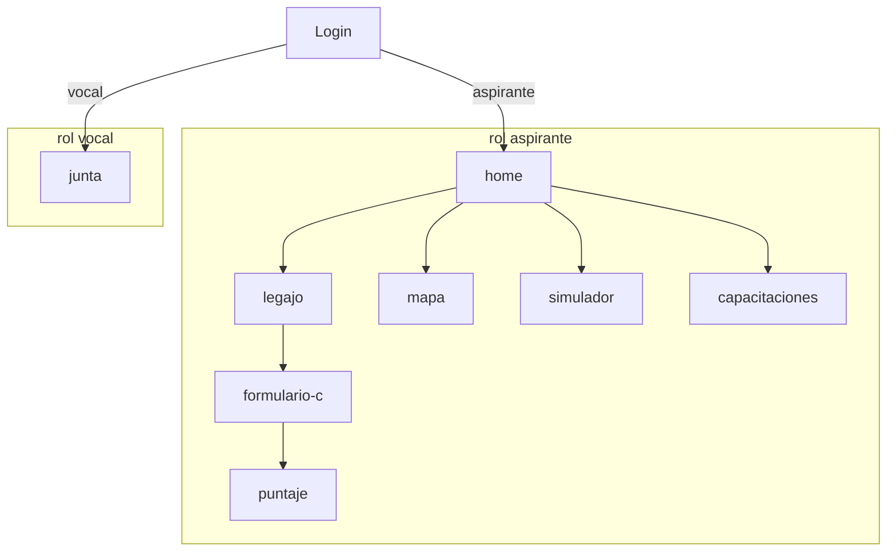

# Trazabilidad Sprint P2 + spike mapa (PD-21)

Portal Docente G24 — Planning 2 implementado con mocks locales (julio 2026). Actualizado al 27/09/2026 con los cambios de agosto y septiembre (ver [Actualizaciones posteriores](#actualizaciones-posteriores-agosto--septiembre-2026)).

## Resumen ejecutivo

| Entrega | Historias | Estado |
|---------|-----------|--------|
| Roles dual aspirante/vocal | US-01 (redirect) | Implementado |
| Revisión vocal por escuela | US-06 | Implementado (asignación vocal–escuela mock) |
| Puntaje de inscripción | US-05 | Implementado (mock; total real en Oracle lab) |
| Observaciones de rechazo | Inst 2 §4 | Implementado |
| Mapa territorial Leaflet | PD-21 / ADR-008 | Funcional: vacantes, semáforo LOM, filtros e intereses (mock y Oracle lab) |
| Simulador de puntaje LOM | US-11 | Vista preliminar (estimación Dto. 257/19, no oficial) |
| Recomendador capacitaciones | US-12 | Vista preliminar (catálogo tipo SIPEC, no oficial) |
| Interés desde mapa | US-10 lite | Registrar y eliminar interés (no postulación) |

## Matriz US → API → pantalla

| ID | Título | Endpoints | Ruta UI | Fixture / store |
|----|--------|-----------|---------|-----------------|
| US-05 | Consultar puntaje inscripción | `GET /api/puntaje/inscripcion` | `/puntaje` | `puntaje.mock.json` |
| US-06 | Revisar aspirantes por escuela | `GET /api/junta/escuelas` | `/junta` | `vocal-escuelas.mock.json` |
| | | `GET /api/junta/escuelas/:escuelaId/aspirantes?estado=` | | + `user-data.store` Form C |
| | | `GET /api/junta/aspirantes/:cuil/legajo?escuelaId=` | | |
| | | `POST /api/junta/aspirantes/:cuil/antecedentes/:id/aceptar` | | body `{ escuelaId }` |
| | | `POST /api/junta/aspirantes/:cuil/antecedentes/:id/rechazar` | | body `{ escuelaId, motivo }` |
| §4 | Observaciones rechazo | `GET /api/legajo` (lectura) | `/legajo` | store legajo |
| PD-21 | Mapa vacantes territorial | `GET /api/mapa/escuelas` (semáforo LOM + filtros) | `/mapa` | `mapa-establecimientos.mock.json` + `mapa-lom.mock.json` |
| | | `GET /api/mapa/establecimientos` · `GET /api/mapa/asignaturas` | | |
| | | `GET/POST /api/mapa/interes` · `DELETE /api/mapa/interes/:escuelaId/:asignaturaCodigo` | | `user-data.store` |
| US-11 | Simulador puntaje LOM | `GET /api/simulador/ascenso` | `/simulador` | `simulador-lom.mock.json` |
| US-12 | Recomendador capacitaciones | `GET /api/capacitaciones/recomendaciones` | `/capacitaciones` | `capacitaciones-sugeridas.mock.json` |

## Roles y seguridad



- Backend: `jwtMiddleware` + `requireRole('aspirante'|'vocal')`.
- Frontend: `aspiranteGuard` / `vocalGuard` + menú contextual en `app-shell`.

## Adaptación ADR-013 (US-06)

| Concepto acta legacy | Implementación actual |
|----------------------|------------------------|
| Escuela base del aspirante | No existe — escuelas en Formulario C |
| Escuelas del vocal | `vocal-escuelas.mock.json` por CUIL |
| Aspirantes de una escuela | Cruzar `formulario.inscripciones[].escuelaId` |

## Usuarios demo

| CUIL | Password | Rol | Escenario |
|------|----------|-----|-----------|
| 20123456789 | demo1234 | aspirante | Puntaje mock (3 filas), legajo y Form C precargados (seed). Título demo alineado a lab: `PROFESOR DE COMPUTACION Y MATEMATICA` |
| 20111111111 | demo1234 | aspirante | Sin valoración puntaje; postula a ESC-003 en seed |
| 27999888777 | demo1234 | vocal | Capital: ESC-001, ESC-002 y ESC-009…ESC-018 |
| 27111222333 | demo1234 | vocal | ESC-003 (aislamiento) |

Hints en pantalla `/login`: aspirante `20123456789` y vocal `27999888777` (password `demo1234`).

Al arrancar, la API agrega los CUIL de `fixtures/demo-store.seed.json` que falten en `.data/dev-store.json` (sin sobrescribir datos locales). Más usuarios y escenarios en [`src/fixtures/README.md`](../src/fixtures/README.md).

## Guión demo (8–10 min)

### Aspirante `20123456789` / `demo1234`

1. **Home** — revisar pasos 1–4 (legajo, Form C, puntaje, mapa).
2. **Legajo** — títulos/antigüedad precargados (sin adjuntos en el seed); opcional: cargar un antecedente con PDF y previsualizarlo; opcional sync provincia.
3. **Formulario C** — buscar escuela por código `EE0320014` (ESC-001 en mock), asignaturas `320` (Matemática) / `193` (Física); imprimir resumen.
4. **Puntaje** — 3 filas (Matemática `320` y Física `193` en ESC-001, Preceptor `X001` en ESC-002).
5. **Mapa** — filtrar asignatura `320` (Matemática); leer el semáforo LOM del popup (compara el promedio de la escuela con tu puntaje); registrar interés en una vacante y eliminarlo.
6. **Simulador** — escenarios de proyección de puntaje LOM (sin cambios, +1 curso, +2 cursos); estimación, no orden oficial.
7. **Capacitaciones** — cursos sugeridos con puntos estimados (Dto. 257/19 Art. 10).

### Vocal `27999888777` / `demo1234`

8. **Junta** → ESC-001 → aspirante precargado → rechazar antecedente (motivo ≥ 10 caracteres).
9. **Aspirante** de nuevo → **Legajo** → ver observación de rechazo.

### Aislamiento vocal

10. **Vocal** `27111222333` → Junta ESC-003 → aspirante `20111111111`.

## Pendiente producción (no bloquea demo)

| Tema | Dependencia |
|------|-------------|
| Motor LOM desglosado | Ministerio / junta (el lab solo expone el total) |
| GeoJSON provincial oficial | SIG ministerio |
| Vacantes de la convocatoria vigente | El lab expone publicaciones históricas (VA 2018) |
| Asignación vocal–escuela | Acta junta (ADR-018) |
| Antecedentes provinciales con CUIL | SGE / JTP (ADR-017) |
| Postulación desde mapa | US-10 lite (interés) implementado; postulación oficial pendiente |
| Baremo LOM oficial y catálogo de capacitaciones | Junta / Ministerio — hoy estimación Dto. 257/19 sobre catálogo tipo SIPEC |

## Diagramas relacionados

- [ADR-014](./adr/ADR-014-roles-aspirante-vocal-p2.md)
- [05 rutas frontend](./diagramas/05-frontend-rutas-y-features.md)
- [06 cadena negocio](./diagramas/06-cadena-de-negocio-to-be-mvp-codeado.md)
- [11 estados antecedente](./diagramas/11-estados-carga-de-antecedente-dominio.md)
- [18 mapa API](./diagramas/18-mapa-api-rest-implementado.md)
- [20 secuencia US-06](./diagramas/20-secuencia-us06-revision-vocal.md)
- [21 secuencia US-05](./diagramas/21-secuencia-us05-puntaje.md)
- [22 secuencia PD-21 mapa](./diagramas/22-secuencia-pd21-mapa-leaflet.md)

## Tests automatizados

| Archivo | Casos |
|---------|-------|
| `junta.test.ts` | escuelas vocal, aspirantes, filtro, aceptar, rechazo, 403 aspirante |
| `puntaje.test.ts` | valoración, sin datos, 403 vocal |
| `demo-flow.test.ts` | guión integrado aspirante + vocal + health |
| `mapa.test.ts` | establecimientos, filtro, intereses (alta, duplicado, baja), semáforo LOM y filtros de `/api/mapa/escuelas`, 403 vocal |
| `simulador.test.ts` | escenarios LOM, 403 vocal |
| `capacitaciones.test.ts` | recomendaciones, 403 vocal |
| `fixture-consistency.test.ts` | integridad de fixtures y seed (volumen, referencias, perfiles) |

```bash
cd src/server && npm test
```

## Complemento: Oracle lab

Para demo con VPN y `INTEGRATION_MODE=prod`, ver [`DEMO_ORACLE_LAB.md`](./DEMO_ORACLE_LAB.md) (guía unificada) y [`DEMO_ALCANCE_ORACLE.md`](./DEMO_ALCANCE_ORACLE.md) (validador). En `prod` pasan a datos reales de solo lectura el validador, el padrón y catálogo del Form C, el mapa, las alertas de vacantes y el total del puntaje; qué sigue simulado y cómo se rotula está en [`DATOS_REALES_Y_SIMULADOS.md`](./DATOS_REALES_Y_SIMULADOS.md).

## Actualizaciones posteriores (agosto – septiembre 2026)

| Fecha | Cambio | Referencia |
|-------|--------|------------|
| 23–24/08 | Validador, padrón/catálogo (con CUE), mapa y puntaje total conectados a Oracle lab | ADR-009, ADR-015, ADR-016, ADR-010 |
| 24/08 | Bloqueos documentados: antecedentes SGE sin CUIL y sin vista vocal–escuela | ADR-017, ADR-018 |
| 06/09 | Simulador reorientado: proyecta puntaje en la LOM (antes, por error, checklist de cargos directivos, fuera del MVP) | ADR-011 addendum |
| 06/09 | Junta a escala para demo: 40 escuelas, más de 200 aspirantes ficticios, búsqueda y panel lateral | PR #34–#36 |
| 22/09 | Mapa en `prod`: vacantes desde publicaciones de la Junta (Interinato/Suplencia, sin directivos); `T_CO_VACANTES` descartado | ADR-016, PR #39 |
| 22/09 | Semáforo LOM: promedio de los 10 mejores puntajes de secundaria por escuela vs. tu puntaje (datos históricos en el lab) | ADR-019, PR #39 |
| 22/09 | Simulador y capacitaciones con catálogo tipo SIPEC; puntos = horas × 0,017 (cursos ≥ 20 h, Dto. 257/19 Art. 10) | ADR-011, ADR-012, PR #40 |
| 28/09 | Semáforo LOM: convocatoria más reciente con más de 10 docentes por escuela y promedio de los 5 mejores | ADR-019 |
| 30/09 | Semáforo LOM solo desde `T_DETALLES_INSC_JD`, un puntaje por docente (antes se repetían docentes y se cruzaban publicaciones/aspirantes): 719 de 819 escuelas con promedio y arranque de ~100 s a ~25 s | ADR-019 |
| 30/09 | Alertas de vacantes leen de MT4T por defecto (en MT4D no hay publicaciones del año): ya no dependen del `.env` local | ADR-020, `DEMO_ORACLE_LAB.md` |
| 30/09 | Mapa a ancho completo (puntaje + semáforo e intereses arriba, filtros y mapa debajo) y zoom inicial a Capital | — |
| 07/10 | Mapa: correcciones de ubicación (10 sedes del interior en Capital u otro departamento), un punto por sede con anexos y extensiones vinculados a su escuela madre, y departamento por coordenadas con límites de IDECOR para ~98 sedes sin dato | ADR-019 |
| 07/10 | Mapa: barrios basura descartados, localidad y barrio con búsqueda y en cascada, filtro por color del semáforo, nota de promedio general por escuela y estética unificada con el perfil | ADR-019 |
| 07/10 | Se quita el modo `idecor` del mapa (`MAPA_MODE`); IDECOR queda solo como fuente de los límites departamentales | ADR-008 |
| 13/10 | Lo que carga el portal (legajo con PDF, Formulario C, revisión del vocal, intereses, notificaciones y avisos) se guarda en PostgreSQL detrás de una interfaz; el lab Oracle sigue de solo lectura | ADR-028 |
| 13/10 | Formulario C: el aspirante puede inscribirse en una materia aunque su título no la habilite; el vocal lo ve marcado como «Sin título habilitante» | US-04, US-06 |
| 13/10 | Modo `prod` sin fixtures ficticios: aspirantes de prueba en escuelas reales del padrón, escuelas repartidas entre los vocales, puntaje estimado según el Dto. 257/19 cuando el lab no tiene valoración y rótulo «datos de ejemplo» en lo que sigue simulado | ADR-018, ADR-027, [`DATOS_REALES_Y_SIMULADOS.md`](./DATOS_REALES_Y_SIMULADOS.md) |

## Equivalencia con Instancia 2

Los identificadores US de este repositorio (código, ADR, tests) son internos. Para la documentación académica rige la numeración de Instancia 2; esta tabla da la equivalencia.

| Historia (Instancia 2) | ID interno en el repo |
|------------------------|-----------------------|
| Autenticarse con CiDi (US-01) | US-01 |
| Actualizar legajo y antecedentes (US-02) | US-03 |
| Obtener antecedentes del docente (US-03) | US-03 (sincronización provincial) |
| Consultar observaciones de rechazos (US-04) | Inst 2 §4 / observaciones de rechazo |
| Consultar estado de antecedentes (US-07) | US-03 (listado del legajo) |
| Completar Formulario C (US-08) | US-04 |
| Validar alcances de título (US-09) | US-07 |
| Obtención del puntaje de inscripción (US-10) | US-05 |
| Consumir alertas de vacantes (US-11) | ADR-020 (notificaciones de vacantes) |
| Postularse a solicitudes de cobertura de vacantes (US-12) | US-10 lite (solo interés) |
| Simular la obtención del puntaje (US-13) | US-11 |
| Recibir recomendaciones de capacitación (US-14) | US-12 |
| Visualizar vacantes y demandas territoriales (US-17) | PD-21 |
| Revisar aspirantes por escuela (Inst 2 §19.18) | US-06 |
| Selección de escuela base (épica E2) | US-02 (descartada, ADR-013) |

En Instancia 2 la numeración de la tabla del backlog y la del detalle de historias (§19) no coinciden a partir de la US-18; por eso la revisión de aspirantes se cita por sección.