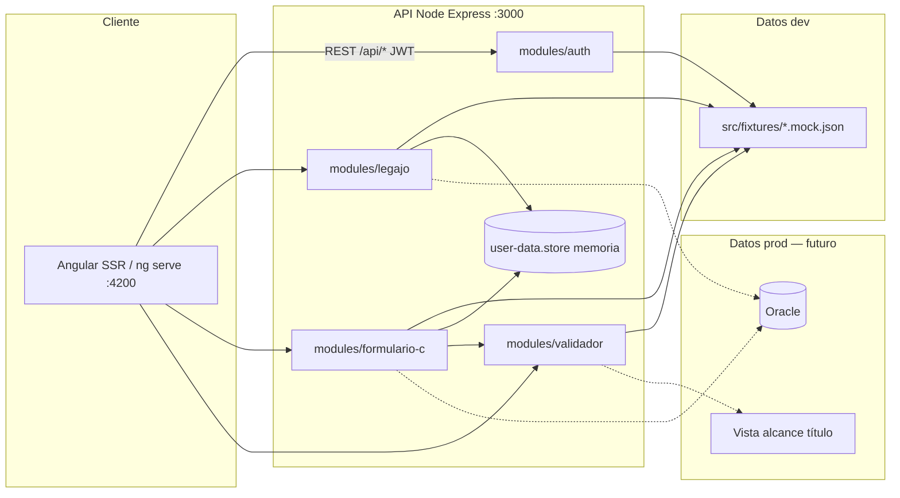

# Arquitectura de contenedores (C4 — nivel 2)

Monolito modular (ADR-004). Dev local: fixtures JSON + store en memoria; prod: Oracle (ADR-003).

---

---

[← Índice diagramas](./README.md) · [Documento completo](../DIAGRAMAS_MVP.md)
