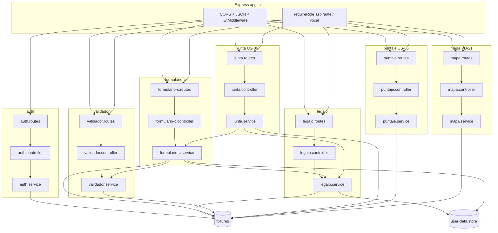

# Componentes backend (capas por módulo)

Patrón repetido en cada US: **routes → controller → service → fixtures/store**.

---

[← Índice diagramas](./README.md) · [Documento completo](../DIAGRAMAS_MVP.md)
