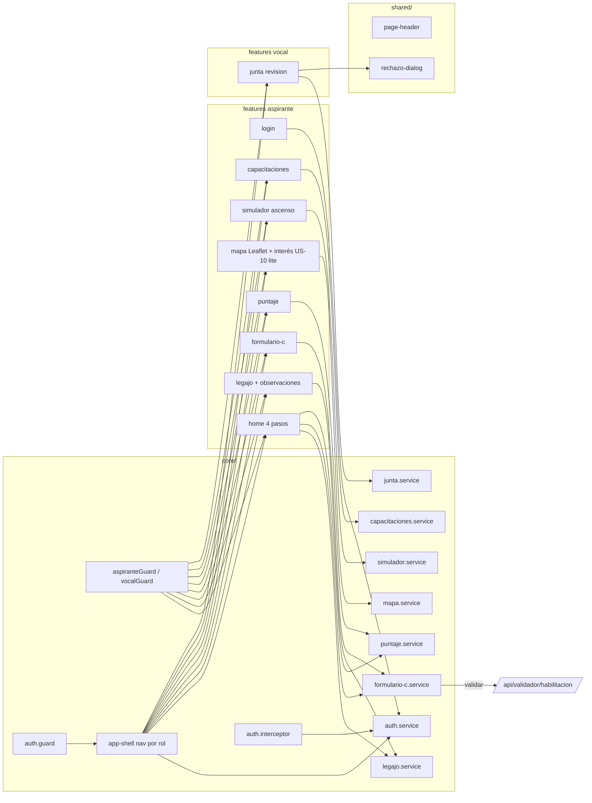

# Frontend — rutas y features (P2 + mapa)

**Rutas:** `/login` · `/home` · `/legajo` · `/formulario-c` · `/puntaje` · `/mapa` · `/simulador` · `/capacitaciones` (aspirante) · `/junta` (vocal).

---

[← Índice diagramas](./README.md) · [Documento completo](../DIAGRAMAS_MVP.md)
