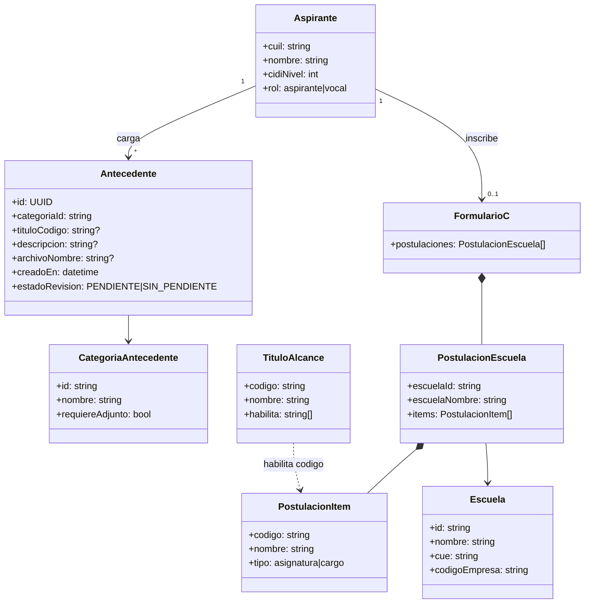

# Diagrama de clases — dominio (conceptual)

Entidades de negocio. Algunos atributos son **TBD** (marcados).

---

---

[← Índice diagramas](./README.md) · [Documento completo](../DIAGRAMAS_MVP.md)
