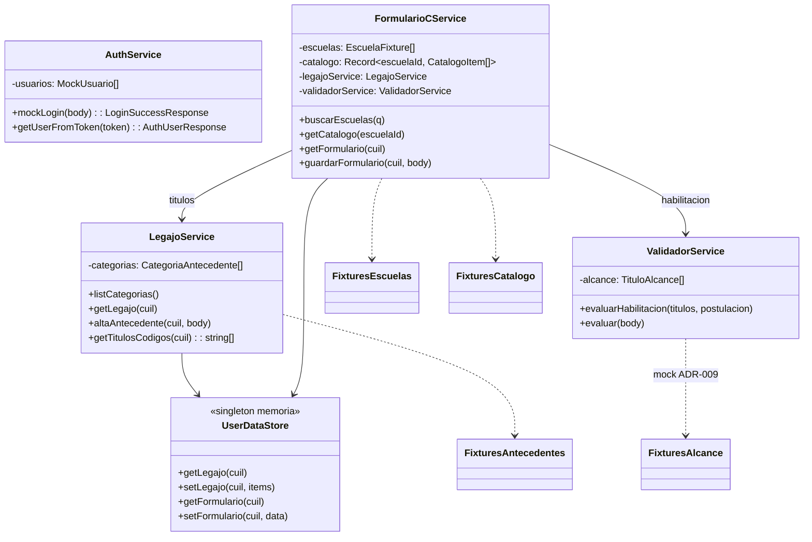

# Diagrama de clases — backend (implementación)

Constantes de negocio en código:

| Constante | Valor | Fuente |
|-----------|-------|--------|
| `MAX_ESCUELAS` | 3 | Acta junta |
| `MAX_ITEMS_POR_ESCUELA` | 5 | Acta junta [36:00] |
| `CIDI_NIVEL_MINIMO` | 2 | Política CiDi mock |

---

---

[← Índice diagramas](./README.md) · [Documento completo](../DIAGRAMAS_MVP.md)
