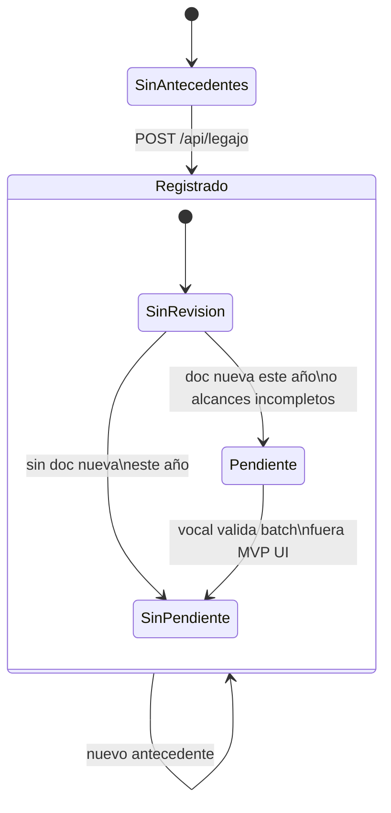

# Estados — carga de antecedente (dominio)

Estados `PENDIENTE` / `SIN_PENDIENTE` / `RECHAZADO` persistidos en `user-data.store` (dev JSON). La revisión vocal (US-06) actualiza el estado vía API junta. TBD-05: regla técnica definitiva en Oracle prod.

---

---

[← Índice diagramas](./README.md) · [Documento completo](../DIAGRAMAS_MVP.md)
