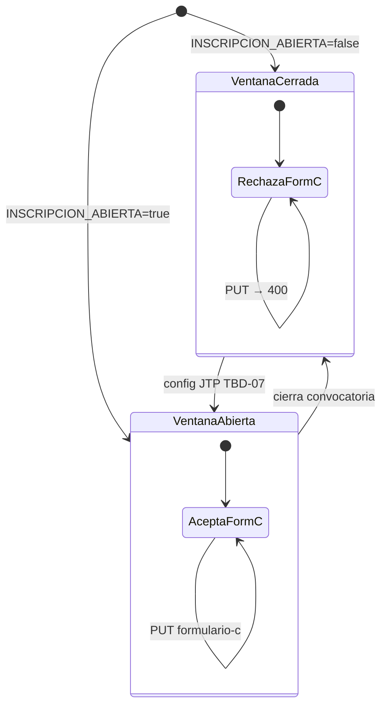

# Estados — inscripción anual (config)

Flag mock `INSCRIPCION_ABIERTA` (TBD-07). Regla real pendiente junta.

---

---

[← Índice diagramas](./README.md) · [Documento completo](../DIAGRAMAS_MVP.md)
