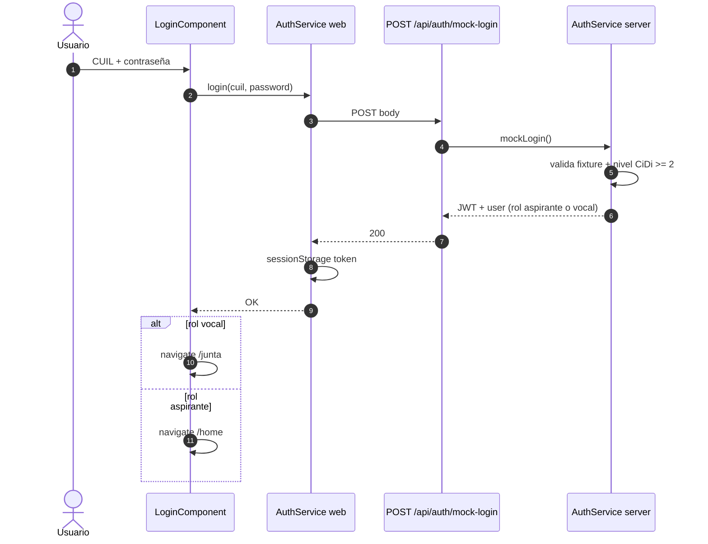

# Secuencia — login mock CiDi

Hints en UI: aspirante `20123456789` / vocal `27999888777` (contraseña `demo1234`).

---

[← Índice diagramas](./README.md) · [Documento completo](../DIAGRAMAS_MVP.md)
