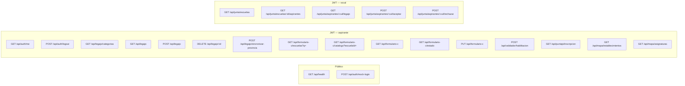

# Mapa API REST (implementado)

Roles: `requireRole` en rutas P2 (ADR-014). Aspirante recibe 403 en `/api/junta/*`; vocal en legajo, Form C, validador, puntaje y mapa.

---

[← Índice diagramas](./README.md) · [Documento completo](../DIAGRAMAS_MVP.md)
