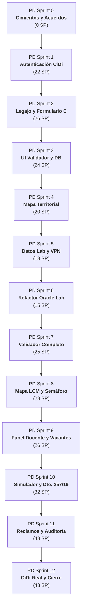

# Guía Paso a Paso: Importación en Jira y Configuración de Sprints (`PD Sprint 0` a `PD Sprint 12`)

**Proyecto Final — Gestión Integral Docente (GID) — Grupo 24 (UTN-FRC)**  
**Archivo Fuente CSV:** [`Jira_actualizado.csv`](../Jira_actualizado.csv) *(95 registros: 15 Épicas + 80 Historias de Usuario)*  
**Catálogo de HUs:** [`README.md`](./README.md) (`US-01` a `US-80` • 347 Story Points)  
**Trazabilidad Detallada:** [`TRAZABILIDAD_JIRA_SPRINTS_HUS.md`](./TRAZABILIDAD_JIRA_SPRINTS_HUS.md)

---

## 📌 1. Resumen del Archivo `Jira_actualizado.csv`

El archivo [`Jira_actualizado.csv`](../Jira_actualizado.csv) consolida la totalidad del producto desarrollado a lo largo de los **13 Sprints** del proyecto:
1. **15 Épicas** (`E01` a `E14` + `S/E Transversales`): con claves `PD-E01` a `PD-S/E`, nombres oficiales y descripciones de alcance.
2. **80 Historias de Usuario atómicas** (`US-01` a `US-80`): con su narrativa formal (*Como... Quiero... Para...*), reglas de negocio, criterios de aceptación, estimación en Story Points (1 a 8 SP), prioridad (`Alta`, `Media`, `Baja`), asignación de sprint (`PD Sprint 1` a `PD Sprint 12`) y vinculación a su épica padre.
3. **Distribución de miembros del equipo:** asignación balanceada entre los 5 integrantes del Grupo 24 (*Nicolas Steffolani, Alexis Demaria, Matias Agustin Formoso, Fabrizio Valverde, Augusto Serafini*).

---

## 🛠️ 2. Paso a Paso para Importar el CSV en Jira

### Paso 2.1: Acceder al Importador de Jira
1. Iniciar sesión en Jira Cloud con la cuenta administradora del proyecto `PD` (*Portal Docente - Tesis - 2026*).
2. Dirigirse al menú superior de **Ajustes** (ícono de engranaje ⚙️) → **Sistema** → **Importación de sistema externo** → seleccionar **CSV**.  
   *(Alternativa rápida desde el proyecto: ir al menú lateral **Incidencias** o **Backlog** → hacer clic en el botón de opciones `···` en la esquina superior derecha → **Importar incidencias desde archivo CSV**).*
3. Seleccionar el archivo [`Jira_actualizado.csv`](../Jira_actualizado.csv).
4. Dejar marcada la opción de codificación **UTF-8** y el delimitador de campo en **Coma (`,`)**.
5. Hacer clic en **Siguiente**.

---

### Paso 2.2: Selección del Proyecto de Destino
- **Proyecto de Jira:** Seleccionar `Portal Docente - Tesis - 2026 (PD)`.
- **Formato de Fecha:** Dejar la configuración por defecto o formato estándar.
- Hacer clic en **Siguiente**.

---

### Paso 2.3: Mapeo de Campos (Field Mapping)
En la pantalla de mapeo, tildar los campos que se desean importar y asociarlos con el campo correspondiente en Jira:

| Campo en el CSV (`Jira_actualizado.csv`) | Campo de Destino en Jira | Observaciones / Notas |
| :--- | :--- | :--- |
| **`Tipo de Incidencia`** | **Tipo de Incidencia (`Issue Type`)** | Mapear `Epic` → `Épica` / `Epic`, e `Historia` → `Historia` / `Story`. |
| **`Resumen`** | **Resumen (`Summary`)** | Campo obligatorio principal. |
| **`Descripción`** | **Descripción (`Description`)** | Contiene la narrativa y criterios de aceptación. |
| **`Prioridad`** | **Prioridad (`Priority`)** | Mapear `Alta`, `Media`, `Baja`. |
| **`Estado`** | **Estado (`Status`)** | Mapear `Listo` / `cerrado` → `Listo` / `Done`. |
| **`Resolución`** | **Resolución (`Resolution`)** | Mapear `Listo` → `Listo` / `Done`. |
| **`Sprint`** | **Sprint** | Asigna automáticamente la HU al sprint correspondiente. |
| **`Campo personalizado (Story point estimate)`** | **Story Points** / **Estimación de puntos** | Métrica de estimación ágil (1 a 8 SP). |
| **`Campo personalizado (Nombre de la Épica)`** | **Nombre de la Épica (`Epic Name`)** | Aplica a las filas de tipo `Epic`. |
| **`Clave principal`** o **`Parent summary`** | **Enlace de Épica (`Epic Link`)** / **Principal (`Parent`)** | Asocia cada historia a su épica correspondiente. |
| **`Persona asignada`** | **Persona asignada (`Assignee`)** | Miembro del equipo responsable. |
| **`Informador`** | **Informador (`Reporter`)** | `Nicolas Steffolani`. |

> [!TIP]
> Si Jira consulta si desea importar el campo `Clave de incidencia` (`PD-XX`), puede tildarlo si desea preservar las claves históricas o destildarlo para que Jira asigne los números correlativos automáticamente.

Hacer clic en **Comenzar importación**.

---

## 🏃 3. Configuración y Organización de los Sprints (`PD Sprint 0` a `PD Sprint 12`)

Una vez importadas las incidencias, dirigirse al **Backlog** del tablero Scrum para verificar o crear los contenedores de los **13 Sprints**:

---

### Detalle de Contenido por Sprint:

#### `PD Sprint 0` — Cimientos, Arquitectura y Acuerdos de Trabajo
- **Objetivo:** Definición de Working Agreement, política de ramas SCM, modelo de contenedores C4 y acuerdos de equipo.
- **HUs asociadas:** Tareas preliminares de setup, base para [US-80](./US-80-despliegue-contenedores-docker-inicializacion-bd.md).
- **Estado:** `Cerrado` | **SP:** 0 SP (Preparación).

#### `PD Sprint 1` — Autenticación CiDi y Base de Usuario
- **Objetivo:** Infraestructura de sesión, login simulado de desarrollo y bifurcación según rol (Docente / Vocal).
- **HUs asociadas:** [US-01](./US-01-ingreso-redireccion-cidi.md), [US-03](./US-03-bifurcacion-entorno-rol.md), [US-04](./US-04-expiracion-inactividad-cierre-sesion.md), [US-05](./US-05-arnes-ingreso-simulado-temporal.md).
- **Estado:** `Cerrado` | **SP:** 22 SP.

#### `PD Sprint 2` — Gestión del Legajo Digital y Formulario C Inicial
- **Objetivo:** Carga manual de antecedentes, reglas iniciales del Formulario C (máx 3 escuelas y 5 materias) y API de validación.
- **HUs asociadas:** [US-11](./US-11-carga-manual-antecedentes-pdf.md), [US-27](./US-27-seleccion-libre-hasta-tres-escuelas.md), [US-28](./US-28-seleccion-hasta-cinco-materias-por-escuela.md), [US-75](./US-75-conmutacion-modo-integracion-oracle-mock-rotulos.md).
- **Estado:** `Cerrado` | **SP:** 26 SP.

#### `PD Sprint 3` — Bandeja de Junta y Conexión de Datos
- **Objetivo:** Interfaz de carga del validador, bandeja preliminar de vocales y conexión a vistas Oracle.
- **HUs asociadas:** [US-13](./US-13-consulta-listado-estados-legajo.md), [US-14](./US-14-previsualizacion-descarga-certificado-pdf.md), [US-22](./US-22-consulta-instantanea-catalogo-alcance-titulos.md), [US-59](./US-59-bandeja-legajos-escuela-base-asignada.md).
- **Estado:** `Cerrado` | **SP:** 24 SP.

#### `PD Sprint 4` — Mapa Territorial y Consulta de Puntajes
- **Objetivo:** Spike del mapa de vacantes con Leaflet y consulta de puntajes con datos simulados.
- **HUs asociadas:** [US-38](./US-38-mapa-interactivo-escuelas-secundarias-provinciales.md), [US-39](./US-39-busqueda-centrado-escuelas-mapa.md), [US-17](./US-17-calculo-automatico-antiguedad-sge-peoplenet.md).
- **Estado:** `Cerrado` | **SP:** 20 SP.

#### `PD Sprint 5` — Conexión VPN del Ministerio y Datos Reales
- **Objetivo:** Configuración de OpenVPN con infraestructura ministerial y normalización contra el dump oficial.
- **HUs asociadas:** [US-77](./US-77-carga-catalogo-dump-oficial-alcance-titulos.md), [US-78](./US-78-resiliencia-degradacion-elegante-servicios-externos.md).
- **Estado:** `Cerrado` | **SP:** 18 SP.

#### `PD Sprint 6` — Refactorización de Esquemas y Desacoplamiento
- **Objetivo:** Solución al error ORA-00942 (migración a vistas `VT_MAT_GRADO_X_TITULO`) y modo `INTEGRATION_MODE=foto`.
- **HUs asociadas:** [US-23](./US-23-clasificacion-incumbencia-docente-habilitante-supletorio.md), [US-24](./US-24-advertencia-no-bloqueante-titulo-sin-alcance.md).
- **Estado:** `Cerrado` | **SP:** 15 SP.

#### `PD Sprint 7` — Validador de Alcance Completo y Reglas
- **Objetivo:** Desacoplamiento de escuela base (ADR-013) y validación no bloqueante en el Formulario C (ADR-009).
- **HUs asociadas:** [US-25](./US-25-busqueda-autocompletado-materias-catalogo.md), [US-29](./US-29-agrupamiento-visual-postulaciones-por-escuela.md), [US-30](./US-30-eliminacion-reordenamiento-filas-formulario-c.md).
- **Estado:** `Cerrado` | **SP:** 25 SP.

#### `PD Sprint 8` — Mapa LOM y Semáforo de Establecimientos
- **Objetivo:** Semáforo de competitividad LOM sobre el mapa territorial y filtros multicriterio por departamento.
- **HUs asociadas:** [US-40](./US-40-filtro-departamento-localidad-orientacion-mapa.md), [US-41](./US-41-semaforo-lom-competitividad-escuelas-mapa.md), [US-42](./US-42-ficha-detalle-escuela-mapa.md).
- **Estado:** `Cerrado` | **SP:** 28 SP.

#### `PD Sprint 9` — Panel Docente y Alertas de Vacantes
- **Objetivo:** Panel de inicio con estado del ciclo lectivo y módulo de suscripción/alertas a vacantes activas.
- **HUs asociadas:** [US-06](./US-06-panel-inicio-estado-ciclo.md), [US-07](./US-07-consulta-datos-personales-perfil.md), [US-44](./US-44-suscripcion-alertas-vacantes-departamento-asignatura.md), [US-45](./US-45-notificaciones-internas-nuevas-vacantes.md).
- **Estado:** `Cerrado` | **SP:** 26 SP.

#### `PD Sprint 10` — Simulador de Carrera y Motor Decreto 257/19
- **Objetivo:** Implementación del motor de cálculo reglamentario, topes de títulos (30 pts) y cursos (60 pts) y simulador de carrera.
- **HUs asociadas:** [US-18](./US-18-valoracion-titulos-tope-treinta-puntos.md), [US-19](./US-19-valoracion-cursos-capacitaciones-tope-sesenta-puntos.md), [US-20](./US-20-caducidad-decenal-antecedentes-decreto-257-19.md), [US-49](./US-49-simulacion-incorporacion-titulos-impacto-puntaje.md), [US-50](./US-50-proyeccion-escuelas-alcanzables-simulador.md).
- **Estado:** `Cerrado` | **SP:** 32 SP.

#### `PD Sprint 11` — Ayudas a la Decisión, Reclamos y Auditoría Inmutable
- **Objetivo:** Módulo de sugerencia asistida de escuelas (Segura, Justa, Apuesta), régimen digital de reclamos (ADR-035) y auditoría inmutable en PostgreSQL (ADR-032).
- **HUs asociadas:** [US-33](./US-33-propuesta-asistida-escuelas-segura-justa-apuesta.md), [US-65](./US-65-presentacion-reclamo-digital-lom-provisoria.md), [US-66](./US-66-seguimiento-estado-resolucion-reclamo.md), [US-71](./US-71-bitacora-inmutable-auditoria-cambios-postgresql.md), [US-72](./US-72-registro-auditoria-accesos-seguridad.md).
- **Estado:** `Cerrado` | **SP:** 48 SP.

#### `PD Sprint 12` — Integración CiDi Nivel 2, Persistencia Espejo y Cierre
- **Objetivo:** Cierre del ciclo con CiDi Nivel 2 real (ADR-031), módulo de gestión del Administrador de la Junta (ADR-038/ADR-041), replicación espejo (ADR-029) y métricas de competitividad regional (ADR-037).
- **HUs asociadas:** [US-02](./US-02-verificacion-cidi-nivel-2.md), [US-68](./US-68-visualizacion-metricas-percentiles-competitividad-regional.md), [US-70](./US-70-sincronizacion-espejo-tablas-junta-oracle.md), [US-73](./US-73-consulta-filtrado-historial-auditoria-accesos-cambios.md), [US-76](./US-76-parametrizacion-ventana-convocatoria-ciclo-lectivo.md), [US-80](./US-80-despliegue-contenedores-docker-inicializacion-bd.md).
- **Estado:** `Cerrado` | **SP:** 43 SP.

---

## 📊 4. Métricas Consolidadas para la Presentación de Regularidad

Al finalizar la importación y organización de sprints, Jira reflejará las siguientes métricas exactas:

- **Total de Historias de Usuario:** **80 HUs** (+ 15 Épicas).
- **Total de Story Points:** **347 SP**.
- **Velocidad promedio del equipo:** **~28 SP por Sprint** (sprints quincenales).
- **Tasa de éxito de Sprints:** 100% de objetivos cumplidos conforme a los PRs `#1` a `#76` en GitHub.
- **Gráficos disponibles en Jira:**
  - *Burndown Chart* (Gráfico de trabajo pendiente cerrado por sprint).
  - *Velocity Chart* (Velocidad sostenida a lo largo de los 12 sprints).
  - *Epic Report* (Progreso de las 14 épicas de producto al 100%).
